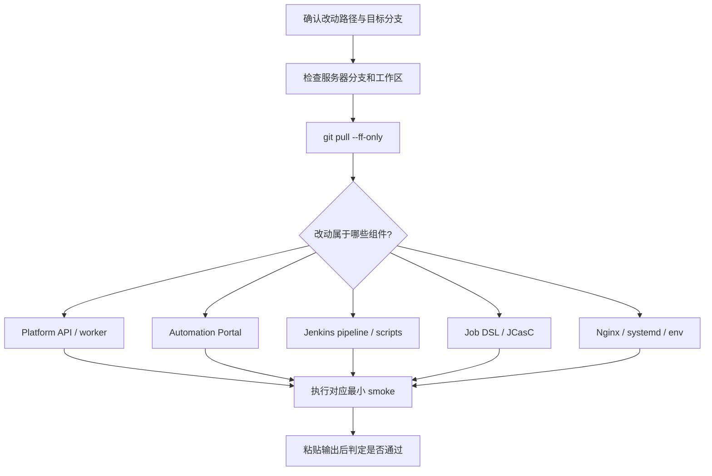

# 日常发布 Checklist

## 1. 文档定位

这份文档是 `jenkins_robotframework` **代码已经完成并提交后**，判断服务器需要执行哪些生效动作的唯一日常入口。

三份部署文档固定分工如下：

- `deploy/RELEASE_CHECKLIST.md`
  - 日常发布决策：改了什么、需要做什么、如何判断成功
- `deploy/SERVER_OPERATIONS.md`
  - 单项运维命令：状态、日志、重启、构建、快速排障
- `deploy/DEPLOYMENT.md`
  - 首次部署、完整环境初始化和低频专题配置

本 Checklist 不负责首次安装 Jenkins、创建 SSH 密钥、签发证书或填写真实凭据；这些场景回到 `deploy/DEPLOYMENT.md`。

## 2. 固定边界

当前部署拓扑：

```text
代码目录       /opt/jenkins_robotframework
Portal         https://10.71.210.104/
Platform API   https://10.71.210.104/api/
Jenkins        https://10.71.210.104/jenkins/
API 本机端口   127.0.0.1:8000
Jenkins 本机   127.0.0.1:8080/jenkins/
```

发布必须遵守：

1. 本地 IDE 修改业务代码，Git 仓库保存版本，服务器只拉取和运行。
2. 服务器不直接长期修改 `app/*.py`、`src/*.tsx`、Jenkinsfile 或 Job DSL。
3. 不把 token、密码、私钥、真实 `.env` 内容写入命令记录或仓库。
4. 不执行 `git reset --hard`、强制切分支、删除目录、删除 Nginx site 或覆盖凭据。
5. 用户未确认目标分支时，不生成切换分支命令。
6. 只执行与本次改动相关的最小动作，不把所有服务无差别重启。
7. 验证由用户在目标服务器执行；收到输出前，状态只能写“待验证”。

## 3. 发布决策流程



## 4. 第一步：确认本次改动范围

先列出本次真正改动的路径，再从下面选择所有命中的行。一次提交可能同时命中多行。

| 改动路径 | 生效动作 |
|---|---|
| `platform-api/app/services/ai_analysis_worker.py` 或只被 worker 使用的模块 | 只重启 `platform-api-ai-worker` |
| 同时被 API 和 worker 导入的 repository/schema/service/config | 重启 `platform-api` 和 `platform-api-ai-worker` |
| 其他 `platform-api/app/**` | 重启 `platform-api` |
| `platform-api/requirements.txt` 或依赖文件 | 在 venv 中更新依赖，然后重启受影响服务 |
| `automation-portal/src/**`、`public/**`、Vite 配置 | 重新执行 `npm run build`，再 reload Nginx |
| `automation-portal/package.json`、lock 文件 | 先 `npm install`，再 build 和 reload |
| 服务器侧 `automation-portal/.env` 中 `VITE_*` 变化 | 必须重新 build；Vite 不会在运行时重新读取这些字段 |
| `jenkins-integration/pipelines/**`、`scripts/**` | 通常无需重启 Jenkins；目标 Job 的 SCM ref 必须包含本次提交 |
| `jenkins-integration/jobs/**` | 确认 Seed Job 的 `REPOSITORY_REF` 与 Agent 状态后运行 Seed Job |
| `jenkins-integration/jcasc/**` | 渲染并重载 JCasC；当前环境使用重启 Jenkins 时必须先确认环境文件和私钥可读 |
| `deploy/nginx/**` | 同步配置、`nginx -t`、确认通过后 reload |
| `deploy/systemd/**` | 同步目标 unit、`daemon-reload`、重启对应服务 |
| `deploy/env/*.example` | 只说明契约变化；真实服务器 env 需要人工逐项合并，不能直接覆盖 |
| 仅 `docs/**`、测试说明或 `.cursor/**` | 通常不需要服务器服务动作 |

## 5. 第二步：服务器安全预检与拉取

### 5.1 安全预检

请在目标服务器执行：

```bash
cd /opt/jenkins_robotframework
git status --short
git branch --show-current
git rev-parse --short HEAD
```

预期结果：

- `git status --short` 没有意外输出
- 当前分支就是本次约定的部署分支
- 能记录更新前提交号，便于问题定位

常见失败：

- 有未提交文件：先停止，不要直接 pull 或清理，确认这些文件是谁产生的
- 分支不一致：先向用户确认目标分支，不自动切换
- 仓库目录不存在：这是首次部署或目录异常，应转到 `deploy/DEPLOYMENT.md`

### 5.2 拉取更新

预检通过后执行：

```bash
cd /opt/jenkins_robotframework
git fetch --all --prune
git pull --ff-only
git rev-parse --short HEAD
```

预期结果：

- `git pull --ff-only` 成功
- 最终提交号与准备发布的提交一致

常见失败：

- `Not possible to fast-forward`：分支历史已分叉，停止并回到本地处理
- 认证或网络失败：检查 Git 凭据、网络或一次性代理参数，不把凭据写入文档
- 本地改动阻止 pull：停止并确认服务器改动来源，不使用破坏性清理命令

## 6. 第三步：按组件执行最小生效动作

以下小节只选择本次命中的部分。

### 6.1 Platform API

仅 Python 业务代码变化：

```bash
sudo systemctl restart platform-api
sudo systemctl status platform-api --no-pager
sudo journalctl -u platform-api -n 100 --no-pager
curl -s http://127.0.0.1:8000/api/health
```

如果依赖文件变化，先执行：

```bash
cd /opt/jenkins_robotframework/platform-api
source venv/bin/activate
python -m pip install -r requirements.txt
deactivate
```

预期结果：

- `platform-api` 为 `active (running)`
- 日志没有新的启动异常
- health 返回成功 JSON

失败判断：

- `ModuleNotFoundError`：依赖未安装到 service 实际使用的 venv
- `Address already in use`：存在重复进程或 unit 配置错误
- Nginx 返回 502、但本机 health 失败：先修复 API 服务，不先改 Nginx

### 6.2 AI Analysis Worker

worker 或其共享代码变化：

```bash
sudo systemctl restart platform-api-ai-worker
sudo systemctl status platform-api-ai-worker --no-pager
sudo journalctl -u platform-api-ai-worker -n 100 --no-pager
```

如果 API 和 worker 共享逻辑都变化：

```bash
sudo systemctl restart platform-api
sudo systemctl restart platform-api-ai-worker
sudo systemctl status platform-api --no-pager
sudo systemctl status platform-api-ai-worker --no-pager
```

预期结果：

- 两个相关服务均为 `active (running)`
- worker 日志没有循环退出

失败判断：

- analysis 一直 `queued`：worker 未运行，或 worker/API 没有使用同一个数据库
- worker 启动即退出：检查 venv、WorkingDirectory、导入错误和 `.env` 配置
- Cursor 403：属于外部权限或能力问题，不通过重复重启解决

### 6.3 Automation Portal

仅前端源码变化：

```bash
cd /opt/jenkins_robotframework/automation-portal
npm run build
ls -la dist/index.html
sudo nginx -t
sudo systemctl reload nginx
curl -k -I https://127.0.0.1/
```

如果 `package.json`、lock 文件变化，或服务器尚未安装依赖：

```bash
cd /opt/jenkins_robotframework/automation-portal
npm install
npm run build
ls -la dist/index.html
sudo nginx -t
sudo systemctl reload nginx
curl -k -I https://127.0.0.1/
```

预期结果：

- build 成功并生成 `dist/index.html`
- `nginx -t` 成功
- Portal 返回 `200 OK`

失败判断：

- TypeScript/Vite build 失败：旧 `dist` 可能仍在服务，不能宣称新版本已发布
- 页面仍是旧内容：确认构建目录、浏览器缓存和当前 Git 提交
- Jenkins 链接错误：检查 `VITE_JENKINS_BASE_URL` 是否为浏览器可访问的外部地址，并重新 build

### 6.4 Jenkins Pipeline 或辅助脚本

命中 `jenkins-integration/pipelines/**` 或 `scripts/**` 时：

1. 通常不重启 Jenkins。
2. 确认目标 Job 使用 `Pipeline script from SCM`。
3. 确认 Job 指向包含本次提交的仓库分支。
4. 由用户触发最小构建，检查 Console Output 是否体现新参数或新步骤。

这里的实际生效来源是目标 Job 自己的 SCM checkout，不是 Master 上 `/opt/jenkins_robotframework` 的部署副本。

基础可用性检查：

```bash
sudo systemctl status jenkins --no-pager
curl -I http://127.0.0.1:8080/jenkins/
```

预期结果：

- Jenkins 保持可用
- 新一次构建从目标分支读取最新 Jenkinsfile 和脚本

失败判断：

- 新参数未出现：Job 分支不对、Declarative 参数尚未刷新，或 Job 不是 SCM 模式
- 不要用“重启 Jenkins”掩盖 Job 分支或 SCM 配置问题

### 6.5 Job DSL

命中 `jenkins-integration/jobs/**` 时：

1. 确认当前环境由 Seed Job 管理。
2. 确认包含本次 DSL 改动的提交已经 push 到 Seed Job 可访问的仓库。
3. 确认 `t813 && robot` Agent 在线；当前 Seed Pipeline 运行在这个 label 上。
4. 运行 `seed/jenkins-robotframework-seed`。
5. 将 `REPOSITORY_REF` 设置为包含本次提交的 branch、tag 或 commit。
6. 保持 `JOB_DSL_TARGETS=jenkins-integration/jobs/*_job.groovy`，除非本次明确需要其他受审查目标。
7. 检查 Seed Job Console Output。
8. 检查目标 Job 是否创建或更新。

重要：

- Seed Job 会根据自己的 `REPOSITORY_URL` / `REPOSITORY_REF` 重新 checkout。
- Master 上 `/opt/jenkins_robotframework` 的 `git pull` 只更新部署副本，不会自动把 Job DSL 应用到 Jenkins。
- `IGNORE_REMOVED_JOBS` 默认保留未生成的旧 Job；不要为了清理旧 Job 临时改成破坏性策略。

预期结果：

- Seed Job 成功
- 目标 Job 参数、SCM 或目录结构与 DSL 一致

失败判断：

- `*.groovy` 未被执行：检查 Seed Job targets 和文件命名
- checkout 到旧代码：检查 `REPOSITORY_REF` 是否包含目标提交
- Job 一直排队：检查 `t813 && robot` Agent 是否在线
- Job DSL sandbox/approval 失败：按 Jenkins 安全审批流程处理，不关闭安全检查
- 手工维护 Job 不会因为服务器 `git pull` 自动变化

### 6.6 JCasC

命中 `jenkins-integration/jcasc/**` 时，先确认：

```bash
sudo test -r /etc/default/jenkins-jcasc
sudo -u jenkins test -r /etc/jenkins/keys/jenkins_agent_rsa
```

只有环境文件和私钥均确认可读，且当前 systemd override 已配置 `render_jcasc.py`，才执行当前推荐的生效方式：

```bash
sudo systemctl restart jenkins
sudo systemctl status jenkins --no-pager
sudo journalctl -u jenkins -n 100 --no-pager
curl -I http://127.0.0.1:8080/jenkins/
```

重启会由 systemd `ExecStartPre` 调用 `render_jcasc.py` 生成 `jenkins.rendered.yaml`。

如果希望使用 Jenkins 页面中的：

```text
Manage Jenkins -> Configuration as Code -> Reload existing configuration
```

必须先通过已批准的步骤重新生成 `jenkins.rendered.yaml`。仅在服务器 `git pull` 后点击 reload，可能仍然加载旧的 rendered YAML。当前 Checklist 默认使用 systemd restart，是因为它能固定触发 `ExecStartPre` 渲染。

预期结果：

- Jenkins 成功启动
- JCasC 没有 unresolved placeholder 或 YAML 错误
- Agent、credentials 引用和 Seed Job 仍存在

失败判断：

- 私钥不可读或 PEM 格式错误：渲染或 Jenkins 启动可能失败
- 环境变量缺失：先修复 `/etc/default/jenkins-jcasc`
- 不把真实私钥直接写回 `jenkins.yaml`

### 6.7 Nginx

命中 `deploy/nginx/jenkins-kpi-platform.conf` 时：

```bash
sudo cp /opt/jenkins_robotframework/deploy/nginx/jenkins-kpi-platform.conf \
  /etc/nginx/sites-available/jenkins-kpi-platform.conf
sudo ln -sf /etc/nginx/sites-available/jenkins-kpi-platform.conf \
  /etc/nginx/sites-enabled/jenkins-kpi-platform.conf
sudo nginx -t
sudo systemctl reload nginx
sudo systemctl status nginx --no-pager
```

预期结果：

- `nginx -t` 显示配置测试成功
- reload 成功，现有连接不被无故中断

失败判断：

- `nginx -t` 失败：不要 reload，先根据行号修复配置
- 不删除其他 site；若存在冲突，只报告冲突路径并请求确认

### 6.8 systemd unit 或服务器 env

当前仓库已落地的 unit 模板是：

```text
deploy/systemd/platform-api-ai-worker.service
```

命中该文件时：

```bash
sudo cp /opt/jenkins_robotframework/deploy/systemd/platform-api-ai-worker.service \
  /etc/systemd/system/platform-api-ai-worker.service
sudo systemctl daemon-reload
sudo systemctl restart platform-api-ai-worker
sudo systemctl status platform-api-ai-worker --no-pager
```

对于尚未在 `deploy/systemd/` 落地模板的服务，不从文档临时拼装覆盖；转到 `deploy/DEPLOYMENT.md` 确认当前服务器真实 unit。

`deploy/env/*.env.example` 变化时：

1. 对比新增或修改的字段名。
2. 由用户在服务器真实 env 中逐项合并。
3. 不执行整文件覆盖。
4. 不要求用户在聊天中粘贴 secret 值。
5. 按使用该 env 的服务执行对应 restart/rebuild。

## 7. 第四步：统一最小 Smoke

发布动作完成后，由用户只执行本次组件适用的 smoke：

```bash
sudo systemctl status platform-api platform-api-ai-worker jenkins nginx --no-pager
curl -s http://127.0.0.1:8000/api/health
curl -I http://127.0.0.1:8080/jenkins/
curl -k -I https://127.0.0.1/
curl -k -s https://127.0.0.1/api/health
curl -k -I https://127.0.0.1/jenkins/
```

说明：

- 没有部署 AI worker 时，可以从 `systemctl status` 中去掉它。
- 仅 Jenkins SCM 文件变化时，不需要为了 checklist 重启其他服务。
- 涉及真实 Robot/KPI 功能时，功能级验证继续使用对应 step 文档，不在这里扩大为全量回归。

通过标准：

1. 本次涉及的 service 为 `active (running)`。
2. 只有涉及 API 或 Nginx 时，要求对应 API health 正常。
3. 只有涉及 Portal 或 Nginx 时，要求 Portal 外部入口可访问。
4. 只有涉及 Jenkins 或 Nginx 时，要求 Jenkins `/jenkins/` 外部入口可访问。
5. 日志无本次发布引入的新启动错误。

## 8. 结果回传模板

执行完成后，将下面内容贴回：

```text
[Deployment Verification]
- target branch:
- before commit:
- after commit:
- changed components:
- actions executed:
- service status:
- API health:
- Portal:
- Jenkins:
- errors or warnings:
```

在收到结果前，文档状态写：

```text
实现已完成，服务器验证待用户执行。
```

收到成功证据后，才可写：

```text
服务器验证已由用户执行并通过。
```

## 9. 常见场景速查

### 只改 Platform API

```text
安全预检 -> pull --ff-only -> restart platform-api -> status/journal -> API health
```

### 只改 Portal

```text
安全预检 -> pull --ff-only -> npm run build -> nginx -t -> reload -> Portal 200
```

### 只改 Jenkinsfile 或 Jenkins 辅助脚本

```text
安全预检 -> pull --ff-only -> 不重启 Jenkins -> 触发目标 Job -> 检查 SCM 分支和 Console Output
```

### 改 Job DSL

```text
安全预检 -> pull --ff-only（只更新部署副本） -> 确认提交已 push
  -> 确认 t813 && robot Agent 在线
  -> Seed Job REPOSITORY_REF 指向目标提交
  -> 运行 Seed Job -> 检查目标 Job 更新
```

### 改 JCasC

```text
安全预检 -> pull --ff-only -> 检查 env/私钥可读 -> restart Jenkins -> 日志与 /jenkins/ smoke
```

### 同时改 Job DSL 与 JCasC

```text
安全预检 -> pull --ff-only
  -> 检查 JCasC env/私钥可读
  -> restart Jenkins 触发 render_jcasc.py
  -> Jenkins status / journal / /jenkins/ smoke
  -> 确认 seed/jenkins-robotframework-seed 已存在
  -> 确认 t813 && robot Agent 在线
  -> Seed Job REPOSITORY_REF 指向目标提交
  -> 运行 Seed Job -> 检查目标 Job 更新
```

### 改 Nginx

```text
安全预检 -> pull --ff-only -> 同步配置 -> nginx -t -> 通过后 reload -> 三个外部入口 smoke
```

## 10. 后续自动化边界

本阶段不把以上流程直接做成 Jenkins 平台发布 Pipeline，也不新增自动 SSH 部署。

后续只有在 Checklist 经多次真实发布验证稳定后，才考虑：

1. 将机械步骤沉淀为 `deploy/scripts/*.sh`
2. 让 Jenkins 平台发布 Pipeline 只编排这些脚本
3. 保持平台发布 Pipeline 与 Robot/KPI 测试执行 Pipeline 分离
