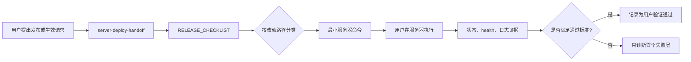

# Deployment Release Handoff

## 1. 这一步解决什么问题

项目已经有完整部署手册和服务器运维命令，但日常发布仍需要人工从长文档中判断：

- 本次改动到底影响哪些组件
- 哪些服务需要重启
- 哪些服务不应重启
- Portal 是否需要重新 build
- Jenkinsfile、Job DSL、JCasC 的生效方式有什么区别
- 怎样把服务器验证交给用户，并避免在没有证据时提前标记完成

这一步把部署知识拆成两个稳定层：

1. `deploy/RELEASE_CHECKLIST.md`
   - 日常发布事实源
   - 负责“改动路径 -> 生效动作 -> smoke”
2. `.cursor/skills/server-deploy-handoff/SKILL.md`
   - Agent 决策与交接层
   - 负责读取 Checklist、选择最小命令集合、解释预期与失败模式

## 2. 文件变化与职责

### 新增文件

- `deploy/RELEASE_CHECKLIST.md`
  - 固定部署边界、改动分类、安全预检、生效动作、smoke 和结果回传模板
- `.cursor/skills/server-deploy-handoff/SKILL.md`
  - 固定触发条件、读取顺序、决策流程、输出格式和安全约束
- `docs/modules/jenkins-integration/guides/deployment-release-handoff.md`
  - 记录本次设计、调用流、验证交接和学习复盘

### 更新文件

- `deploy/DEPLOYMENT.md`
  - 明确它只作为首次部署和完整参考手册
- `deploy/SERVER_OPERATIONS.md`
  - 明确它只提供单项运维命令
- `docs/modules/jenkins-integration/index.md`
  - 增加本 guide 入口
- `docs/overview/8-day-full-project-execution-plan.md`
  - 登记部署知识提取旁路线，不改变 Day 2 / Step 3 主线

## 3. 三层文档边界

```text
RELEASE_CHECKLIST
  决定“这次做什么”

SERVER_OPERATIONS
  提供“某个单项怎么做”

DEPLOYMENT
  解释“首次如何完整搭起来”
```

不要把同一组完整命令复制到三份文档中。

日常发布首先使用 Checklist；只有缺少底层环境、service、证书、SSH/Jenkins 初始化时，才进入完整部署手册。

## 4. 核心调用流



## 5. 关键输入和存放位置

| 输入 | 来源或存放位置 | 用途 |
|---|---|---|
| changed paths | 用户描述、当前改动或提交范围 | 选择发布分类 |
| target branch | 用户确认、Jenkins SCM 或服务器当前分支 | 决定是否允许切分支 |
| deploy root | `/opt/jenkins_robotframework` | 服务器代码根目录 |
| public base URL | Nginx 配置和服务器 env | 验证 Portal/API/Jenkins 外部入口 |
| API service | `platform-api` systemd unit | 后端生效 |
| AI worker service | `platform-api-ai-worker` systemd unit | AI 队列消费 |
| Portal build-time env | 服务器 `automation-portal/.env` | Vite build 注入 `VITE_*` |
| Jenkins JCasC env | `/etc/default/jenkins-jcasc` | JCasC 非秘密/秘密字段引用 |
| Jenkins launcher key | `/etc/jenkins/keys/jenkins_agent_rsa` | Agent SSH launcher |
| Seed Job | `seed/jenkins-robotframework-seed` | 应用 Job DSL |
| Seed source ref | Seed 参数 `REPOSITORY_REF` | 指向包含本次 DSL 提交的 branch、tag 或 commit |
| Seed execution node | Jenkins label `t813 && robot` | Seed Pipeline 的实际运行节点 |
| verification evidence | 用户粘贴的状态、HTTP 和日志输出 | 判定是否验证通过 |

真实 token、密码、私钥和完整服务器 `.env` 不回传到聊天，也不写进学习记录。

## 6. 改动分类规则

### Platform API

- `platform-api/app/services/ai_analysis_worker.py` 或只被 worker 使用的模块：只重启 worker
- 同时被 API 和 worker 导入的 repository/schema/service/config：重启 API 和 worker
- 其他 `platform-api/app/**`：重启 API
- 依赖文件变化：先更新 venv 依赖

### Automation Portal

- 页面、静态资源或 Vite 配置变化：重新 build
- `package.json` 或 lock 文件变化：先安装依赖
- `VITE_*` 变化：必须重新 build，因为它们是构建时注入

### Jenkins

- Pipeline 或辅助脚本：通常无需重启 Jenkins，由 SCM 下一次构建读取
- Job DSL：确认提交已 push、`REPOSITORY_REF` 和 Seed Agent 后运行 Seed Job；Master `/opt` pull 不是 DSL 生效来源
- JCasC：先检查 env 和私钥可读；默认 restart 以触发 `render_jcasc.py`，只有 rendered YAML 已更新时才使用页面 reload

### 基础设施

- Nginx：同步配置，先 `nginx -t`，通过后 reload
- systemd：只同步仓库已有模板，执行 `daemon-reload`，只重启对应服务
- env example：只合并字段，不覆盖真实 env

## 7. 安全边界

Skill 和 Checklist 共同固定：

1. 不主动 SSH 到服务器执行发布。
2. 不主动执行 pytest、前端测试或长验证。
3. 不执行 `git reset --hard`、强制切换、目录删除或 force push。
4. 服务器有未提交改动时立即停止，并要求用户确认来源。
5. 不无差别重启全部服务。
6. Nginx 语法检查失败时不 reload。
7. JCasC env 或私钥不可读时不重启 Jenkins。
8. 未收到用户输出前只能标记“待验证”。

## 8. 三类 Skill 演练

### 场景 A：只改 Platform API

输入：

```text
platform-api/app/services/run_service.py 已更新，请给服务器发布命令。
```

应输出：

```text
安全预检
  -> pull --ff-only
  -> restart platform-api
  -> status / journal
  -> local API health
```

不应输出：

- `npm install`
- Portal build
- Jenkins restart
- Nginx 配置覆盖

### 场景 B：只改 Portal

输入：

```text
automation-portal/src/pages/RunDetail.tsx 已更新。
```

应输出：

```text
安全预检
  -> pull --ff-only
  -> npm run build
  -> dist/index.html 检查
  -> nginx -t
  -> nginx reload
  -> Portal HTTP smoke
```

不应输出：

- API restart
- AI worker restart
- Jenkins restart

### 场景 C：Job DSL 与 JCasC

输入：

```text
jenkins-integration/jobs 和 jcasc 都有更新。
```

应输出：

```text
安全预检
  -> pull --ff-only
  -> 检查 JCasC env 与 launcher key 可读
  -> restart Jenkins 触发 render_jcasc.py
  -> Jenkins status / journal / prefix smoke
  -> 确认目标 DSL 提交已 push
  -> 确认 t813 && robot Agent 在线
  -> Seed Job REPOSITORY_REF 指向目标提交
  -> 运行 seed/jenkins-robotframework-seed
  -> 检查目标 Job
```

不应输出：

- 真实私钥内容
- 直接覆盖 `/etc/default/jenkins-jcasc`
- 删除旧 Job
- 跳过 JCasC 前置检查直接重启

## 9. 本次静态验收

检查项：

- Skill 名称为小写连字符格式
- frontmatter 包含明确的 what 和 when
- Skill 少于 500 行
- Skill 优先读取 `deploy/RELEASE_CHECKLIST.md`
- 三类场景只选择相关动作
- Checklist 与 Skill 都包含验证交接和安全边界
- 三份部署文档职责没有冲突

本次不执行 pytest、前端测试或服务器命令。

## 10. 服务器基线验证交接

本次只新增文档和 Skill，不要求立即发布服务器运行代码。

如需确认当前部署基线仍正常，请用户在目标服务器执行：

```bash
cd /opt/jenkins_robotframework
git branch --show-current
git rev-parse --short HEAD
sudo systemctl status platform-api platform-api-ai-worker jenkins nginx --no-pager
curl -s http://127.0.0.1:8000/api/health
curl -I http://127.0.0.1:8080/jenkins/
curl -k -I https://127.0.0.1/
curl -k -s https://127.0.0.1/api/health
curl -k -I https://127.0.0.1/jenkins/
```

预期结果：

- 当前分支和提交号可识别
- 已部署的服务为 `active (running)`
- API health 正常
- Portal 与 Jenkins HTTPS 入口可访问

常见失败：

- `platform-api` inactive 且 health 失败：先查看 API journal
- Portal 失败但 API/Jenkins 正常：检查 Nginx 和 `dist/index.html`
- Jenkins 本机入口失败：检查 Jenkins service，不先修改 Portal
- AI worker 未部署：从 status 命令中去掉该服务，不把它误判为整体失败

收到用户输出前，本步骤状态：

```text
文档与 Skill 实现完成，服务器基线验证待用户执行。
```

## 11. 复盘问题

1. Checklist 是否覆盖了团队最常见的发布组合？
2. 当前 Jenkins Job 是否都已切到 SCM + Seed Job/JCasC 管理？
3. 是否存在服务器手工维护、但仓库中没有模板的 systemd unit？
4. 使用 2 到 3 次真实发布后，哪些命令已经稳定到可以抽成幂等脚本？
5. 平台发布 Pipeline 是否仍能与 Robot/KPI 测试执行 Pipeline 保持独立？
