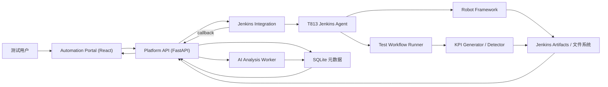
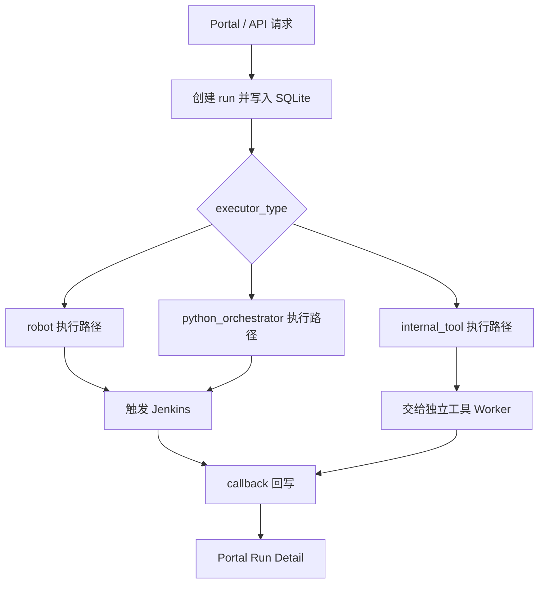

# Jenkins RobotFramework 项目综合总结

## 1. 文档定位

本文档用于从全项目视角回答四个问题：

1. 这个项目最终要解决什么问题
2. 当前总共实现了哪些能力
3. 实现过程中涉及哪些架构与测试要点
4. 哪些内容已经验证，哪些仍待服务器或真实测试线验证

总结日期：`2026-07-17`

本次总结以当前仓库代码为主要事实依据，并交叉参考：

- [项目路线图](roadmap.md)
- [8 天全项目执行计划](8-day-full-project-execution-plan.md)
- [四模块边界与最终流程图](four-module-boundaries-and-flow.md)
- [GNB KPI Regression Architecture](gnb-kpi-regression-architecture.md)
- [AI-Driven Intelligent Testing Platform](ai-driven-intelligent-testing-platform.md)
- 各模块 `README.md`、`index.md`、step 与 testing 文档

由于部分模块索引的勾选状态落后于代码，本文件统一使用以下状态口径：

- **代码已实现**：仓库中已有对应源码、配置或测试资产
- **用户已验证**：执行计划或 step 文档明确记录用户已在目标环境验证
- **待服务器验证**：仓库实现已存在，但仍缺目标服务器执行结果
- **待完善**：代码链路仍不完整，或真实业务环境尚未接通

---

## 2. 项目目标

这个项目已经从“用 Jenkins 跑 Robot Framework”的单一流水线，逐步演进为一个面向 5G GNB 自动化测试的轻量化测试平台。

它要打通的完整闭环是：

```text
用户在 Web 门户提交测试
  -> FastAPI 创建并保存 run
  -> Jenkins 调度 T813 Agent
  -> Robot Framework 或 Python KPI Runner 执行
  -> 归档 Robot / KPI / detector 产物
  -> callback 回写状态和元数据
  -> SQLite 保存平台记录
  -> Portal 展示详情、产物、KPI 和 AI 分析
```

项目不是要用 React 或 FastAPI 取代 Jenkins，而是明确分工：

- React 负责用户操作和结果展示
- FastAPI 负责平台契约、持久化与结果聚合
- Jenkins 负责调度、执行编排和产物归档
- Robot Framework / Test Workflow Runner 负责真实测试执行
- AI Analysis Worker 负责日志分析、RCA 建议和报告生成

---

## 3. 当前总体架构



### 3.1 四个主模块

| 模块 | 主要技术 | 当前职责 |
|---|---|---|
| `automation-portal` | React、TypeScript、Vite | 创建 Robot/KPI/workflow run，查看详情、产物、KPI 和 AI 结果 |
| `platform-api` | FastAPI、Pydantic、SQLite | run contract、持久化、Jenkins 触发、callback、查询与 AI 分析入口 |
| `jenkins-integration` | Jenkins Pipeline、Job DSL、JCasC、Python scripts | Job/Pipeline、Agent、checkout、命令物化、callback 和 Seed Job |
| `test-workflow-runner` | Python、ThreadPoolExecutor、TAF binding、KPI tools | workflow stage/item 编排、资源安全、KPI 后处理和统一结果输出 |

### 3.2 三条主要执行路径



- `robot`：执行单个或一组 Robot case
- `python_orchestrator`：执行结构化 workflow，支持 stage、item、并行与 KPI followup
- `internal_tool`：单独运行 KPI generator 或 detector，不依赖完整 Robot workflow

---

## 4. `platform-api` 已完成内容

### 4.1 FastAPI 分层骨架

后端已经形成稳定分层：

```text
HTTP Request
  -> router
  -> service
  -> repository
  -> SQLite
  -> response schema
  -> HTTP Response
```

关键职责：

- `app/main.py`：FastAPI 应用入口与 repository 初始化
- `app/api/v1/router.py`：HTTP 路由
- `app/schemas/`：请求和响应契约
- `app/services/`：业务语义与外部系统调用
- `app/repositories/`：SQLite 数据访问
- `app/core/config.py`：环境变量和全局配置

### 4.2 Run API 与执行契约

当前主要 API 能力包括：

| 能力 | API |
|---|---|
| 健康检查 | `GET /api/health` |
| 创建 run | `POST /api/runs` |
| 查询 run 列表 | `GET /api/runs` |
| 查询 execution-ready 详情 | `GET /api/runs/{run_id}` |
| 单独触发 Jenkins | `POST /api/runs/{run_id}/trigger` |
| Jenkins / worker 回调 | `POST /api/runs/{run_id}/callbacks/jenkins`、`callbacks/worker` |
| 查询产物 | `GET /api/runs/{run_id}/artifacts` |
| 查询 KPI / detector 摘要 | `GET /api/runs/{run_id}/kpi` |
| 更新和查询进度 | `POST/GET /api/runs/{run_id}/progress` |
| 更新 Pipeline stage | `POST /api/runs/{run_id}/stages` |
| 删除或重建 run | `DELETE /api/runs/{run_id}`、`POST /rebuild` |
| 创建独立 KPI 工具 run | `POST /api/kpi/tool-runs` |
| 查询 workflow 操作目录 | `GET /api/workflow/operation-catalog` |
| 上传输入文件 | `POST /api/uploads` |

### 4.3 Executor-agnostic run contract

平台没有把所有执行都硬编码成 Robot，而是通过 `executor_type` 区分：

- `robot`
  - 必须有 `robotcase_path`
  - 不允许直接配置 KPI workflow 字段
- `python_orchestrator`
  - 必须有 `workflow_spec`
  - 可以启用 KPI generator / anomaly detector
- `internal_tool`
  - 通过 `/api/kpi/tool-runs` 创建
  - 用于独立 generator / detector

这一设计把平台 run ID、状态和查询面与具体执行器解耦，后续扩展新执行器时不需要重新设计整套 API。

### 4.4 Create 与 Trigger 分离

Robot B1 主线采用：

```text
POST /api/runs
  -> 只创建平台 run
POST /api/runs/{run_id}/trigger
  -> 再触发 Jenkins
```

优点：

- 创建失败与 Jenkins 触发失败可以分开判断
- `trigger_failed` 可以重试
- 前端可以先拿到稳定 `run_id`
- 平台记录不会与 Jenkins queue/build number 混成一个概念

### 4.5 SQLite 持久化

默认数据库：

```text
platform-api/data/results/automation_platform.db
```

`runs` 表保存：

- `run_id`
- `executor_type`
- `testline`
- `robotcase_path`
- `workflow_spec_json`
- `status`、`message`
- `jenkins_build_ref`
- `artifact_manifest_json`
- `kpi_config_json`
- `kpi_summary_json`
- `detector_summary_json`
- `run_metadata_json`
- 创建、更新、开始和完成时间

数据库只保存结构化元数据、摘要、路径和 URL，不保存 `output.xml`、`log.html`、KPI Excel 等大文件本体。

### 4.6 Callback 与查询闭环

Jenkins 或 worker 执行结束后，通过 callback 回写：

- run 状态
- Jenkins build 引用
- 开始和结束时间
- artifact manifest
- KPI summary
- detector summary
- 扩展 metadata

Portal 不需要直接解析 Jenkins workspace，只需通过 Platform API 查询统一结构。

### 4.7 AI Log Analysis 第一期 MVP

已实现 AI 分析 API：

- `POST /api/runs/{run_id}/ai-analysis`
- `GET /api/runs/{run_id}/ai-analysis`
- `GET /api/runs/{run_id}/ai-report`

执行流程：

```text
Portal 手动触发分析
  -> Platform API 写入 queued 任务
  -> AI Analysis Worker 领取任务
  -> 收集 run / console / artifact / KPI 证据
  -> rules_first 或 Cursor REST 分析
  -> 保存结构化结果和 Markdown 报告
  -> Portal 展示 Diagnosis / Evidence / Report
```

当前生产默认模式是 `rules_first`：

- 可识别 Robot `output.xml` 中的失败
- 可识别 SCM、Python、Agent、UE、timeout、TAF import 等常见失败
- 不依赖外部 AI 权限也能给出基础分类和 rerun 建议

Schema 中的模式名仍叫 `cursor_sdk`，但当前实现已经改为 `cursor_rest_client.py` 直接调用 Cursor Cloud Agents REST API，并不依赖 Python `cursor-sdk` 包。

### 4.8 Platform API 测试资产

已存在：

- `tests/test_health.py`
- `tests/test_runs.py`
- `tests/test_ai_analysis.py`
- `tests/test_cursor_rest_client.py`
- 公共 fixture 与隔离 SQLite 数据库
- Allure pytest 标注与 `allure-results` 输出能力

当前测试覆盖创建、查询、详情、contract 校验、trigger、callback、internal tool、AI queue/result/report 和规则分类等主要路径。

---

## 5. `jenkins-integration` 已完成内容

### 5.1 Jenkins as Code 骨架

已经建立：

```text
jenkins-integration/
  jcasc/
  jobs/
  pipelines/
  scripts/
```

职责分别是：

- `jcasc/`：Controller、Agent、环境变量、credentials 和 Seed Job
- `jobs/`：Job DSL，定义 Job 参数和 SCM Pipeline
- `pipelines/`：Robot、KPI Runner、Seed Job 执行阶段
- `scripts/`：复杂参数处理、checkout、命令构建和 callback

### 5.2 JCasC 与 Seed Job

`jcasc/jenkins.yaml` 已定义：

- Jenkins Controller 不承担业务 executor
- `t813-agent`
- Agent labels：`t813 robot`
- SSH launcher credential
- Jenkins 全局环境变量
- `seed/jenkins-robotframework-seed`

`seed-jobs.Jenkinsfile` 负责：

1. checkout 当前仓库
2. 扫描 canonical `*_job.groovy`
3. 通过 Job DSL 生成 Robot 和 KPI Runner Job

### 5.3 Robot 执行 Job

Robot Pipeline 已形成完整阶段：

1. checkout 平台仓库
2. materialize Robot run request
3. checkout `robotws` 和 `testline_configuration`
4. 准备或复用 TAF Python 环境
5. 构建 Robot 命令
6. 执行 Robot
7. 归档 `artifacts/**`
8. callback Platform API

关键脚本：

- `materialize_run_request.py`
- `checkout_sources.py`
- `prepare_taf_environment.py`
- `build_robot_command.py`
- `post_run_callback.py`

### 5.4 KPI Runner Job

KPI Runner Pipeline 已支持：

1. 把 `workflow_spec` 物化为 runner request JSON
2. checkout Robot/Testline 依赖
3. 准备运行环境
4. 调用 `python -m test_workflow_runner.cli`
5. 生成 runner metadata
6. 归档结果并 callback

对应 Job DSL 当前以单个示例目标落地：

```text
CIT/CRT/KPI_Testing/SBTS26R1/7_5_UTE5G402T813
```

多版本、多 testline 批量扩展仍需要后续继续增加 DSL 配置。

### 5.5 Thin Pipeline, Thick Python

Groovy Pipeline 主要负责阶段编排，复杂逻辑尽量下沉到 Python：

- JSON 输入输出更稳定
- Python 更容易写单元测试
- shell 命令可以先物化为 plan 再执行
- Pipeline 日志和失败边界更清晰

### 5.6 Credentials 与 Agent 边界

当前设计区分：

- Controller 到 Agent 的 launcher SSH key
- Agent checkout `robotws` / `testline_configuration` 的本地 SSH key
- Jenkins SCM checkout 当前平台仓库的 credential
- Compass、callback 等业务 credential

凭据只通过 Jenkins Credentials、环境变量或服务器受控文件注入，不写入仓库。

### 5.7 AI Evidence Collection

Jenkins 产物设计已经考虑 AI 后续分析，重点归档：

- request JSON
- checkout plan
- environment plan
- Robot command plan
- `output.xml`
- `debug.log`
- runner `result.json`
- callback payload/result
- KPI/detector metadata

这样 AI 分析不是只看一段 console 文本，而是能基于结构化证据做分类。

---

## 6. `test-workflow-runner` 已完成内容

### 6.1 Python workflow orchestrator

Runner 接收 JSON request，通过 CLI 执行：

```text
request JSON
  -> RequestLoader 校验
  -> TestlineContext / bindings 准备
  -> OrchestratorRunner
  -> stage / item handler
  -> ResultBuilder
  -> result.json
```

当前输入模型包括：

- `testline`
- `ue_selection`
- `traffic_plan.stages`
- stage/item 执行模式
- `ue_scope`
- `runtime_options`
- `bindings_module`

### 6.2 Stage / Item 执行引擎

支持：

- stage 串行执行
- item 串行或并行执行
- `stop_on_failure`
- `continue_on_failure`
- `max_parallel_workers`
- 按 `item_id` 稳定整理并行结果
- 按业务类型把结果归入不同 bucket

结果 bucket：

- `preconditions`
- `traffic`
- `sidecars`
- `followups`

### 6.3 并行安全与资源锁

并行不是简单把所有 item 放入线程池，而是增加：

- parallel stage 静态校验
- UE 资源锁
- appserver 锁
- gNB/cell/RU 锁
- KPI followup 锁
- observation 锁
- reset、lock/unlock 等模型串行限制

目标是避免两个 item 同时操作同一 UE、同一 gNB 资源或同一后处理目录。

### 6.4 支持的业务模型

当前模型已覆盖：

- 前置准备：`apply_preconditions`
- UE 生命周期：`prepare_ue`、`attach`、`handover`、`detach`
- 流量：`dl_traffic`、`ul_traffic`
- gNB 控制：site/RU/RF reset、cell lock/unlock
- 观察：alarm check、syslog check
- 后处理：`kpi_generator`、`kpi_detector`

### 6.5 统一结果输出

`result.json` 已统一包含：

- 总体状态和 summary
- testline 和 alias
- workflow 时间
- `kpi_window`
- item-level timeline
- `artifact_manifest`
- resolved config
- 四类结果 bucket

`kpi_window` 区分：

- workflow 总时间
- 真正业务流量执行时间

这样 KPI generator 不会把 followup 报告生成时间错误地算入 KPI 取数窗口。

### 6.6 KPI Generator / Detector 内部接入

原有 generator 和 detector 已收编到：

```text
test-workflow-runner/internal_tools/
```

接入方式改为：

- orchestrator handler 直接调用内部 Python service
- 不再默认依赖任意 `params.command`
- Portal standalone tool run 通过 `internal_tools.tool_runner` 调用同一套 service
- worker 执行后通过 `/callbacks/worker` 回写平台

### 6.7 Python KPI Runner MVP

已实现：

- UE type / family 提取
- `ue_scope=ue_families`
- 不选 UE 的 gNB-only workflow
- TAF binding skeleton
- 资源锁
- KPI window
- Portal Workflow Builder 到 Jenkins KPI Job 的调度入口

### 6.8 当前主要缺口：真实 Step 3

当前执行层最大的未完成项仍是：

```text
testline_configuration
  + robotws
  + TAF gateway / bindings
  + 真实 T813 设备调用
```

目前已经完成一部分契约：

- `repository_root` 进入 `TestlineContext`
- 相对 `script_path` / `working_directory` 能按仓库根目录解析
- `EnvConfigResolver` 可以按 `env_map.json` 定位测试线配置
- `TafGateway` 可以动态调用 binding module

但仍存在：

- 仓库只有 `env_map.example.json`，没有真实环境映射
- `bindings/taf_power_ue.py` 仍主要是骨架
- 真实 TAF/robotws API 尚未在目标设备完整验证
- 真实 testline 端到端执行证据尚未收口

---

## 7. `automation-portal` 已完成内容

### 7.1 前端基础工程

技术栈：

- React
- TypeScript
- Vite
- React Router
- 原生 CSS

前端通过 `VITE_API_BASE_URL` 访问 Platform API，本地 Vite 使用 `/api` proxy。

### 7.2 Robot Run 页面

已实现：

- Robot run 列表
- 新建 Robot run 表单
- create + trigger 两步调用
- run detail
- Retry Trigger
- Delete
- 从已有 run 克隆参数

表单支持：

- testline
- robotcase path
- case name
- selected tests
- Robot variables JSON
- build
- TAF mode
- robotws ref

### 7.3 KPI 工具页面

已实现独立页面：

- KPI Generator list/form/detail
- KPI Detector list/form/detail
- 输入文件上传
- tool run 创建
- progress polling
- rebuild 和 delete

这部分代码已经领先于部分模块文档中“后续再加独立工具页面”的旧描述。

### 7.4 Workflow Builder

已实现：

- workflow run 列表
- operation catalog
- UE selection
- stage/item 结构化配置
- drag-and-drop 组织操作
- 创建 `python_orchestrator` run
- 触发 Jenkins KPI Runner
- workflow run detail

### 7.5 Run Detail 展示

详情页已经可以展示：

- run 基本信息和状态
- Jenkins queue/build 链接
- Pipeline stages
- progress
- Robot artifact
- `log.html` / report 入口
- KPI summary
- detector summary
- metadata

### 7.6 AI Run Insight

Run Detail 已接入：

- Generate / Regenerate AI Analysis
- Refresh
- failure layer / root cause
- evidence 列表
- rerun advice
- Markdown report
- 报告复制

Portal 模块索引仍把 Step 2 标为未完成，但对应页面和 API 调用代码已经存在。更准确的状态是：**功能代码已实现，最终前端构建和服务器 UI smoke 仍需按验证记录确认**。

### 7.7 前端测试现状

当前 `package.json` 只有：

- `dev`
- `build`
- `preview`

尚未建立：

- Vitest / Jest
- React Testing Library
- Playwright E2E
- 可执行的 `npm run test`

这是 Portal 后续质量收口的重要缺口。

---

## 8. 测试与质量体系

### 8.1 当前已有测试资产

| 类型 | 当前资产 |
|---|---|
| 后端 API 自动化 | `platform-api/tests/` pytest |
| Runner 单元与 CLI 测试 | `test-workflow-runner/tests/test_orchestrator.py` |
| Jenkins helper 测试 | `jenkins-integration/tests/` |
| Allure | pytest 生成 `allure-results`，Jenkins 展示为后续发布能力 |
| Postman | `platform-api/practice/postman/` |
| SQL 校验 | `platform-api/practice/sql/` |
| JMeter smoke | `platform-api/practice/jmeter/` |
| 测试设计训练 | 各模块 `testing-training/` |
| 自动化交付记录 | 各模块 `testing-automation/` |

### 8.2 测试分层思路

项目已经形成以下测试层次：

1. Schema / service / repository 单元与契约测试
2. FastAPI TestClient 接口测试
3. SQLite 持久化一致性检查
4. Jenkins helper 和 runner CLI 测试
5. Postman 跨接口链路验证
6. JMeter 最小性能 smoke
7. Jenkins / Agent / Robot / TAF 真实集成验证
8. Portal 前端单元和 E2E 测试（待补）

### 8.3 验证交接模式

项目采用：

```text
AI 实现和整理验证命令
  -> 用户在目标 Debian/Jenkins/UTE 环境执行
  -> 用户贴回结果
  -> 再判断 verified 或继续修复
```

这样可以避免在本地误判服务器、Jenkins credential、真实测试线和 TAF 环境状态。

---

## 9. 部署与运维沉淀

### 9.1 统一访问入口

Nginx 统一收口：

- `/` -> `automation-portal/dist`
- `/api/` -> Platform API
- `/jenkins/` -> Jenkins

同时保留 Robot `log.html` artifact 的访问兼容处理。

### 9.2 部署文档分工

| 文件 | 用途 |
|---|---|
| `deploy/DEPLOYMENT.md` | 首次部署、环境初始化和低频配置 |
| `deploy/SERVER_OPERATIONS.md` | 单项服务状态、日志和操作命令 |
| `deploy/RELEASE_CHECKLIST.md` | 日常发布的唯一决策入口 |

### 9.3 Release Checklist

Checklist 已按改动路径确定最小动作：

- API-only 改动只重启 Platform API
- AI worker-only 改动只重启 worker
- API/worker 共享代码改动重启两者
- Portal 改动重新 build `dist`
- Pipeline script 改动通常不重启 Jenkins
- Job DSL 改动运行 Seed Job
- JCasC 改动重新 render 并重启 Jenkins
- Nginx 改动先 `nginx -t` 再 reload

### 9.4 `server-deploy-handoff` Skill

项目 Skill 已把部署知识提炼为可重复工作流：

1. 根据 changed paths 分类
2. 读取 Checklist
3. 生成最小服务器命令
4. 给出预期结果
5. 给出常见失败识别方式
6. 等待用户执行和回传

Skill 明确禁止：

- 自动 SSH 上服务器执行发布
- 泄露 token、密码和私钥
- 使用破坏性 Git 命令
- 在服务器直接修改业务源码
- 没有证据就宣称验证通过

### 9.5 systemd 现状

仓库当前明确提交的 systemd unit 是：

- `deploy/systemd/platform-api-ai-worker.service`

Platform API、Jenkins 和 Nginx 的运行方式主要记录在部署文档及服务器现有配置中，仓库内并没有完整保存所有实际 unit 文件。这是后续减少服务器配置漂移时可继续完善的方向。

---

## 10. 关键技术与架构要点

### 10.1 门户与 Jenkins 解耦

浏览器不直接保存 Jenkins credential，固定走：

```text
Portal -> Platform API -> Jenkins
```

### 10.2 Contract-first

先冻结 request/response/schema，再做执行器：

- run create contract
- trigger contract
- callback contract
- artifact/KPI query contract
- workflow request contract

这使前端、后端、Jenkins 和 runner 可以围绕稳定 JSON 协作。

### 10.3 平台 ID 与 Jenkins ID 分离

- `run_id` 是平台主键
- Jenkins queue/build 是外部执行引用

不会因为 Jenkins 重试、换 Job 或换调度方式而失去平台记录。

### 10.4 元数据与大文件分离

- SQLite 保存结构化状态、摘要、路径和 URL
- Jenkins artifact / 文件系统保存 XML、HTML、Excel 和日志

避免把大文件塞入 SQLite。

### 10.5 Thin Pipeline, Thick Python

- Groovy 管阶段和 Jenkins 能力
- Python 管复杂解析、验证、计划生成和 callback

减少 Pipeline 脚本难测试、难复用的问题。

### 10.6 并行安全优先

Runner 的并行能力与资源锁同时设计，避免“为了并行而并行”：

- 共享 UE 不并发
- 同一 gNB/cell/RU 操作受控
- followup 不并发写同一结果
- reset / lock 等危险动作受串行规则约束

### 10.7 AI 先做证据分析，不直接自动修复

第一期 AI 只做：

- 证据收集
- 日志摘要
- 失败层分类
- RCA 建议
- rerun 建议
- 报告生成

暂不自动修改环境、自动修复、自动 rerun 或自动关闭问题，降低误操作风险。

### 10.8 Secrets 与运行环境边界

- 仓库不保存真实 secret
- Jenkins Credentials / env 注入
- 服务器只部署运行，不直接维护业务源码
- GitHub 仓库是代码真源

---

## 11. 当前真实完成状态

### 11.1 文档记录为用户已验证

根据 [8 天全项目执行计划](8-day-full-project-execution-plan.md)：

- Jenkins Master、`/jenkins/` HTTPS 基线已打通
- `t813-agent` 已在线
- Agent 最小 shell 与 workspace 写入 smoke 已通过
- Platform API Day 1 / Step 10-13 已由用户验证
- Run contract、callback、artifact/KPI 查询和 execution-ready detail 已形成闭环

### 11.2 代码已实现，但仍需要目标环境继续验证

- JCasC 在真实 Jenkins 上重新应用
- Seed Job 生成 canonical Robot/KPI Job
- Robot Job 从 Portal 创建、触发到真实 case callback
- KPI Runner 非 dry-run 执行
- Compass KPI generator 与真实 Excel detector
- AI worker systemd 基线 smoke
- Cursor Cloud Agents 权限和 no-repo agent smoke
- Portal 当前全部页面的服务器 build 与 UI 回归

### 11.3 当前主线未完成项

最核心的是 Test Workflow Runner Step 3：

```text
真实 env_map
  -> testline_configuration
  -> robotws
  -> TAF binding
  -> T813 设备
  -> result/callback
```

此外还包括：

- Portal 前端测试框架
- 多版本、多 testline 的 KPI Job DSL 扩展
- 更严格的 Jenkins Agent host key verification
- 更完整的 systemd/Jenkins override 配置入库
- AI Cloud Agents 权限确认
- 完整端到端回归和演示证据

---

## 12. 已发现的文档漂移与风险

### 12.1 进度看板落后于代码

- Platform API index 中 Step 10-13、16 仍未勾选，但代码和执行计划已记录实现或验证
- Portal Step 2 仍未勾选，但 AI Run Insight 已存在
- Portal 文档仍把 KPI 工具页和 Workflow Builder 写成未来方向，但代码已经落地
- 8 天执行计划仍停留在 Runner Step 3，没有完整反映后续 Step 6-8 代码进展

因此判断当前状态时，优先级应为：

```text
当前代码
  -> 8-day execution plan 的验证记录
  -> 当前 step 文档
  -> module index 的旧勾选状态
```

### 12.2 Job DSL 存在新旧两套文件名

当前 Seed Job 匹配 canonical：

- `robot_execution_job.groovy`
- `kpi_runner_job.groovy`

旧的 hyphen 文件：

- `robot-execution-job.groovy`
- `kpi-runner-job.groovy`

不在 Seed 的 `*_job.groovy` 匹配范围内。后续修改时必须先确认正在修改 canonical 文件。

### 12.3 AI 模式命名容易误导

API schema 仍使用 `cursor_sdk`，实际实现已经是 Cursor REST API。后续可以考虑在兼容旧请求的前提下逐步改成更准确的模式名称。

### 12.4 真实环境配置没有入库

Runner 只有 `env_map.example.json`，真实 `env_map.json`、TAF binding 和设备参数必须由目标环境安全提供。

### 12.5 部分安全默认值需要生产收紧

需要后续评估：

- Jenkins Agent `nonVerifyingKeyVerificationStrategy`
- callback insecure TLS
- callback ignore failure
- Seed Job `sandbox: false`

这些设置适合第一阶段联调，但生产化时应建立更严格的安全边界。

---

## 13. 关键文件速查

### Platform API

- `platform-api/app/api/v1/router.py`
- `platform-api/app/schemas/run.py`
- `platform-api/app/services/run_service.py`
- `platform-api/app/services/jenkins_service.py`
- `platform-api/app/services/ai_analysis_worker.py`
- `platform-api/app/services/cursor_rest_client.py`
- `platform-api/app/repositories/run_repository.py`
- `platform-api/tests/`

### Jenkins Integration

- `jenkins-integration/jcasc/jenkins.yaml`
- `jenkins-integration/jobs/robot_execution_job.groovy`
- `jenkins-integration/jobs/kpi_runner_job.groovy`
- `jenkins-integration/pipelines/robot-execution.Jenkinsfile`
- `jenkins-integration/pipelines/kpi-runner.Jenkinsfile`
- `jenkins-integration/pipelines/seed-jobs.Jenkinsfile`
- `jenkins-integration/scripts/`

### Test Workflow Runner

- `test-workflow-runner/test_workflow_runner/models.py`
- `test-workflow-runner/test_workflow_runner/request_loader.py`
- `test-workflow-runner/test_workflow_runner/runner.py`
- `test-workflow-runner/test_workflow_runner/safety.py`
- `test-workflow-runner/test_workflow_runner/result_builder.py`
- `test-workflow-runner/test_workflow_runner/taf_gateway.py`
- `test-workflow-runner/internal_tools/`

### Automation Portal

- `automation-portal/src/main.tsx`
- `automation-portal/src/App.tsx`
- `automation-portal/src/api.ts`
- `automation-portal/src/pages/`
- `automation-portal/src/styles.css`

### Deployment and Documentation

- `deploy/RELEASE_CHECKLIST.md`
- `deploy/SERVER_OPERATIONS.md`
- `deploy/DEPLOYMENT.md`
- `deploy/nginx/jenkins-kpi-platform.conf`
- `deploy/systemd/platform-api-ai-worker.service`
- `.cursor/skills/server-deploy-handoff/SKILL.md`
- `docs/overview/8-day-full-project-execution-plan.md`

---

## 14. 后续最推荐顺序

1. 先完成 Runner Step 3 的真实 `testline_configuration / robotws / TAF` binding
2. 在目标 Jenkins 应用 JCasC、运行 Seed Job，并验证 canonical Robot/KPI Job
3. 打通一个真实 Robot case 的 Portal -> callback 端到端闭环
4. 把 KPI Runner 从 dry-run 切到受控真实环境验证
5. 补 Portal Vitest/React Testing Library 和 Playwright E2E
6. 收紧 Jenkins SSH、TLS 和 callback 安全设置
7. 同步更新各模块 index，消除代码与进度看板漂移
8. 最后完成 Day 8 演示脚本、回归清单和项目验收记录

---

## 15. 一句话总结

这个项目已经完成了一个真实自动化测试平台的大部分软件骨架：

```text
React 提交和展示
  + FastAPI run contract 与 SQLite
  + Jenkins as Code 和 Agent 调度
  + Robot / Python workflow 执行
  + KPI 后处理
  + artifact/callback
  + AI 日志分析
  + 测试与部署知识沉淀
```

当前不再缺“平台结构”，真正需要继续突破的是：**把已经实现的平台契约和执行骨架，在真实 T813、robotws、testline_configuration、TAF 和 Jenkins 环境中完成最终端到端验证。**
