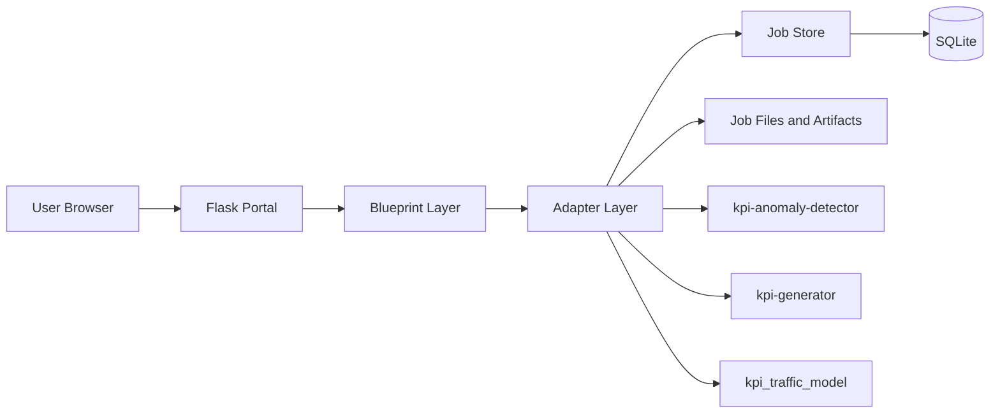
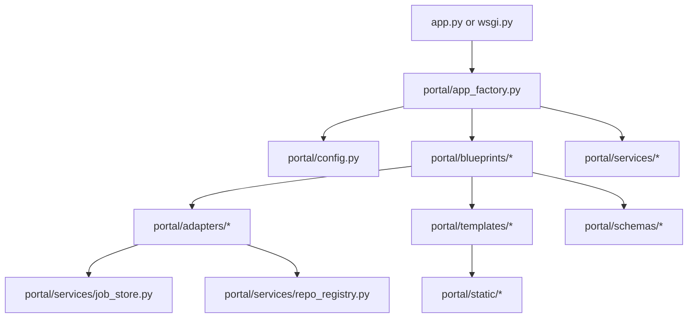
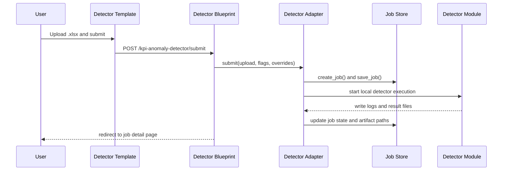
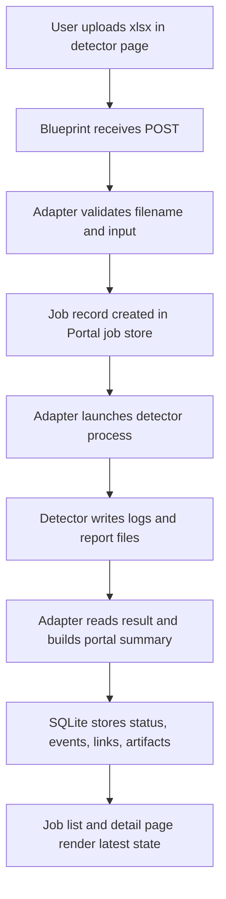
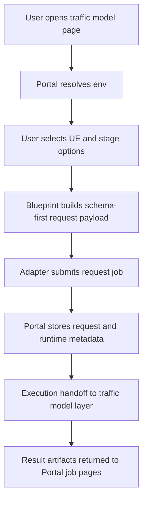
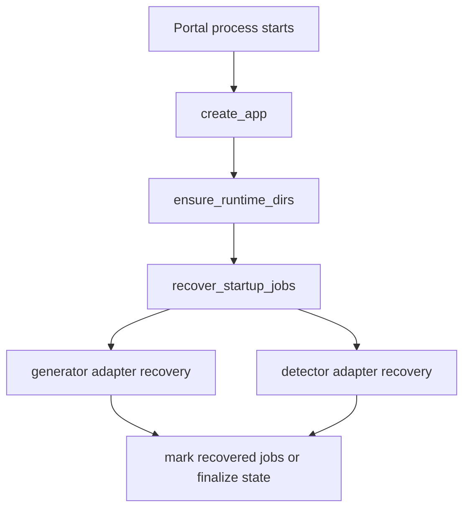
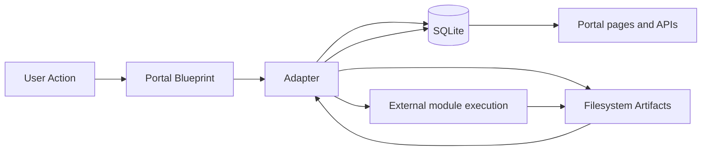
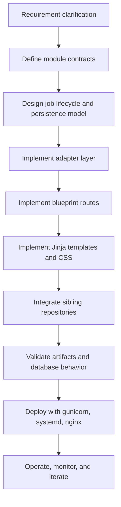

# KPI Portal Project Development Details

## 1. Document Purpose

This document explains `kpi-dashboard` in a code-oriented way, not just as a conceptual Portal.

The target is to answer four practical questions:

- how the project is layered by directory
- where each responsibility actually lives in code
- how a browser request becomes a local module execution job
- where database, filesystem, and sibling repositories participate

## 2. Project Positioning

`kpi-dashboard` is a Flask-based orchestration shell for KPI capabilities. It does not contain all KPI business logic itself. Instead, it provides:

- a unified web entry
- navigation across multiple KPI modules
- a normalized HTTP/UI layer
- a local adapter layer for sibling repositories
- a runtime job store
- artifact browsing and download

The currently registered sibling repositories are:

- `kpi-anomaly-detector`
- `kpi-generator`
- `kpi_traffic_model`

So the Portal is best understood as a capability aggregator and local execution console.

## 3. Runtime View



## 4. Directory-By-Directory Explanation

### 4.1 `kpi-dashboard/`

This is the deployable Flask project root.

- `app.py`
    - minimal runtime entry for local startup
    - delegates to `portal.app_factory.create_app()`
- `wsgi.py`
    - WSGI entry for gunicorn or other production servers
- `requirements.txt`
    - Python runtime dependency definition
- `deploy/`
    - deployment scripts or service-related assets
- `docs/`
    - local project documentation
- `instance/`
    - runtime mutable data area
    - used by the Portal for SQLite and per-job runtime files
- `tests/`
    - test coverage for the Portal project
- `portal/`
    - the actual application package

### 4.2 `kpi-dashboard/portal/`

This directory is the real application body. It contains routing, adapters, contracts, schemas, services, templates, and static files.



### 4.3 `portal/app_factory.py`

This file is the application bootstrap center.

Core responsibilities:

- create the Flask app instance
- load environment-driven config
- initialize logging
- ensure runtime directories exist
- register blueprints
- trigger startup recovery for unfinished jobs
- support URL prefix deployment behind nginx or reverse proxy

This is the file you change when you need to add global middleware, startup behavior, or environment bootstrap logic.

### 4.4 `portal/config.py`

This is the deployment configuration layer.

It centralizes environment-controlled settings such as:

- app environment and mode
- logging level
- URL prefix
- job store backend
- SQLite path
- module-specific timeouts and related runtime values

The architectural point is important: operational behavior is meant to be changed by environment variables, not by editing application code.

### 4.5 `portal/blueprints/`

This is the HTTP controller layer. It owns route declaration, form parsing, flash messages, redirects, and template rendering.

Contained files:

- `portal.py`
    - `GET /` renders home page with module cards from `repo_registry`
    - `GET /healthz` returns service health and job-store backend state
- `kpi_detector.py`
    - detector list page, file submit, filename validation, detail page, rerun, cancel, delete, bulk operations, JSON status API, artifact delivery
- `kpi_generator.py`
    - generator list page, generator submit, scout conversion submit, detail page, rerun, cancel, delete, JSON status API, artifact delivery
- `kpi_traffic_model.py`
    - traffic model list page, env resolve API, request submit, detail page, JSON status API, artifact delivery, delete

Blueprints in this project are intentionally thin. They should decide request/response behavior, but avoid holding core execution logic.

### 4.6 `portal/adapters/`

This is the most important backend directory. The adapter layer converts Portal-shaped requests into module-specific execution behavior.

Contained files:

- `base.py`
    - defines shared adapter behavior
    - includes `ModuleRepository` and common module description logic
    - exposes normalized `describe_module()` and `sample_command()` behavior
- `kpi_detector.py`
    - handles detector-specific validation, job submission, history query, rerun, cancel, delete, log tailing, and artifact lookup
- `kpi_generator.py`
    - handles report generation jobs, scout conversion jobs, follow-up detector integration, rerun, cancel, delete, and artifact lookup
- `kpi_traffic_model.py`
    - handles traffic model environment inspection, request submission, list/get/delete, and artifact lookup

Why this layer matters:

- Portal routes stay stable even if underlying module invocation changes
- each sibling repo can evolve behind a local compatibility boundary
- job persistence and UI decoration stay centralized in the Portal side

This is an anti-corruption layer pattern.

### 4.7 `portal/contracts.py`

This file defines normalized contract objects exposed to the UI layer or integration layer.

Current dataclasses include:

- `ModuleCapabilityContract`
    - declares whether a module supports cancel, delete, rerun, preview, auto-trigger, and status API
- `JobContract`
    - describes module job status values, artifact kinds, progress fields, and linked job fields
- `SummaryContract`
    - describes result payload key, summary fields, and UI display fields

These contracts are a useful sign that the Portal is trying to standardize module diversity rather than hardcoding every module directly into templates.

### 4.8 `portal/schemas/`

This directory defines typed Portal input models.

Files observed:

- `input_models.py`
- `__init__.py`

Key dataclasses:

- `PortalJobCommonFields`
    - normalized common fields such as `job_mode`, `build`, `environment`, `scenario`
- `PortalRuntimeOptions`
    - runtime flags such as `as_base_file`, `auto_detector`, `auto_generator`, `dry_run`, `stop_on_failure`, `max_parallel_workers`, `log_level`, `timeout_seconds`
- `DetectorPortalInput`
    - detector upload model built from filename context
- `GeneratorPortalInput`
    - generator request model for template-driven report generation
- `GeneratorScoutPortalInput`
    - generator request model for scout-report conversion mode
- `TrafficModelPortalInput`
    - traffic model execution request with selected UE indexes and execution modes
- `InputValidationError`
    - normalized validation exception used by routes and adapters

This package is where request normalization becomes explicit Python data.

### 4.9 `portal/services/`

This directory holds infrastructure services.

#### `job_store.py`

This is the Portal runtime persistence core.

Responsibilities:

- ensure runtime directories under `instance/` and `instance/jobs/`
- create and update jobs
- persist jobs in SQLite or file mode
- maintain `jobs`, `job_events`, `job_links`, and `job_artifacts` tables
- derive artifact metadata from job fields
- delete job metadata and job directories
- support listing, filtering, pagination, and sort order

Important persisted job fields from `create_job()` include:

- `id`
- `module_key`
- `original_filename`
- `stored_filename`
- `is_base_file`
- `queue_order`
- `status`
- `created_at`
- `started_at`
- `completed_at`
- `error_message`
- `process_pid`
- `cancel_requested_at`
- `input_path`
- `stdout_log_path`
- `stderr_log_path`
- `result_json_path`
- `report_html_path`
- `report_excel_path`
- `report_data_path`
- `stats`
- `current_record`

This proves the database is not business KPI storage. It is an operational job-state database.

#### `repo_registry.py`

This file maps Portal modules to real repository locations.

For each module it registers:

- module key
- UI title and summary
- route name
- repository path
- readme path
- execution entry candidates

This registry powers the home page module cards and helps adapters locate actual code entry points.

### 4.10 `portal/runners/`

This directory indicates there is a runner/execution abstraction layer below adapters. Even when not deeply inspected here, its architectural role is clear: isolate process or execution orchestration from HTTP/controller code.

### 4.11 `portal/templates/`

This is the server-rendered UI layer.

Observed structure and role:

- `base.html`
    - shared layout and top navigation
    - includes links to Portal Home, KPI Anomaly Detector, KPI Generator, KPI Traffic Model
- `home.html`
    - module card landing page
- `modules/*.html`
    - module list and detail pages
    - detector module template includes upload UI, override UI, filters, job table, actions

The UI is form-driven and table-driven, not SPA-driven.

### 4.12 `portal/static/`

This directory contains static frontend assets such as `styles.css`.

Its role is presentation only. The project does not currently depend on a Node-based asset pipeline.

## 5. End-To-End Request Flow

### 5.1 Detector example



### 5.2 Traffic model example

The traffic model path is more structured than simple file upload:

- route validates env and selected UE indexes
- `TrafficModelPortalInput.from_form()` normalizes execution flags
- blueprint builds a structured payload containing:
    - `job_version`
    - `job_mode`
    - `env`
    - `testline_resolution`
    - `ue_selection`
    - `traffic_plan`
    - `runtime_options`
    - `portal_followups`
- adapter persists and dispatches that request to the traffic-model side

This module is the closest to a schema-first orchestration engine rather than a simple upload tool.

## 6. Front-End and Back-End Split

### 6.1 Front-end responsibilities

- layout and navigation
- HTML forms
- table rendering
- filter controls
- button-triggered actions
- auto-refresh hints for running jobs

Implemented mainly by:

- `portal/templates/`
- `portal/static/`

### 6.2 Back-end responsibilities

- route definitions
- request parsing
- schema validation
- execution orchestration
- local repository integration
- job persistence
- artifact resolution
- status API exposure

Implemented mainly by:

- `portal/blueprints/`
- `portal/adapters/`
- `portal/services/`
- `portal/schemas/`

## 7. Database Participation

The Portal database participates as an operational metadata store, not as the source of KPI business data.

SQLite is used to persist:

- job header records
- event history records
- linked job relationships
- artifact index records

Actual heavy outputs remain on the filesystem, for example:

- uploaded request files
- stdout and stderr logs
- JSON result files
- HTML or Excel reports

So the storage model is hybrid:

- SQLite for searchable state
- filesystem for large artifacts

## 8. Development Logic For Rebuild

Recommended rebuild order:

1. Define module registry and deployment config.
2. Implement app factory and blueprint registration.
3. Build `job_store.py` first, because all modules depend on it.
4. Define input schemas and validation models.
5. Implement a common adapter base class.
6. Implement one module adapter end to end first, preferably detector.
7. Add server-rendered templates and artifact download flow.
8. Add startup recovery and production deployment packaging.

## 9. Required Skills

To maintain or rebuild this project well, the developer should understand:

- Flask application factory pattern
- Blueprint-based routing
- Python dataclasses and validation design
- local process orchestration and filesystem management
- SQLite persistence design
- Jinja template rendering
- reverse proxy deployment with gunicorn and nginx
- adapter and anti-corruption layer design

## 10. Core Conclusion

`kpi-dashboard` is not just a Flask website. It is a local orchestration console that standardizes different KPI tools behind a common Portal contract.

The code is organized around a clear separation:

- blueprints own HTTP
- schemas own normalized input
- adapters own module integration
- services own persistence and registry
- templates own server-rendered UI

That separation is the main reason the project is extendable. If a new KPI module must be added later, the expected extension path is already visible in the current codebase.

    User->>TemplateUI: Submit upload / request form
    TemplateUI->>Blueprint: HTTP POST
    Blueprint->>Adapter: Validate and submit job
    Adapter->>JobStore: Create queued job record
    Adapter->>Capability: Launch local execution
    Adapter->>JobStore: Update status, logs, artifacts, events
    User->>Blueprint: Open job detail page
    Blueprint->>Adapter: Load decorated job
    Adapter->>JobStore: Read job, artifacts, events
    Adapter-->>Blueprint: Render-ready data
    Blueprint-->>TemplateUI: HTML page
    TemplateUI-->>User: Job status and outputs
```

This collaboration model shows that the front-end is thin, and the back-end owns all execution and state logic.

## 6. Portal Request and Execution Flow

### 6.1 Detector flow



### 6.2 Traffic model flow



### 6.3 Portal startup recovery flow



This is an important operational feature. It means the Portal is designed to survive restarts without losing all running job state.

## 7. Database Usage in the Project

## 7.1 What database is used

The current Portal uses SQLite as its primary runtime persistence backend.

This is visible in:

- `portal/config.py`
- `portal/services/job_store.py`
- tests referencing `KPI_SQLITE_PATH`

The configured file is typically:

- `kpi-dashboard/instance/portal.db`

## 7.2 What the database stores

This database is not the business KPI source database.

It is a Portal runtime metadata store.

Based on `job_store.py`, it stores at least:

- jobs
- job events
- job links
- job artifacts

So its role is:

- task state persistence
- artifact indexing
- timeline recording
- UI query source
- restart recovery source

## 7.3 Database logical role in the whole system



The important point is:

- SQLite stores metadata and control-plane state
- The actual heavy outputs remain in the filesystem

This is a classic metadata database plus file artifact storage pattern.

## 7.4 Database principle and why it is useful here

Why not only use files?

Because Portal pages need efficient queries such as:

- list latest jobs
- filter by status
- filter by environment and release
- render timeline and artifact references
- recover interrupted jobs on startup

If only JSON files were used, querying and consistency management would become more expensive and more fragile.

SQLite is suitable here because:

- deployment is simple
- there is no separate DB server dependency
- write volume is moderate
- data is metadata, not massive analytical warehouse data

## 7.5 What the database is not doing

The database is not currently acting as:

- KPI raw source warehouse
- historical analytics warehouse
- Portal authentication database
- distributed queue backend

Its current role is operational metadata persistence.

## 8. Development Logic and Recommended Implementation Steps

If a team builds this project or continues evolving it, the recommended engineering sequence is below.

### Step 1: define Portal capability boundary

Clarify whether the Portal should:

- only host local CLI adapters
- evolve into service orchestration
- or become a full platform with queueing and RBAC

### Step 2: define module contracts

Each module must define:

- input schema
- output schema
- execution contract
- artifact contract
- error contract

This should happen before UI expansion.

### Step 3: stabilize job model and persistence

Before adding more modules, stabilize:

- job lifecycle model
- event model
- artifact model
- linked-job model
- recovery model

### Step 4: harden adapter layer

The adapter layer should be treated as a formal boundary.

Each adapter should define:

- sample command
- validation rules
- runtime execution path
- job state updates
- artifact discovery
- cancellation model

### Step 5: refine server-rendered UI

After contracts are stable, refine:

- upload flow
- filter UX
- detail views
- error states
- report preview or links

### Step 6: improve deployment and operations

Current deployment already uses:

- gunicorn
- systemd
- nginx
- env-var configuration

So the next logical steps are:

- health checks
- monitoring
- structured logging
- backup and retention policy
- migration strategy if SQLite grows too large

## 9. Required Skills to Build and Maintain This Project

The skill set is not only Flask.

### 9.1 Back-end skills

- Python
- Flask application factory pattern
- Blueprint-based modular routing
- process execution and subprocess management
- file and path handling
- SQLite usage and schema management
- background job state management
- configuration through environment variables
- logging and operational troubleshooting

### 9.2 Front-end skills

- HTML5
- CSS
- Jinja template rendering
- server-rendered UI design
- form submission and browser interaction basics
- progressive enhancement without SPA complexity

### 9.3 Architecture and integration skills

- adapter pattern
- module contract design
- local CLI integration
- filesystem artifact lifecycle design
- error propagation and user-facing feedback design

### 9.4 Deployment and ops skills

- Linux
- systemd
- nginx reverse proxy
- gunicorn
- TLS and URL prefix deployment
- filesystem permissions
- runtime directory management

### 9.5 Domain skills

- KPI analysis workflows
- anomaly detection workflow understanding
- report generation workflow understanding
- possibly testline and UE workflow understanding for traffic model integration

## 10. Front-End vs Back-End Work Breakdown

## 10.1 Front-end work items

- define page information architecture
- create module list cards
- create upload and filter forms
- style result tables and detail panels
- create status chips and artifact links
- implement auto-refresh hint and page behavior
- make pages readable for engineering users

## 10.2 Back-end work items

- define routes and page endpoints
- define adapter execution logic
- implement job creation and status transitions
- persist job records and artifacts
- launch external module processes
- parse and decorate module outputs
- expose result detail and artifact download endpoints
- recover interrupted state at startup

## 10.3 Collaboration model

The front-end and back-end collaboration pattern is:

1. Back-end defines the data contract for templates
2. Front-end templates render those contracts
3. Back-end owns execution state and business rules
4. Front-end reflects state through tables, badges, and messages
5. Back-end remains the source of truth

This project currently favors strong back-end ownership with lightweight front-end rendering.

## 11. Development Flowchart



## 12. What Makes This Portal Different from a Typical CRUD Web App

This Portal is not mainly about create-read-update-delete business rows.

Its center of gravity is:

- asynchronous job orchestration
- capability aggregation
- runtime metadata management
- artifact-driven result presentation

So developers should think of it as an engineering operations portal, not a traditional admin panel.

## 13. Final Summary

The `portal` project is a Flask-based orchestration shell that integrates multiple KPI capability repositories through adapters, renders server-side HTML pages, stores runtime job metadata in SQLite, and uses the filesystem for heavy artifact storage.

From a technical responsibility standpoint:

- front-end is template-based presentation and interaction
- back-end is routing, orchestration, validation, persistence, and integration
- database stores Portal operational metadata, not core KPI warehouse data

The development difficulty is mainly in adapter design, job lifecycle correctness, and multi-module integration stability rather than in frontend framework complexity.
