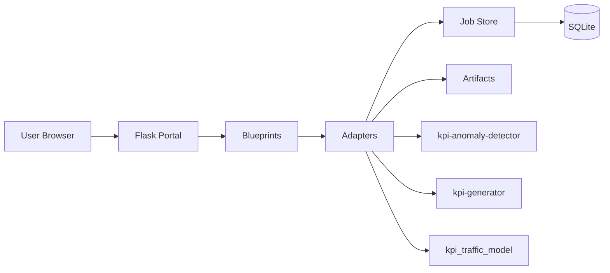
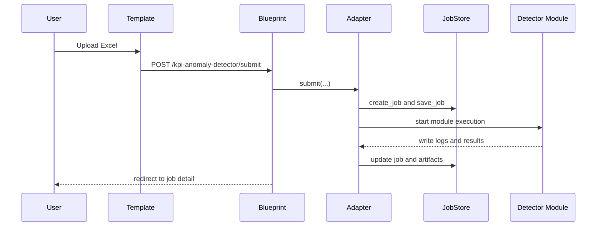

# KPI Portal Project Development Details

## 1. Purpose

This document explains `kpi-dashboard` as a code-structured Portal project.

It answers:

- how the project is layered by directory
- where responsibilities live in code
- how browser requests become local jobs
- how SQLite and filesystem artifacts participate

## 2. Project Positioning

`kpi-dashboard` is a Flask-based orchestration shell. It provides:

- unified web entry
- module navigation
- normalized HTTP layer
- local adapter layer for sibling repositories
- operational job store
- artifact browsing and download

Registered sibling repositories:

- `kpi-anomaly-detector`
- `kpi-generator`
- `kpi_traffic_model`

## 3. Runtime View

## 4. Directory Explanation

### `kpi-dashboard/`

- `app.py`: local runtime entry
- `wsgi.py`: production WSGI entry
- `requirements.txt`: runtime dependencies
- `deploy/`: deployment assets
- `docs/`: project documentation
- `instance/`: runtime data and SQLite
- `tests/`: automated tests
- `portal/`: actual application package

### `portal/`

Contains:

- `app_factory.py`: app bootstrap, config, blueprint registration, startup recovery
- `config.py`: env-driven runtime configuration
- `blueprints/`: HTTP controller layer
- `adapters/`: module integration layer
- `contracts.py`: normalized Portal contracts
- `schemas/`: typed request models and validation
- `services/`: infrastructure services such as job store and repo registry
- `templates/`: server-rendered UI
- `static/`: styles and static assets
- `runners/`: execution-oriented helpers below adapters

### `blueprints/`

Main route groups:

- `portal.py`: home page and `/healthz`
- `kpi_detector.py`: detector list, submit, validate, detail, rerun, cancel, delete, artifacts
- `kpi_generator.py`: generator list, submit, detail, rerun, cancel, delete, artifacts
- `kpi_traffic_model.py`: env resolution, submit, detail, delete, artifacts

### `adapters/`

Main responsibility:

- convert Portal input into module-specific execution behavior
- create and update Portal job records
- map runtime outputs into artifact links and job summaries

Modules:

- `base.py`
- `kpi_detector.py`
- `kpi_generator.py`
- `kpi_traffic_model.py`

### `schemas/`

Key dataclasses:

- `PortalJobCommonFields`
- `PortalRuntimeOptions`
- `DetectorPortalInput`
- `GeneratorPortalInput`
- `GeneratorScoutPortalInput`
- `TrafficModelPortalInput`
- `InputValidationError`

### `services/`

#### `job_store.py`

Handles:

- runtime directories
- job creation and update
- SQLite persistence
- events, links, and artifact indexes
- list, filter, pagination, delete

Important stored fields include:

- `id`
- `module_key`
- `status`
- `created_at`
- `started_at`
- `completed_at`
- `input_path`
- `stdout_log_path`
- `stderr_log_path`
- `result_json_path`
- `report_html_path`
- `report_excel_path`
- `report_data_path`

#### `repo_registry.py`

Maps module key to:

- UI title and summary
- route name
- repository path
- readme path
- entry candidates

### `templates/`

Server-rendered UI files:

- `base.html`
- `home.html`
- `modules/kpi_detector.html`
- `modules/kpi_detector_job.html`
- `modules/kpi_generator.html`
- `modules/kpi_generator_job.html`
- `modules/kpi_traffic_model.html`
- `modules/kpi_traffic_model_job.html`

## 5. End-to-End Flow

### Detector example

## 6. Front-End and Back-End Split

Front-end responsibilities:

- layout and navigation
- HTML forms
- filters and tables
- action buttons
- auto-refresh hints

Back-end responsibilities:

- route definitions
- validation
- orchestration
- module integration
- persistence
- artifact exposure

## 7. Database Participation

The Portal database is an operational metadata store, not KPI business storage.

SQLite stores:

- job headers
- lifecycle events
- linked jobs
- artifact indexes

Heavy outputs stay on filesystem.

## 8. Rebuild Order

Recommended implementation order:

1. config and app factory
2. job store
3. schemas
4. adapter base
5. one module end to end
6. templates and downloads
7. startup recovery and deployment packaging

## 9. Core Conclusion

The codebase is extendable because it separates HTTP, schema normalization, module integration, persistence, and UI rendering into distinct directories.