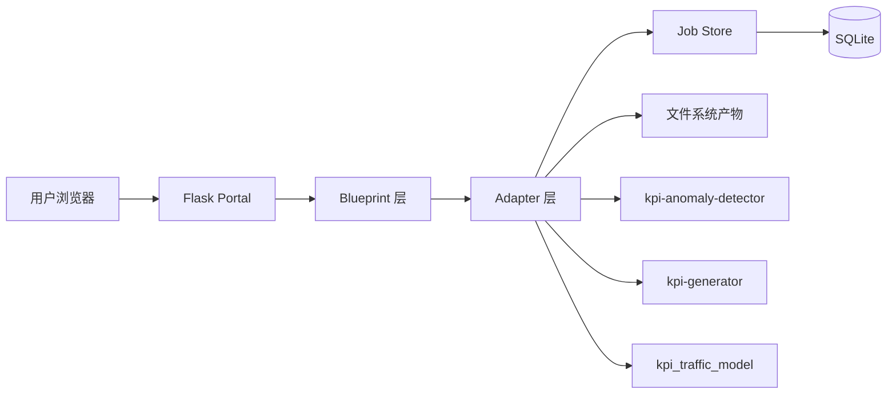
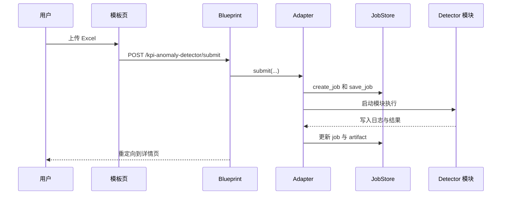

# KPI Portal 项目开发细节说明

## 1. 文档目的

本文档从代码结构角度解释 `kpi-dashboard`，重点回答：

- 项目按目录如何分层
- 每类职责落在哪些代码里
- 浏览器请求如何变成一个本地执行作业
- SQLite 和文件系统在其中如何参与

## 2. 项目定位

`kpi-dashboard` 是一个基于 Flask 的 KPI 编排外壳，它提供：

- 统一 Web 入口
- 多模块导航
- 统一 HTTP 接口层
- 面向兄弟仓库的 adapter 层
- Portal 侧 job 存储
- artifact 浏览与下载

当前接入的兄弟仓库：

- `kpi-anomaly-detector`
- `kpi-generator`
- `kpi_traffic_model`

## 3. 运行视图

## 4. 目录级解释

### `kpi-dashboard/`

- `app.py`：本地启动入口
- `wsgi.py`：生产 WSGI 入口
- `requirements.txt`：运行依赖
- `deploy/`：部署相关资源
- `docs/`：项目文档
- `instance/`：运行期数据目录和 SQLite
- `tests/`：测试代码
- `portal/`：实际应用包

### `portal/`

主要包含：

- `app_factory.py`：应用初始化、配置、蓝图注册、启动恢复
- `config.py`：环境变量驱动配置
- `blueprints/`：HTTP 控制层
- `adapters/`：模块集成层
- `contracts.py`：Portal 统一契约
- `schemas/`：输入 dataclass 和校验
- `services/`：基础设施服务
- `templates/`：服务端渲染页面
- `static/`：样式和静态文件
- `runners/`：更底层的执行辅助

### `blueprints/`

主要路由组：

- `portal.py`：首页和 `/healthz`
- `kpi_detector.py`：detector 列表、提交、校验、详情、重跑、取消、删除、产物
- `kpi_generator.py`：generator 列表、提交、详情、重跑、取消、删除、产物
- `kpi_traffic_model.py`：环境解析、提交、详情、删除、产物

### `adapters/`

核心职责：

- 把 Portal 输入转换为模块自己的执行请求
- 创建和更新 Portal job
- 把运行结果重新映射成页面可用的 artifact 和摘要

主要文件：

- `base.py`
- `kpi_detector.py`
- `kpi_generator.py`
- `kpi_traffic_model.py`

### `schemas/`

关键 dataclass：

- `PortalJobCommonFields`
- `PortalRuntimeOptions`
- `DetectorPortalInput`
- `GeneratorPortalInput`
- `GeneratorScoutPortalInput`
- `TrafficModelPortalInput`
- `InputValidationError`

### `services/`

#### `job_store.py`

负责：

- 运行目录初始化
- job 创建与更新
- SQLite 持久化
- events、links、artifacts 记录
- 列表、过滤、分页、删除

关键字段包括：

- `id`
- `module_key`
- `status`
- `created_at`
- `started_at`
- `completed_at`
- `input_path`
- `stdout_log_path`
- `stderr_log_path`
- `result_json_path`
- `report_html_path`
- `report_excel_path`
- `report_data_path`

#### `repo_registry.py`

负责把模块 key 映射到：

- 页面标题和摘要
- route 名称
- 仓库路径
- readme 路径
- 入口候选文件

### `templates/`

服务端渲染模板包括：

- `base.html`
- `home.html`
- `modules/kpi_detector.html`
- `modules/kpi_detector_job.html`
- `modules/kpi_generator.html`
- `modules/kpi_generator_job.html`
- `modules/kpi_traffic_model.html`
- `modules/kpi_traffic_model_job.html`

## 5. 端到端流程

### Detector 示例

## 6. 前后端边界

前端负责：

- 页面布局和导航
- 表单
- 过滤和表格
- 操作按钮
- 运行中自动刷新提示

后端负责：

- 路由
- 校验
- 编排
- 模块集成
- 持久化
- artifact 暴露

## 7. 数据库参与方式

Portal 的数据库是运行元数据存储，不是 KPI 业务数据仓库。

SQLite 主要存：

- job 主记录
- 生命周期事件
- 关联 job
- artifact 索引

大文件仍保存在文件系统。

## 8. 建议重建顺序

1. 配置与 app factory
2. job store
3. schema
4. adapter 基类
5. 先打通一个模块
6. 模板与下载链路
7. 启动恢复与部署包装

## 9. 结论

这个项目可扩展的关键，在于它把 HTTP、输入标准化、模块集成、持久化和 UI 渲染拆成了独立层次。