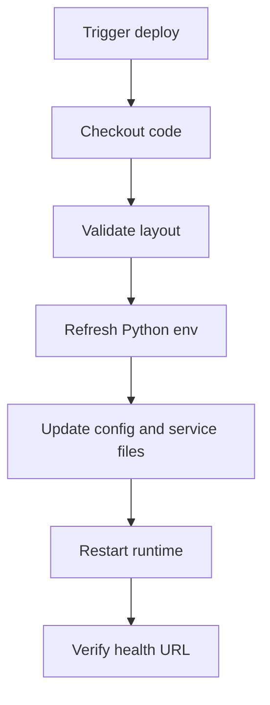
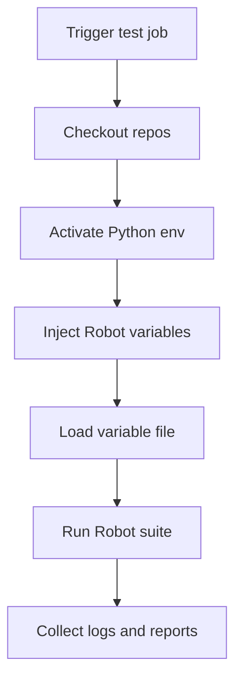

# Portal Jenkins vs robotws Jenkins

## 1. Purpose

This document explains the difference between Jenkins for the Portal project and Jenkins for `robotws`.

## 2. Short Answer

- `robotws` Jenkins is primarily a test execution scheduler
- Portal Jenkins is primarily a build, deployment, and service update pipeline

## 3. Positioning Difference

### Portal Jenkins

Focused on:

- pulling latest code
- validating deployment layout
- refreshing Python dependencies
- updating env vars and service files
- restarting gunicorn and nginx path
- verifying health URL

### robotws Jenkins

Focused on:

- selecting test line and Robot suite
- injecting build parameters
- loading testline configuration
- running Robot Framework on real environments
- collecting logs, xUnit, and business outputs

## 4. Operational Comparison

| Dimension | Portal Jenkins | robotws Jenkins |
| --- | --- | --- |
| Main goal | Build and deploy web service | Execute automated tests |
| Runtime target | Flask Portal service | Robot Framework run |
| Success definition | Service reachable | Test result produced |
| Primary artifact | Running app and deployment logs | Test evidence and reports |
| Unit of work | Release or update | Test run |

## 5. Input Difference

### Portal Jenkins inputs

- target server
- workspace root
- Python env path
- nginx and systemd settings
- env vars such as `KPI_SQLITE_PATH`
- deploy mode

### robotws Jenkins inputs

- test line name
- Robot suite path
- case name
- build URL or AF path
- related versions
- execution options
- variable file path

## 6. Workflow Difference

### Portal Jenkins

### robotws Jenkins

## 7. Infrastructure Difference

Portal side needs:

- Flask app
- gunicorn
- systemd
- nginx
- SQLite
- runtime directories

robotws side needs:

- Python environment
- Robot Framework
- TAF and related libraries
- real test line access
- testline configuration
- resource locking

## 8. Failure Meaning

Portal Jenkins failure usually means deployment or service availability problem.

robotws Jenkins failure may mean either:

- product regression
- environment instability
- execution infrastructure problem

## 9. Recommended Separation

Portal job families:

- build-portal
- deploy-portal-dev
- deploy-portal-test
- verify-portal-health

robotws job families:

- run-single-robot-case
- run-robot-suite
- run-nightly-regression
- rerun-failed-case

## 10. Core Conclusion

Portal Jenkins manages a running application service. `robotws` Jenkins manages automated test execution on real environments. They may share Jenkins as a platform, but they belong to different engineering domains.