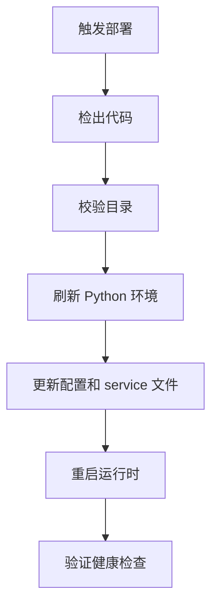
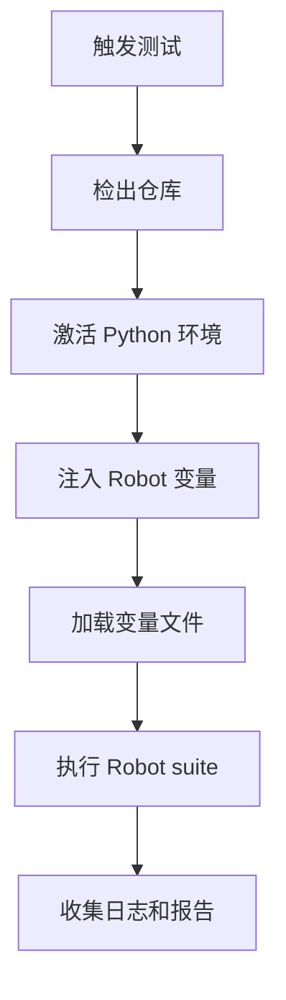

# Portal Jenkins 与 robotws Jenkins 对比

## 1. 文档目的

本文档说明 Portal 项目的 Jenkins 与 `robotws` 项目的 Jenkins 的本质差异。

## 2. 简短结论

- `robotws` Jenkins 的核心是测试执行调度
- Portal Jenkins 的核心是构建、部署和服务更新

## 3. 定位差异

### Portal Jenkins

主要关注：

- 拉取最新代码
- 校验部署目录
- 刷新 Python 依赖
- 更新环境变量和 service 文件
- 重启 gunicorn 和 nginx 路径
- 校验健康检查地址

### robotws Jenkins

主要关注：

- 选择 test line 和 Robot suite
- 注入 build 参数
- 加载 testline 配置
- 在真实环境上执行 Robot
- 收集日志、xUnit 和业务输出

## 4. 运行目标对比

| 维度 | Portal Jenkins | robotws Jenkins |
| --- | --- | --- |
| 主要目标 | 构建和部署 Web 服务 | 执行自动化测试 |
| 运行对象 | Flask Portal 服务 | Robot Framework 任务 |
| 成功标准 | 服务可访问 | 有测试结果输出 |
| 主要产物 | 运行中的应用和部署日志 | 测试证据与报告 |
| 工作单元 | 发布或更新 | 一次测试执行 |

## 5. 输入差异

### Portal Jenkins 输入

- 目标服务器
- 工作区根目录
- Python 环境路径
- nginx 和 systemd 配置
- 如 `KPI_SQLITE_PATH` 等环境变量
- 部署模式

### robotws Jenkins 输入

- test line 名称
- Robot suite 路径
- case 名称
- build URL 或 AF_PATH
- 相关版本
- 执行选项
- variable file 路径

## 6. 流程差异

### Portal Jenkins

### robotws Jenkins

## 7. 基础设施差异

Portal 侧需要：

- Flask
- gunicorn
- systemd
- nginx
- SQLite
- 运行目录

robotws 侧需要：

- Python 环境
- Robot Framework
- TAF 等依赖库
- 真实 test line 访问
- testline 配置
- 资源锁

## 8. 故障含义差异

Portal Jenkins 失败通常意味着部署失败或服务不可用。

robotws Jenkins 失败则可能表示：

- 产品回归
- 环境不稳定
- 执行基础设施异常

## 9. 建议分离方式

Portal 任务族：

- build-portal
- deploy-portal-dev
- deploy-portal-test
- verify-portal-health

robotws 任务族：

- run-single-robot-case
- run-robot-suite
- run-nightly-regression
- rerun-failed-case

## 10. 结论

Portal Jenkins 管的是持续运行的应用服务，`robotws` Jenkins 管的是面向真实环境的自动化测试执行。两者都基于 Jenkins，但属于不同工程域。