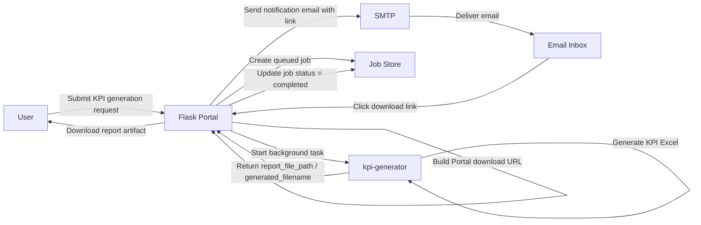
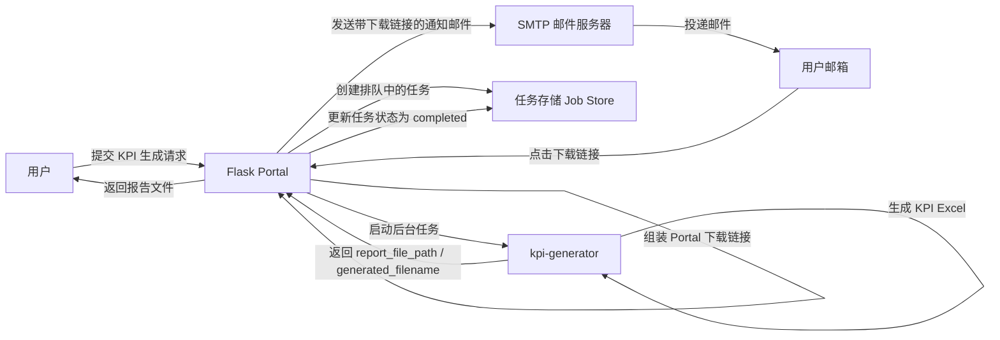
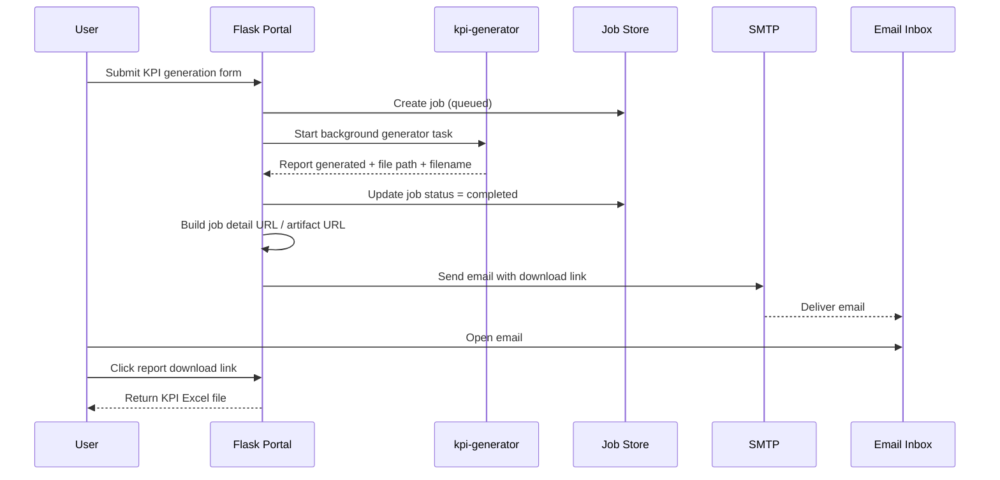
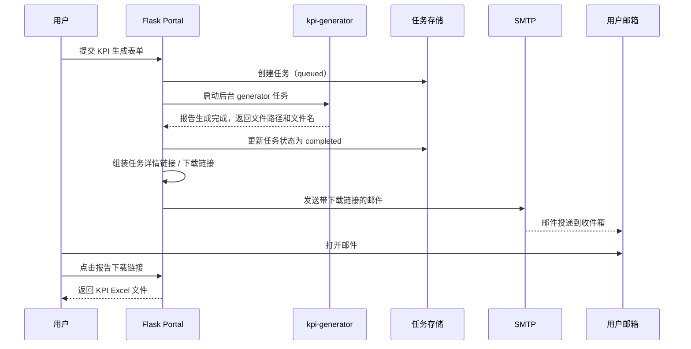

# KPI Generator 邮件通知流程说明

## 1. 目标

这里采用的不是“把 KPI Excel 直接作为附件发到邮箱”，而是：

- `kpi-generator` 先在 Portal 内完成报告生成
- Portal 保存任务状态和报告产物
- Portal 在任务完成后发一封通知邮件
- 邮件里提供任务详情页链接和报告下载链接
- 用户收到邮件后，再回到 Portal 下载 KPI 文件

这样做的核心好处是：

- Portal 继续作为统一结果入口
- 邮件只承担通知作用
- 不依赖附件大小限制
- 更适合后续权限控制和审计

## 2. 最小流程图



### 2.1 中文版流程图



## 3. 时序图



### 3.1 中文版时序图



## 4. 流程原理

### 4.1 提交任务

用户在 Portal 页面提交 `kpi-generator` 表单。

此时 Portal 做的事情是：

- 创建一个 generator job
- 把任务状态设为 `queued`
- 启动后台异步执行逻辑

这一阶段还不能发“结果邮件”，因为报告文件还没有生成。

### 4.2 后台生成 KPI 报告

Portal 后台调用 `kpi-generator` 执行实际生成动作。

生成完成后，Portal 能拿到这些关键信息：

- `job_id`
- `report_file_path`
- `generated_filename`
- `build`
- `environment`
- `scenario`

只有到这一步，系统才真正具备发送结果通知邮件的条件。

### 4.3 更新任务状态

当 generator 成功完成后，Portal 会把 job 更新成：

- `status = completed`
- `completed_at = ...`
- `report_file_path = ...`
- `generated_filename = ...`

这表示：

- Portal 内部已经有可下载的结果文件
- 对外可以开始提供下载链接

### 4.4 组装下载链接

Portal 不会把服务器本地路径直接发到邮箱，例如：

```text
/opt/xxx/outputs/report.xlsx
```

因为这种路径用户在浏览器里无法直接访问。

正确做法是把它转换成 Portal 的 HTTP 链接，例如：

- 任务详情页链接
- 报告 artifact 下载链接

典型形式如下：

```text
https://kpi.company.com/kpi-generator/jobs/<job_id>
https://kpi.company.com/kpi-generator/jobs/<job_id>/artifacts/report
```

### 4.5 Portal 调 SMTP 发通知邮件

Portal 使用配置好的 SMTP 服务器发送邮件。

邮件里通常包含：

- Job ID
- Build
- Environment
- Scenario
- 完成时间
- 任务详情页链接
- 直接下载链接

邮件的职责只是通知，不承担文件存储。

### 4.6 用户点击邮件链接回 Portal 下载

用户收到邮件后：

1. 打开邮件
2. 点击详情页或下载链接
3. 浏览器访问 Portal
4. Portal 返回 KPI Excel 文件

因此最终文件下载仍然由 Portal 统一提供。

## 5. 关键逻辑规则

### 5.1 邮件发送时机

必须在任务真正完成之后发送，而不是在 submit 时发送。

原因：

- submit 时只有 job，结果文件还不存在
- 只有 `status=completed` 后，下载链接才真正有效

### 5.2 发链接，不发本地路径

邮件里发的是 Portal URL，而不是服务器磁盘路径。

也就是说，邮件中应该出现：

```text
https://kpi.company.com/kpi-generator/jobs/<job_id>/artifacts/report
```

而不是：

```text
/opt/jenkins_robotframework/.../report.xlsx
```

### 5.3 邮件失败不应让主任务失败

如果 KPI 已经生成成功，但 SMTP 发送失败：

- generator job 仍应保持 `completed`
- 邮件状态应该单独记录为失败

原因是：

- KPI 生成是主任务
- 邮件通知是附加动作

不能因为通知失败，把已经生成成功的 KPI 报告误判成业务失败。

### 5.4 Portal 继续作为统一结果入口

这套方案的核心设计是：

- 报告仍然保存在 Portal 所管理的任务产物中
- 邮件只是给出访问入口
- 用户最终还是回到 Portal 查看和下载结果

## 6. 角色分工

- `kpi-generator`：负责真正生成 KPI Excel
- Flask Portal：负责创建 job、更新状态、托管 artifact、生成下载链接、发送通知邮件
- SMTP：负责把通知邮件投递到收件箱
- 用户邮箱：负责展示通知邮件
- 用户浏览器：负责点击链接并回 Portal 下载结果

## 7. 一句话总结

这套方案不是“把 KPI 文件发进邮箱”，而是：

- 先由 Portal 生成并托管 KPI 结果
- 再由 Portal 发一封包含下载链接的通知邮件
- 用户收到邮件后回到 Portal 下载 KPI 文件