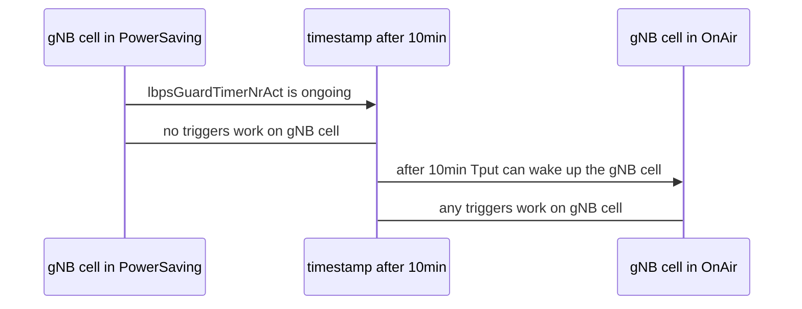

# CB010442
Feature corner: https://feature-corner.nsn-net.net/materials/clchjwwcs374404xkzix2h4shg

## CB010442_A#B1:
First step of execution is perform commissioning and activating features CB010442 and CB010443.
The next keyword is responsible for attenuating all LTE cells. It has been implemented to avoid the influence of any factors on the cell's state. Our goal is to make them sleep. We don't want to trigger them with any impulse.
Next, for a maximum 5min every 30sec we are checking if both LTE and 5G cell change status to Energy Saving.
Then, when 5G cell is in Energy Saving it must sleep for minimum 10min, because of parameter:
>lbpsGuardTimerNrAct = 10min

We can present it via diagram:

After 10min of waiting the Tput is performed and in the meantime, cplane is collected. When during the tput both LTE and NR cell wake up to OnAir state then tput is interrupted. Cplane logs are collected and verifying:
Each counter is map onto the number of occurences specific messages in pcap/pdml file. It means, that if message 'ENDCCellActivationRequest' occurs once then value of counter is equal 1:

| counter |message / value |
|----------------|-------------------------------|
|ENDC_CELL_ACT_REQ_X2  |`ENDCCellActivationRequest`|
|ENDC_CELL_ACC_X2 |`ENDCCellActivationResponse` |
|NR_CELL_ACT_MENB_REQ  |`ENDC_CELL_ACT_REQ_X2**` |
|NR_CELL_ACT_MENB_SUC  |`ENDC_CELL_ACC_X2**` |

>** The values for NR_CELL_ACT_MENB_REQ  and NR_CELL_ACT_MENB_SUC  are like for NR_CELL_ACT_MENB_REQ  and NR_CELL_ACT_MENB_SUC. In TA we didn't get any information about mapping messages for these two counters. We assumed (after contact with manual testers) that all values can be equal like:
1 == 1 == 1 == 1

but still counters:
| counter |message / value |
|----------------|-------------------------------|
|ENDC_CELL_ACT_REQ_X2  |`ENDCCellActivationRequest`|
|ENDC_CELL_ACC_X2 |`ENDCCellActivationResponse` |
are mapped and they define the proper value.
The last keyword 'Verify counters and pdml' just verify if the value of the counters is equal to the amount of messages in pdml file. If OK test PASS.

## CB010442_A#EC1:
The idea of this TC is to activate CB008951 (5G) and CB010443 (LTE) and try to wake up the gNB cell by the load from eNB site. The attempt of waking gNB cell up should fail, and counter M55110C00013 (Number of X2 ERROR INDICATION sent to LTE eNB) should increase. This counter is matched to the message 'ErrorIndication' in pcap in x2ap protocol.
Feature CB010442 is OFF - only CB008951,
Feature CB010443 is ON

Next, when the gNB cell is changed to power saving mode we perform Tput from LTE site (attempt of waking up the gNB cell by the load from eNB site). The ENDC should not be set up (in QXDM there should be only: RADIO_BEARER_CONFIG).
If there is more than one NR cell in the power-saving group then it is a good practice to attenuate all of them except the tested one (we don't wanna wake up a tested gNB cell with another gNB cell).
We decided to attenuate the rest of the gNB cells to stabilize the test-auto environment.

### STEPS:
1. Perform commissioning 10442 5G/LTE
2. Activate 8951 and 10443 based on commissioning from point 1
3. Attenuate cells 5G (except power saving) to MAX + degradate LTE signals by setting attenuator to -10dB
4. Wait for 5G energy saving cell is in power saving state
5. Perform Tput
6. Collect counter M55110C00013 and compare with number of 'ErrorIndication' occurrences
7. If counter value ==  num of occurrences --> PASS

### Additional info:
1. The counter M55112C00020 (ENDC_CELL_ACT_REQ_X2) should not increment
2. The counter M8095C0 (ENDC_CELL_ACT_REQ_PSGRP) should increment**

The gNB cell responded to 'ENDCCellActivationRequest' with 'ErrorIndication', not 'ENDCCellActivationResponse'. However, the request itself was completed, so the counter should increase.

**Remember that the clue of this test case is to check M55110C00013 counter.**

### PROBLEMS:
We had some problems during stabilizing the environment. The counter didn't collect. After pre-check, we decided to set the param:
> lbpsMinNumEndcCapUeNrAct = 0

and decrease radio conditions on LTE cells:
> port [13, 14, 15, 16] = -10dB

Then TC has been stabilized.
