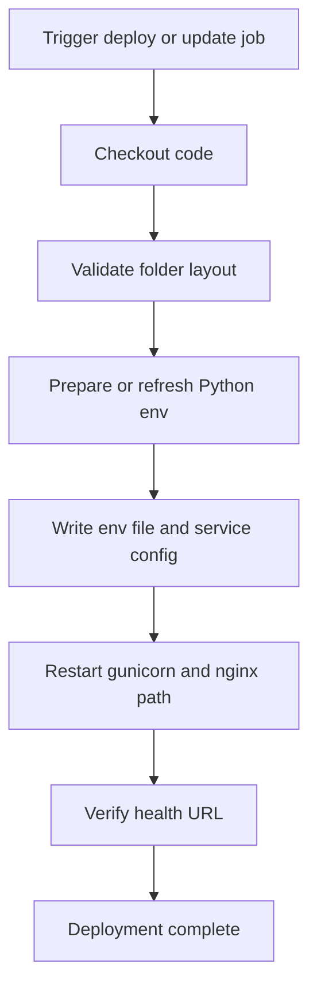
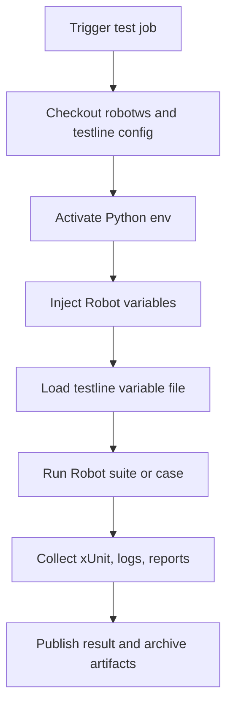

# Portal Jenkins vs robotws Jenkins

## 1. Document Purpose

This document explains the practical difference between:

- Jenkins used for the Portal framework project in `kpi_web_app`
- Jenkins used for the `robotws` automation test project

The two may both use Jenkins, but they solve very different problems.

## 2. Short Answer

The difference is this:

- `robotws` Jenkins is primarily a test execution scheduler
- `Portal` Jenkins is primarily a build, deployment, and service update pipeline

That is the core distinction.

## 3. Core Positioning Difference

## 3.1 `robotws` Jenkins positioning

The Jenkins flow around `robotws` is designed to:

- select a test line
- select a Robot suite or one test case
- inject build and runtime parameters
- load a test line configuration
- execute Robot Framework against real environments
- generate test logs, xUnit XML, and business outputs

So `robotws` Jenkins is execution-centric and environment-centric.

## 3.2 `Portal` Jenkins positioning

The Jenkins flow around the Portal project is designed to:

- pull the latest Portal code
- validate deployment layout
- install or refresh Python dependencies
- configure environment variables
- write or update service files
- restart gunicorn and nginx-related runtime
- verify the service URL

So Portal Jenkins is deployment-centric and service-centric.

## 4. Operational Goal Comparison

| Dimension | Portal Jenkins | robotws Jenkins |
| --- | --- | --- |
| Main goal | Build, deploy, update, and keep web service running | Execute automated test cases against real environments |
| Runtime target | Flask portal service | Robot Framework test execution |
| Success definition | Service starts and is reachable | Test case passes or fails with recorded outputs |
| Primary artifact | Running web app, logs, deployment state | Robot logs, xUnit XML, reports, screenshots, KPI outputs |
| Main unit of work | Service release or update | Test job or test case run |

## 5. Input Difference

## 5.1 Portal Jenkins typical inputs

Portal deployment Jenkins typically needs:

- target server
- workspace root
- Python virtual environment path
- nginx settings
- systemd service settings
- environment variables such as `KPI_SQLITE_PATH`, `KPI_DETECTOR_PYTHON`, URL prefix, ports
- deployment mode such as fresh deploy or update

These inputs are infrastructure and deployment oriented.

## 5.2 robotws Jenkins typical inputs

robotws Jenkins typically needs:

- test line name
- Robot suite path
- test case name
- AF_PATH or build URL
- target version
- related software versions
- branch markers or execution options
- log level
- variable file path

These inputs are test execution and environment oriented.

## 6. Workflow Difference

## 6.1 Portal Jenkins workflow

This workflow is about service lifecycle management.

## 6.2 robotws Jenkins workflow

This workflow is about test orchestration and evidence collection.

## 7. Infrastructure Difference

## 7.1 Portal side infrastructure

The Portal project requires service hosting infrastructure.

Typical components:

- Flask app
- gunicorn
- systemd service
- nginx reverse proxy
- TLS termination
- local runtime directories
- SQLite metadata database

This means Portal Jenkins is close to DevOps or release engineering.

## 7.2 robotws side infrastructure

robotws requires execution infrastructure rather than web hosting.

Typical components:

- Python virtual environment
- Robot Framework
- internal TAF and UTE libraries
- access to test line networks and devices
- testline configuration repository
- environment locks for real test lines

This means robotws Jenkins is close to test automation operations.

## 8. Artifact Difference

## 8.1 Portal Jenkins artifacts

Portal Jenkins mostly produces:

- deployment logs
- service status checks
- updated configuration files
- installed runtime state
- portal application logs

The final output is usually a running URL rather than a test report.

## 8.2 robotws Jenkins artifacts

robotws Jenkins mostly produces:

- `quicktest.xml`
- `debug.log`
- `output.xml`
- `log.html`
- `report.html`
- additional KPI Excel or business result files

The final output is a test result record plus execution evidence.

## 9. Database Usage Difference

Portal uses a database during runtime.

- SQLite stores Portal-side job metadata, events, links, and artifacts

robotws Jenkins generally does not rely on an app-owned database as its primary execution store.

- its center is runtime execution and artifacts
- persistence is more often file-based, Jenkins-based, or external-platform-based

So Portal Jenkins supports an application with persistent operational state, while robotws Jenkins primarily drives ephemeral test runs with archived outputs.

## 10. Failure Meaning Difference

## 10.1 Portal Jenkins failure meaning

If Portal Jenkins fails, it usually means one of these:

- service failed to build or start
- deployment path is wrong
- config or dependency mismatch exists
- reverse proxy or runtime is broken

This is a platform availability problem.

## 10.2 robotws Jenkins failure meaning

If robotws Jenkins fails, it may mean:

- a test case found a product regression
- environment is unstable
- test data is wrong
- execution infrastructure failed

This is not always a platform problem. It may be a product quality signal.

## 11. Suitable Usage Scenarios

## 11.1 Portal Jenkins is suitable for

- deploying new Portal versions
- updating dependencies
- refreshing environment configuration
- rolling out UI or adapter changes
- restarting and verifying the service
- promoting dev to test or prod environments

Typical users:

- backend developers
- DevOps engineers
- release engineers
- operations maintainers

## 11.2 robotws Jenkins is suitable for

- running one Robot case on demand
- running regression suites
- validating build quality on target environments
- collecting KPI and execution evidence
- testing on specific test lines

Typical users:

- test engineers
- CI operators
- validation teams
- release validation owners

## 12. Governance Difference

Portal Jenkins should focus on:

- deployment approval
- secret and config management
- rollback safety
- service uptime
- release traceability

robotws Jenkins should focus on:

- test line reservation and locking
- reproducible execution
- input parameter traceability
- result evidence retention
- isolation between runs

## 13. Recommended Separation in Practice

The two Jenkins categories should not be mixed into one job type.

Recommended separation:

### Portal job families

- build-portal
- deploy-portal-dev
- deploy-portal-test
- update-portal-prod
- verify-portal-health

### robotws job families

- run-single-robot-case
- run-robot-suite
- run-nightly-regression
- rerun-failed-testline-case
- collect-kpi-or-detector-followup

## 14. Final Summary

The simplest accurate statement is:

- Portal Jenkins manages a running web service product
- robotws Jenkins manages automated test execution against real environments

So they are both Jenkins-based, but they belong to different engineering domains.

Portal Jenkins is closer to application deployment and operations.

robotws Jenkins is closer to validation automation and CI test scheduling.
