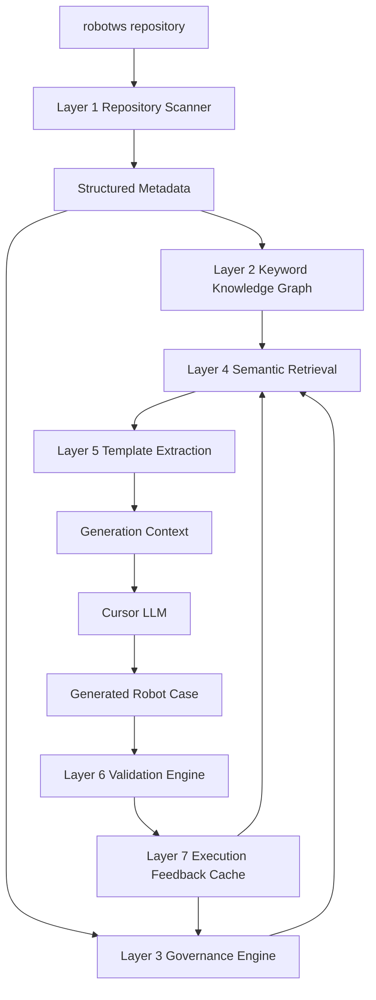

# RobotWS MCP 7-Layer Architecture Spec

本文档记录 `RobotWS MCP Server` 的长期架构方向。

当前项目不应只定位为 RobotWS 文本检索工具，而应演进为：

```text
RobotWS Test Knowledge Graph + Generation Context + Validation Engine
```

目标是让 Cursor/LLM 在生成 Robot Framework testcase 时，不只是看到相似文本，而是理解 SG6 测试工程中的 domain、resource boundary、keyword dependency、workflow state、template pattern 和验证规则。

## 1. 总体分层

```text
Layer 1: Repository Scanner
Layer 2: Keyword Knowledge Graph
Layer 3: Governance Engine
Layer 4: Semantic Retrieval
Layer 5: Template Extraction
Layer 6: Validation Engine
Layer 7: Execution Feedback Cache
```

推荐数据流：



## 2. Layer 1: Repository Scanner

### 2.1 Final Decisions

Layer 1 是 read-only fact collection layer。它负责把 `robotws` repository 中的 Robot Framework / Python source 转成可审计、可查询的 structured metadata records，供后续 graph、retrieval、governance、template extraction、validation 使用。

最终决策：

- Robot Framework source 使用官方 AST parser 作为唯一生产 parser：
  ```python
  from robot.api.parsing import get_model
  ```
- 不保留轻量 Robot parser 作为 fallback。单文件 AST parse 失败时记录 `ParseIssueRecord`，并继续扫描其他文件。
- Python source 使用 Python AST 作为静态 symbol index，不 runtime import module，不执行 Python code。
- Layer 1 只提取 direct logical actions 和 direct facts，不递归展开 call tree。
- SQLite 是当前阶段 structured metadata 主事实库；JSON export 只用于 debug、audit、scan summary 和复盘。

### 2.2 Scope

Layer 1 扫描 active profile 指定的 candidate scopes，并用 allowlist / confirmed case scope / allowed resource scope 标记可用边界。

Layer 1 负责输出：

- testcase、keyword、step、resource import、library import、variable、Python symbol、parse issue 等 facts。
- `site`、`domain`、`case_type`、`feature`、`is_allowed`、`allowed_source`、`exclude_reason` 等边界字段。
- source location，包括 `path`、`line_no`、`end_line_no`、`raw`。

Layer 1 不负责：

- semantic retrieval。
- recursive keyword graph traversal。
- common workflow / setup pattern 识别。
- LLM prompt 组装。
- generated testcase validation。
- Robot / Python runtime execution。
- TAF API 语义解释。

### 2.3 Record Model

Layer 1 输出的是 structured records，不是最终 prompt。

核心 record 类型：

```text
RobotFileRecord
TestCaseRecord
KeywordRecord
StepRecord
ResourceImportRecord
LibraryImportRecord
VariableRecord
PythonSymbolRecord
ParseIssueRecord
```

每类 record 都应保留基础边界字段：

```json
{
  "record_type": "testcase | keyword | step | resource_import | library_import | variable | python_symbol | parse_issue",
  "domain": "RRM | SISO | OAM | Common | Unknown",
  "is_allowed": true,
  "allowed_source": "feature_allowlist | confirmed_case_scope | allowed_resource_scope",
  "exclude_reason": ""
}
```

字段含义：

- `record_type` 表示 metadata 类型，例如 testcase、keyword、step、import、variable、Python symbol、parse issue。
- `domain` 表示业务/技术领域。testcase 从 path 推断；allowed common resource 下的 keyword 标记为 `Common`；无法可靠判断时为 `Unknown`。
- `is_allowed` 表示当前 profile 下该 record 是否允许进入 retrieval / generation context。
- `allowed_source` 只记录明确可用边界：`feature_allowlist`、`confirmed_case_scope`、`allowed_resource_scope`。
- `exclude_reason` 记录不可用原因；允许时为空字符串。

`TestCaseRecord` 示例：

```json
{
  "record_type": "testcase",
  "name": "5G_RRM_HO",
  "path": "testsuite/Hangzhou/RRM/RAN_PZ_HAZ_34/CB010767/CB010767_cases.robot",
  "site": "Hangzhou",
  "domain": "RRM",
  "case_type": "Feature",
  "feature": "CB010767",
  "is_allowed": true,
  "allowed_source": "feature_allowlist",
  "exclude_reason": "",
  "tags": ["CRT"],
  "setup_step_ids": ["step:..."],
  "teardown_step_ids": ["step:..."],
  "body_step_ids": ["step:..."],
  "keyword_sequence": [
    "10767_Case_SetUp",
    "CB009568-A_51_RedCap_UE_handover_from_TDD_cell_to_FDD_cell",
    "10767_Case_Teardown"
  ]
}
```

### 2.4 Parser Rules

Robot AST parser 负责识别 Robot syntax。Scanner 同时读取原始 source lines，并根据 AST node 的 `line_no` / `end_line_no` 回切 `raw`。

`raw` 只用于 traceability、debug parser、source reference；后续层真正学习的是 logical action sequence，而不是 Robot 表层包装写法。

例如：

```robot
[Setup]    Run Keywords
    ...    Run Keyword If    '${stream}'=='SBTS25R1'    Set Test Variable    ${update_params}    ${scf_update_params_9363_6}
    ...    AND    9363_D_Case_SetUp    framestructure=1208
```

Layer 1 应识别为：

```text
source statement:
- normalized_type: setup
- surface_keyword: Run Keywords
- raw: original multi-line setup statement

logical actions:
1. condition: '${stream}'=='SBTS25R1'
   keyword: Set Test Variable
   variables_input: ["${scf_update_params_9363_6}"]
   variables_output: ["${update_params}"]

2. keyword: 9363_D_Case_SetUp
   arguments:
     - kind: named
       name: framestructure
       value: 1208
```

`Run Keywords`、`AND`、`Run Keyword If` 属于 control wrapper / control flow，不是主要学习目标。`Set Test Variable` 和 `9363_D_Case_SetUp` 才是 setup logical actions。

Layer 1 只做 direct logical action extraction：

- testcase setup / teardown / body 记录直接 logical actions。
- keyword definition 记录自身 direct steps。
- 不把 `9363_D_Case_SetUp` 的内部步骤 inline 到 testcase record。
- 递归展开、依赖图、common setup pattern 识别属于 Layer 2 及之后。

`StepRecord` 建议字段：

```json
{
  "record_type": "step",
  "owner_type": "testcase | keyword",
  "owner_name": "string",
  "owner_id": "string",
  "normalized_type": "setup | teardown | step | keyword_step",
  "ordinal": 1,
  "keyword": "string",
  "arguments": [
    {
      "kind": "positional | named",
      "name": "string | null",
      "value": "string"
    }
  ],
  "condition": "string | null",
  "variables_input": ["${var}"],
  "variables_output": ["${var}"],
  "line_no": 1,
  "end_line_no": 1,
  "raw": "original Robot source span"
}
```

调用点参数和 keyword 定义参数分开记录：

- `StepRecord.arguments` 表示某一次调用实际传入的位置参数 / 命名参数。
- `KeywordRecord.arguments_schema` 表示 keyword 定义里的 `[Arguments]`、默认值和必填状态。
- 参数是否等于默认值、是否可省略，交给 Layer 2 / Layer 6 分析。

### 2.5 Boundary Rules

Layer 1 必须区分 scan scope 和 generation boundary。

可用边界：

- testcase 必须位于 feature allowlist 路径或 confirmed case scope，例如 `None_Feature_SG6`。
- keyword 可以来自 allowed resource scope，也可以来自 allowed feature path / confirmed case scope。
- allowed resource scope 下的 keyword 统一视为 `domain=Common`，表示可跨 allowed domain 使用。
- feature / `None_Feature_SG6` 目录下定义的 keyword 继承该目录 domain，例如 RRM 或 SISO。
- scan scope 只表示可以扫描；只有 `is_allowed=true` 的 record 才能进入后续 generation boundary。
- `domain=Unknown` 的 record 不应进入 generation context，除非后续 governance 明确放行。

Resource / Library 路径解析：

- 能通过当前 source path、Robot import path 和 profile scope 静态 resolve 的，记录 `resolved_path`。
- 动态路径、变量路径、无法确认的 import 不做猜测，记录 `ParseIssueRecord` 并保留原始 `raw`。

### 2.6 Python And Helper Reuse

Python AST parser 在 Layer 1 中只作为静态 symbol index，用于记录 Python library/helper 的 class、function、method、signature、docstring、imports、decorators、source location 和 boundary fields。

Python parser 不 runtime import module、不执行 Python code、不连接设备、不解析真实 TAF runtime object。

`PythonSymbolRecord` 应尽量标记 `python_impl_type`：

- `taf_dependent`：依赖 TAF library / namespace / 真实测试环境。
- `pure_python`：脱离 TAF 和设备连接，只使用 Python 语法、stdlib 或普通 helper 逻辑。
- `mixed`：同时包含 TAF dependency 和普通 Python helper 逻辑。
- `unknown`：静态 AST 无法可靠判断。

`KeywordRecord` 应尽量标记 `robot_impl_type`：

- `taf_dependent`：依赖真实测试环境 / 设备 / testline / TAF 底层能力的 keyword。这类 keyword 后续生成时需要可信复用。
- `pure_logic`：只做 Robot Framework / Python 语法层面的逻辑处理，例如字符串、列表、字典、CSV 检查、文件内容判断、简单变量转换。这类 keyword 不强制复用，LLM 可以按需求重新实现。
- `mixed`：同时包含 `taf_dependent` 步骤和 `pure_logic` 步骤。
- `unknown`：静态分析无法可靠判断。

可信复用不等于原封不动复制旧的 case-specific wrapper。它表示 taf-dependent 底层动作必须基于已有 Robot keyword、已有 Python wrapper、或 TAF MCP server 返回的权威 API 事实；允许重新封装新的 case setup/helper，但不允许凭空发明设备/TAF 操作。

Layer 1 只记录 direct/static signal。如果 keyword 间接调用了 `taf_dependent` keyword，是否向上传播 `taf_dependent` 属性交给 Layer 2 keyword graph 处理。

### 2.7 Storage

当前阶段使用 SQLite 作为 Layer 1 structured metadata 的主事实库。

SQLite 存储原则：

- 常用查询字段作为独立列，例如 `record_type`、`path`、`name`、`domain`、`is_allowed`、`allowed_source`、`line_no`。
- 完整 normalized record 可同时保存为 JSON payload，便于 schema 演进。
- 第一版采用全量 rebuild，优先保证 AST parsing、record schema、allowed boundary 准确；后续再基于 file hash / mtime / size 增加增量 scan。

JSON export 只用于 debug、audit、scan summary、复盘，不作为主查询数据库。

PostgreSQL、Neo4j、Qdrant / Milvus 不作为 Layer 1 MVP 依赖：

- 未来进入多用户服务器部署、复杂规则管理、长期执行反馈历史时，可评估 PostgreSQL 替换 SQLite 作为 metadata / rules store。
- 未来 Layer 2 图查询复杂到 SQLite / in-memory graph 难以支撑时，再评估 Neo4j；direct call facts 仍由 Layer 1 records 产生。
- 未来 Layer 4 做 semantic retrieval 时，可优先评估 Qdrant 存 embeddings；完整 metadata 仍回主事实库查询。

### 2.8 Implementation Strategy

Layer 1 v2 在现有 `robotws_mcp_server` repository 内实现，但走新的清晰模块路径。旧代码先保留，不作为新架构主路径，后续 v2 稳定后再决定清理。

建议实现策略：

- 同 repo 新建 Layer 1 v2 模块，避免在旧 lightweight parser 上补丁式修改。
- 复用现有 `config/profiles/`、allowlist、CLI / SQLite / docs 基础。
- 新 scanner 使用 AST parser + structured records + SQLite v2。
- 老 scanner / parser 暂时保留，用于参考和对照输出。
- 稳定 record id 使用 `record_type + path + name/owner + line_no` 生成，方便 `TestCaseRecord`、`KeywordRecord`、`StepRecord`、import record 之间互相关联；如果后续需要跨版本 diff，可再引入 source hash / content hash。

关键原则：

- 不只存原始文本。
- 不只做全文索引。
- 必须保留 AST 级结构、source path、line number、raw source span 和 boundary metadata。
- 必须提取 direct logical actions，避免把 `Run Keywords` / `AND` 这类表层 control wrapper 当作主要学习对象。
- 必须用 `is_allowed` / `allowed_source` / `exclude_reason` 表达当前 profile 的可用边界。

## 3. Layer 2: Keyword Knowledge Graph

### 3.1 Responsibility

Layer 2 是 deterministic keyword dependency graph layer。它只消费 Layer 1 structured metadata，不重新扫描 `robotws`，不重新 parse Robot source，也不做 semantic retrieval。

Layer 2 MVP 负责：

- 把 testcase、keyword、step、resource file、Python symbol、domain、feature 转成可遍历 graph。
- 解析每个 `StepRecord.keyword` 实际调用的 Robot keyword、Python symbol、TAF library keyword、Robot built-in 或 excluded target。
- 保留调用顺序、参数、condition、source location 和 resolution evidence。
- 沿已解析调用图传播 `taf_dependent` / `mixed` / `pure_logic` 信号。
- 为 Layer 4 retrieval、Layer 5 template extraction 和 Layer 6 validation 提供可解释 graph query。

Layer 2 MVP 不自动推断完整测试状态机。`PRODUCES_STATE`、`CONSUMES_STATE`、`NEXT_POSSIBLE`、`FORBIDDEN_BEFORE`、`FORBIDDEN_AFTER` 放到 Layer 2.5，在 keyword graph 稳定后再基于人工规则或半自动规则沉淀。

### 3.2 Inputs From Layer 1

Layer 2 的事实来源是 Layer 1 SQLite records：

```text
TestCaseRecord
KeywordRecord
StepRecord
ResourceImportRecord
LibraryImportRecord
PythonSymbolRecord
ParseIssueRecord
```

默认只构建 `is_allowed=true` 的 generation boundary graph。Debug / audit mode 可以读取 excluded records，但 excluded records 不应进入 generation context。

### 3.3 Graph Node Model

第一版节点类型：

```text
testcase
keyword
step
resource_file
python_symbol
domain
feature
```

每个节点保留：

```json
{
  "node_id": "string",
  "node_type": "testcase | keyword | step | resource_file | python_symbol | domain | feature",
  "record_id": "Layer 1 record id",
  "name": "string",
  "path": "string",
  "domain": "RRM | SISO | Common | Unknown",
  "feature": "string | null",
  "is_allowed": true,
  "impl_type": "taf_dependent | pure_logic | unknown"
}
```

`step` 是独立节点，因为一次 keyword 调用本身包含重要上下文，例如 `ordinal`、`normalized_type`、`arguments`、`condition`、`variables_input`、`variables_output`、`line_no` 和 `raw`。同一个 keyword 可以在不同 testcase / keyword 中以不同参数调用，不能只用 `caller -> callee` 丢掉调用点信息。

### 3.4 Graph Edge Model

第一版边类型：

```text
HAS_STEP
CALLS
DEFINED_IN
IMPORTS_RESOURCE
IMPORTS_LIBRARY
BELONGS_TO_DOMAIN
BELONGS_TO_FEATURE
```

推荐结构：

```text
testcase / keyword -> HAS_STEP -> step -> CALLS -> keyword / python_symbol / taf_library_keyword
```

`CALLS` 边必须保留 resolution metadata，例如 `resolution_status`、`callee_record_id`、`candidates`、`reason` 和 import evidence path。

### 3.5 Keyword Resolution

`StepRecord.keyword` 是调用文本，不等于唯一 keyword 定义。Layer 2 负责把每个 step call 尽量解析成明确 callee。

Resolution 状态：

```text
resolved
python_symbol
taf_library_keyword
library_keyword
builtin
control_keyword
excluded
```

Resolution 优先级：

1. 显式 namespace 调用，例如 `ResourceAlias.Keyword Name` 或 `LibraryAlias.Keyword Name`。
2. 当前文件内 keyword。
3. 当前文件 direct resource imports。
4. 当前文件 resource import closure，例如 resource A import resource B，resource B 再 import resource C。
5. allowed resource scope 内唯一匹配 keyword。
6. imported library / local Python symbol。
7. Robot Framework built-in / known control keyword。
8. excluded。

如果一个调用在可见范围内有多个候选，标记为 `excluded`，保留候选列表用于 debug，不为了让图完整而猜，也不进入 generation context。

在 RobotWS allowed boundary 内，如果一个 step call 既无法解析到 Robot keyword，也无法解析到本地 Python symbol / explicit library import，但它是 namespace-style 调用、plain-name TAF/device 操作或明显底层执行调用，应默认归类为 `taf_library_keyword`，而不是普通 `excluded`。例如：

```robot
csn.execute
coam.reset_unit
coam.get_active_alarms
coam_parameter.perform_scf_delta_commission
AlarmWatchdog.add_allow_alarms
connection_alias_store.Connect to Common Unit Master
Connect to Common Unit Master
AT Operation
COAM Navigate to login page via webUI
Start L3 Call And Verify Throughput
702 Case SetUp For UTE
702 Case TearDown For UTE
Common Case TestLine Setup
```

这类结果应标记：

```json
{
  "resolution_status": "taf_library_keyword",
  "library_kind": "taf",
  "impl_type": "taf_dependent",
  "reason": "TAF/device-like call not resolved to local Robot/Python definition; treated as TAF library keyword under RobotWS allowed boundary"
}
```

普通 unknown call 如果不命中 TAF/device fallback pattern，应标记为 `excluded`，不进入 generation context，也不递归展开。

### 3.6 TAF Dependency Propagation

Layer 1 只记录 direct/static signal。Layer 2 沿 `CALLS` 图传播 TAF dependency：

- `PythonSymbolRecord.python_impl_type=taf_dependent` 是底层 TAF source。
- `taf_library_keyword` 是 TAF dependency evidence，即使无法静态定位具体 Python function。
- Layer 2 不持久化 `mixed` implementation type。为了生成安全，只要 keyword 直接或间接调用 TAF-dependent target，该 keyword 就升级为 `taf_dependent`。
- `pure_logic` 只用于 resolved call graph 中没有 TAF evidence 的 keyword / testcase。
- 如果存在 excluded calls，导致无法安全判断是否依赖 TAF，则标记为 `unknown` 并保留原因。
- Testcase 继承 setup / body / teardown 调用链的 dependency summary。
- Propagation 必须防 cycle，并保留 evidence path，例如 `testcase -> keyword -> keyword -> taf_library_keyword`。

### 3.7 Query Tools

Layer 2 对外工具按 LLM 的查询动作设计，不暴露内部小函数。

第一版建议工具：

#### `get_testcase_graph`

用途：查看一个 testcase 的 setup / body / teardown 调用图，让 LLM 理解旧 testcase 的真实执行结构。

输入：

```json
{
  "testcase_name_or_id": "[1]02_CB009275_Feature_Enable_with_Fault_1932_actived",
  "depth": 2
}
```

输出应按 testcase 结构组织，并包含 step resolution 和 TAF dependency summary：

```json
{
  "testcase": "...",
  "setup": [],
  "body": [
    {
      "step": "02_CB009275_Feature_Enable_with_Fault_1932_actived",
      "called_target": "keyword:...",
      "resolution_status": "resolved",
      "children": [
        {
          "step": "Connect to RU With Allocated IP",
          "called_target": "keyword:...",
          "resolution_status": "resolved"
        },
        {
          "step": "csn.execute",
          "called_target": "taf_library_keyword:csn.execute",
          "resolution_status": "taf_library_keyword"
        }
      ]
    }
  ],
  "teardown": [],
  "taf_dependency": {
    "impl_type": "taf_dependent",
    "evidence_paths": ["..."]
  }
}
```

#### `get_keyword_graph`

用途：查看某个 keyword 的下游调用，或反向查看哪些 testcase / keyword 调用了它。

输入：

```json
{
  "keyword_name_or_id": "Connect to RU With Allocated IP",
  "direction": "downstream",
  "depth": 2
}
```

`direction` 支持：

```text
downstream: 当前 keyword 调用了谁
upstream: 哪些 testcase / keyword 调用了当前 keyword
```

用途场景：

- 复用 keyword 前先看它内部是否 TAF-heavy。
- 查一个 common keyword 被哪些 feature case 使用。

#### `resolve_keyword_call`

用途：解释某一个 step call 为什么解析成某个 called target，主要用于 debug excluded / wrong resolution。

输入：

```json
{
  "owner_id": "keyword:...",
  "step_id": "step:..."
}
```

输出：

```json
{
  "called_name": "Connect to RU With Allocated IP",
  "resolution_status": "resolved",
  "called_target": "keyword:...",
  "reason": "resolved through resource import closure",
  "import_evidence": [
    "CB009275_common.robot -> SG6/Resources.robot -> coam_siso_common.robot"
  ],
  "candidates": []
}
```

#### `explain_taf_dependency`

用途：解释某个 testcase / keyword 为什么是 `taf_dependent`，帮助生成阶段判断哪些 keyword 必须可信复用，不能让 LLM 自己发明。

输入：

```json
{
  "record_id": "keyword:..."
}
```

输出：

```json
{
  "impl_type": "taf_dependent",
  "evidence_paths": [
    [
      "02_CB009275_Feature_Enable_with_Fault_1932_actived",
      "Connect to RU With Allocated IP",
      "csn.execute"
    ]
  ]
}
```

#### `find_keyword_callers`

用途：找某个 keyword 在哪些 testcase / keyword 中被用过，用来获取真实用法 example。

输入：

```json
{
  "keyword_name": "Connect to RU With Allocated IP",
  "domain": "SISO",
  "feature": "CB009275_AEHC",
  "limit": 20
}
```

#### `get_unresolved_calls`

用途：列出 excluded calls，帮助调试 Layer 1 / Layer 2 graph quality。该工具主要用于调试，不一定进入普通生成流程。

输入：

```json
{
  "domain": "SISO",
  "feature": "CB009275_AEHC",
  "status": "unresolved",
  "limit": 50
}
```

设计原则：

- MCP tools 按 LLM 真实问题设计，不暴露内部实现细节。
- 不暴露 `get_node`、`get_edge`、`get_resolution_row`、`get_import_closure` 这类内部工具。
- 第一版工具回答五类问题：这个 testcase 怎么展开、这个 keyword 怎么展开、这个调用为什么这么解析、这个 keyword 为什么是 TAF-dependent、哪里还有 unresolved。

### 3.8 Storage

Layer 2 MVP 使用 SQLite graph tables + in-memory traversal 的混合方式：

- SQLite 持久化 nodes、edges、resolution result 和 dependency summary，便于 debug、audit 和测试。
- 查询时从 SQLite 拉取相关子图，在内存中做 depth traversal、cycle detection 和 summary assembly。
- 不引入 Neo4j；未来图查询复杂到 SQLite / in-memory 难以支撑时再评估 graph DB。

Layer 2 使用独立 SQLite index，例如：

```text
data/indexes/robotws_layer2_graph.sqlite3
```

Layer 1 是事实采集层，Layer 2 是派生图层。Layer 2 可以随时从 Layer 1 rebuild；resolution 规则变化时不应污染 Layer 1 原始 records。

第一版表：

#### `layer2_nodes`

存 graph nodes。

常用列：

```text
node_id
node_type
record_id
name
path
domain
feature
is_allowed
impl_type
data
```

`data` 保存完整 JSON payload；`impl_type` 只使用 `taf_dependent | pure_logic | unknown`。

#### `layer2_edges`

存 graph edges。

常用列：

```text
edge_id
edge_type
source_node_id
target_node_id
source_record_id
target_record_id
step_id
ordinal
resolution_status
data
```

`CALLS` edge 可以指向真实 `keyword` / `python_symbol` node，也可以指向 synthetic target，例如 `taf_library_keyword:csn.execute`。Synthetic target 没有 Layer 1 `target_record_id`，但仍应作为 graph target 保留。

#### `layer2_resolution_results`

专门存 keyword resolution 结果，是 `resolve_keyword_call` 的主要查询来源。

常用列：

```text
step_id
owner_id
called_name
normalized_called_name
resolution_status
called_target_node_id
called_target_record_id
library_kind
reason
candidates_json
import_evidence_json
data
```

Resolution 单独成表是为了 debug 和质量评估：需要解释某个 step 为什么解析到某个 target、通过哪条 resource import closure、有哪些候选、为什么 excluded。

#### `layer2_dependency_summary`

存 TAF dependency propagation 结果。

常用列：

```text
record_id
node_id
node_type
impl_type
has_taf_dependency
evidence_paths_json
unknown_reasons_json
data
```

#### `layer2_build_info`

记录本次图构建信息。

常用列：

```text
key
value
```

建议保存：

```text
source_layer1_db_path
profile
build_time
layer2_schema_version
layer1_record_count
node_count
edge_count
resolution_status_counts
dependency_summary_counts
```

第一版 rebuild 策略是全量 rebuild：

```text
read Layer 1 SQLite
clear Layer 2 tables
build nodes
build edges
run keyword resolution
run TAF dependency propagation
write summaries
```

暂不做增量更新。Layer 1 稳定且性能成为问题后，再考虑基于 file hash / mtime 的增量图构建。

### 3.9 Future Layer 2.5 State Machine

测试工程本质上有状态机语义，但不在 Layer 2 MVP 自动推断。Layer 2.5 在 keyword graph 稳定后扩展：

```text
REQUIRES
PRODUCES_STATE
CONSUMES_STATE
NEXT_POSSIBLE
FORBIDDEN_BEFORE
FORBIDDEN_AFTER
USES_EVIDENCE
USES_CLEANUP
```

状态机规则应基于已解析调用链、真实 testcase pattern 和人工确认规则沉淀，不依赖 keyword name 自由猜测。

## 4. Layer 3: Governance Engine

### 4.1 Responsibility

Layer 3 是 deterministic governance layer。它不发现事实，不重新 parse source，不重新构图；它只把 Layer 1 / Layer 2 facts 放到当前 profile 下评估，并输出可解释的 `allow | deny | warn` 决策。

Layer 3 负责：

- 在 context 进入 Layer 4 retrieval / generation context 前过滤不可用事实。
- 在生成后验证阶段重新检查 generated Robot case。
- 执行 profile、domain、feature、resource、keyword、TAF usage 和 style rules。
- 为每个 deny / warn 提供 `rule_id`、`severity`、`reason` 和 `evidence`。

Layer 3 不依赖 LLM 自觉遵守边界；也不能 silently drop context。

### 4.2 Decision Model

第一版 decision 只使用：

```text
allow
deny
warn
```

`needs_user_confirmation` 暂不进入 MVP。需要用户判断的场景先通过 `warn` / filtered summary 表达；明确不可进入 generation context 的内容用 `deny`。

统一决策结构：

```json
{
  "decision": "allow | deny | warn",
  "rule_id": "taf_usage.grounded_direct_or_new_wrapper",
  "severity": "info | warning | error",
  "reason": "string",
  "evidence": {}
}
```

### 4.3 Context Governance

Retrieval / generation context 前必须执行：

- `is_allowed=false` 的 Layer 1 record deny。
- Layer 2 `resolution_status=excluded` deny。
- `domain=Unknown` deny。
- profile 不匹配的 domain / feature deny。
- allowed `taf_dependent` keyword 可以进入 context，但必须带 evidence path。
- `builtin` / `control_keyword` 可以保留调用事实，但不作为业务推荐核心。
- `excluded` 不进入 generation context，也不递归展开。

### 4.4 Direct TAF Usage Governance

Layer 3 不禁止 direct TAF usage。它要求 direct TAF usage 必须被 SG6 RobotWS evidence 和权威 TAF MCP documentation 共同支撑。

原则：

```text
Direct TAF usage is allowed when grounded by SG6 RobotWS evidence and authoritative TAF MCP documentation. Existing SG6 wrappers are preferred, but new Robot Framework wrappers are allowed when they follow SG6-proven TAF library choice, parameter conventions, setup/teardown expectations, and cleanup patterns.
```

Layer 3 判断：

- 这个 TAF 用法有没有 SG6 RobotWS 证据。
- 这个 API 有没有 TAF MCP 权威文档。
- 这个新 wrapper 是否沿用了 SG6 的底层库选择和参数模式。
- setup / teardown / cleanup 是否符合 SG6 日常模式。

允许场景：

- 有现成 SG6 Robot keyword wrapper，直接复用。
- 没有完全现成 wrapper，但 SG6 有相似 wrapper，TAF MCP 有对应 API 文档，且新 RF wrapper 沿用 SG6-proven library choice、parameter conventions、setup / teardown expectations 和 cleanup patterns。

拒绝场景：

- 没有 SG6 RobotWS evidence。
- 没有 TAF MCP 权威文档。
- TAF MCP 有多个候选 API，但 SG6 evidence 不能判断该选哪个。
- 依据来自 excluded feature / resource。
- 底层库选择、参数模式、setup / teardown 或 cleanup pattern 与 SG6 证据冲突。

### 4.5 Generated Case Validation

生成后检查第一版包括：

- 是否引用 `excluded` keyword / resource。
- 是否使用 forbidden SG/site resource，例如 SG1 / SG11。
- 是否缺少 profile required fields，例如 `[Documentation]`、`[Tags]`、`[Setup]`、`[Teardown]`。
- 是否命中 profile negative patterns。
- TAF usage 是否满足 `4.4 Direct TAF Usage Governance`。

### 4.6 Query Tools

第一版工具按 LLM query action 设计：

```text
filter_generation_context(candidate_ids, profile)
validate_generated_robot(robot_text, profile)
explain_allowed_boundary(record_id_or_path, profile)
evaluate_taf_usage(operation, evidence)
```

不暴露内部 rule function。

## 5. Layer 4: Semantic Retrieval

功能：

- 提升召回质量。
- 避免 Robot Framework 长 testcase 全文 embedding 导致语义被稀释。

实现方式：

- 不只 embedding 整个 testcase。
- 对不同语义维度分别 embedding：
  - testcase objective
  - feature summary
  - keyword sequence
  - setup flow
  - teardown flow
  - failure handling
  - evidence collection
  - tags
  - domain
  - KPI / traffic / UE / PA 操作摘要
- Retrieval 采用混合策略：
  - metadata filter
  - graph traversal
  - similar case search
  - keyword usage examples
  - vector retrieval
  - governance filter

关键原则：

- Vector search 是补充，不是唯一检索方式。
- Retrieval 的输入必须先经过 domain/profile/allowlist 过滤。
- Retrieval 结果要能解释来源和匹配原因。

## 6. Layer 5: Template Extraction

功能：

- 从已有 case 中抽取可复用 operation / workflow pattern。
- 返回推荐骨架，而不是只返回相似 testcase 或 keyword 名字。

实现方式：

- 从 testcase AST、keyword graph、resource graph 中识别常见 operation pattern。
- 对每类 domain / operation 建立 workflow skeleton。
- 返回：
  - recommended skeleton
  - required steps
  - optional steps
  - forbidden order
  - reference cases
  - recommended keywords per step

示例 L3 call pattern：

```text
setup
-> prepare UE
-> attach
-> DL traffic
-> UL traffic
-> check throughput
-> stop traffic
-> detach
-> teardown
```

示例 RRM handover pattern：

```text
prepare source cell
-> prepare target cell
-> prepare UE
-> start Wireshark
-> trigger handover
-> verify UE on target cell
-> check KPI / counter
-> stop capture
-> restore parameters
-> teardown
```

关键原则：

- LLM 应在正确骨架上填细节，而不是从零拼 keyword。
- Template 不应硬编码为唯一答案，应提供候选骨架和可替换节点。

## 7. Layer 6: Validation Engine

功能：

- LLM 生成 Robot testcase 后，先由 MCP 做静态验证。
- 不要直接把未经检查的 case 交给用户。

实现方式：

- 对 generated Robot text 再次执行 Robot Framework AST parse。
- 检查：
  - Robot syntax 是否可解析。
  - required sections 是否存在。
  - `[Documentation]`、`[Tags]`、`[Setup]`、`[Teardown]` 是否完整。
  - keyword 是否存在。
  - resource import 是否缺失。
  - resource 是否允许。
  - keyword 参数是否接近真实调用样例。
  - setup/teardown 是否合理。
  - domain 是否一致。
  - 是否违反 forbidden sequence。
  - 是否缺少 evidence / cleanup / failure handling。
  - 是否调用其他 SG resource。
  - 是否命中 known bad pattern。

输出：

```json
{
  "passed": false,
  "errors": [
    "Unknown keyword: Attach UE Without Prepare"
  ],
  "warnings": [
    "No evidence collection keyword found for handover testcase."
  ],
  "suggestions": [
    "Use reference keyword sequence from CB010767 handover cases."
  ]
}
```

关键原则：

- Validation report 应结构化，便于 Cursor 根据报告自动修正。
- 静态验证不替代真实测试线执行，但能提前挡住大量明显错误。

## 8. Layer 7: Execution Feedback Cache

功能：

- 把真实执行结果和失败经验反哺到生成系统。
- 支持未来 self-healing 和稳定性优化。

实现方式：

- 后续接入：
  - Jenkins logs
  - Robot Framework output
  - Allure report
  - CI result
  - failure classification
  - testline metadata
- 缓存和统计：
  - 哪类 case 经常 fail。
  - 哪些 keyword 不稳定。
  - 哪些 setup/teardown pattern 成功率高。
  - 哪些生成模式容易缺 dependency。
  - 哪些 TL/UE/PA/KPI 组合容易失败。
  - 哪些失败是环境问题，哪些是 case 逻辑问题。

用于：

- retrieval ranking
- template selection
- validation warning
- flaky keyword avoidance
- self-healing suggestion
- future RCA integration

关键原则：

- Layer 7 不是 MVP 必须立即完成。
- 但架构上要预留，因为它决定系统能否长期变强。

## 9. Domain Model

Domain 应作为一等维度，而不是只用 path 字符串推断。

推荐 metadata：

```text
team: SG6
site: Hangzhou
domain: RRM | SISO | TMO | OAM | ...
case_type: Feature | TMO | Common | Resource
feature: CB009363 | None_Feature_SG6 | ...
ownership_status: confirmed | excluded
```

用途：

- Retrieval filter。
- Governance rule。
- Template selection。
- Validation boundary。
- Future feedback analysis。

注意：

- 当前实现已有 `area=RRM/SISO` 和 `case_type=Feature/TMO` 的雏形。
- 后续应升级为更通用的 `domain` 模型，支持 OAM 等新增 domain。

## 10. 与当前实现的关系

当前已实现或部分实现：

- SQLite structured index。
- 轻量 Robot parser。
- Python symbol parser。
- SG6 allowlist-only ownership。
- profile-based retrieval boundary。
- MCP tools。
- local query CLI。
- local HTTP Knowledge API。
- basic style validation。

当前不足：

- 尚未使用 Robot Framework 官方 AST parser。
- Keyword graph / resource graph 还不完整。
- Governance 目前主要是 allowlist/path boundary，还不是规则引擎。
- Semantic retrieval 还没有多维 embedding。
- Template extraction 只有初步 skeleton，还没有 operation pattern mining。
- Validation 仍偏浅层，还没有 dependency analysis。
- Execution feedback cache 尚未实现。

## 11. 推荐后续优先级

正式服务器部署前，建议优先补强核心理解能力：

1. 引入 Robot Framework AST Parser。
2. 建立更完整的 testcase / keyword / resource metadata schema。
3. 建立 keyword index、resource graph、call graph。
4. 把 `area + case_type` 升级为 `team + site + domain + case_type + feature`。
5. 抽象 Governance Engine，替代散落在检索逻辑里的 path-only filter。
6. 升级 generation context，返回 keyword sequence、reference cases、resource graph hints 和 template skeleton。
7. 增加 generated case AST validation 和 dependency analysis。
8. 本地 API 验证通过后，再进入 Docker Compose + Jenkins + Nginx 部署。

Layer 4/5/6 可以逐步增强；Layer 7 可在服务器部署和日志接入后再展开。

## 12. 知识闭环

生成质量提升不来自 MCP 自动训练 LLM，而来自知识闭环：

```text
Cursor 生成 Robot case
-> 用户 review / 修改
-> 目标环境验证
-> 高质量 case 合入 robotws
-> server git pull robotws
-> rebuild index / graph / embeddings
-> Knowledge API 返回更好的 context
-> 下一次生成更接近需求
```

闭环沉淀对象：

- 高质量 testcase。
- 稳定 keyword sequence。
- domain template。
- validation rules。
- failure feedback。
- flaky keyword blacklist / warning。

这一闭环是 `RobotWS MCP Server` 长期变强的基础。
