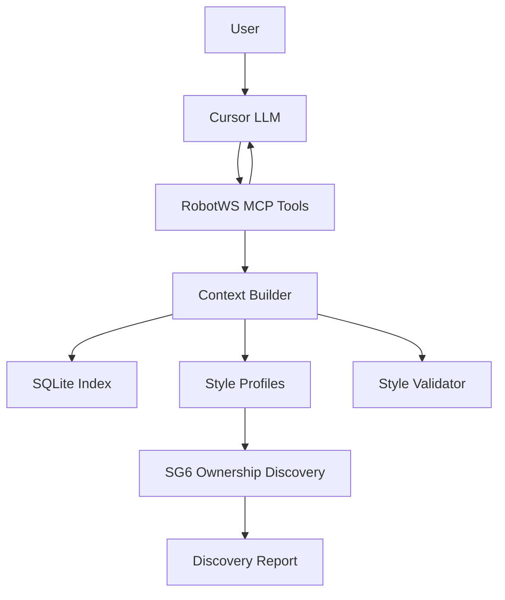

# RobotWS MCP Architecture

## MVP Positioning

The MVP is a read-only context builder for Cursor.

- MCP performs indexing, retrieval, profile selection, context assembly, and style validation.
- SG6 indexing starts from `Hangzhou_SG6_Common`, then applies ownership discovery before cases are used as style examples.
- Cursor LLM performs natural-language reasoning and Robot testcase drafting.
- The MCP does not call LLM services by default.

## Flow

## Future AI Extension

Provider interfaces are reserved under `src/robotws_mcp/providers`.

- `AiProvider`
- `EmbeddingProvider`
- `RerankerProvider`
- `WorkflowProvider`

The default provider is `NoopAiProvider`. Future implementations can call Insights Fusion, OpenAI-compatible APIs, or an internal LLM service while keeping `context_only` as the safe default.
