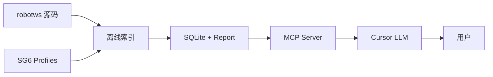
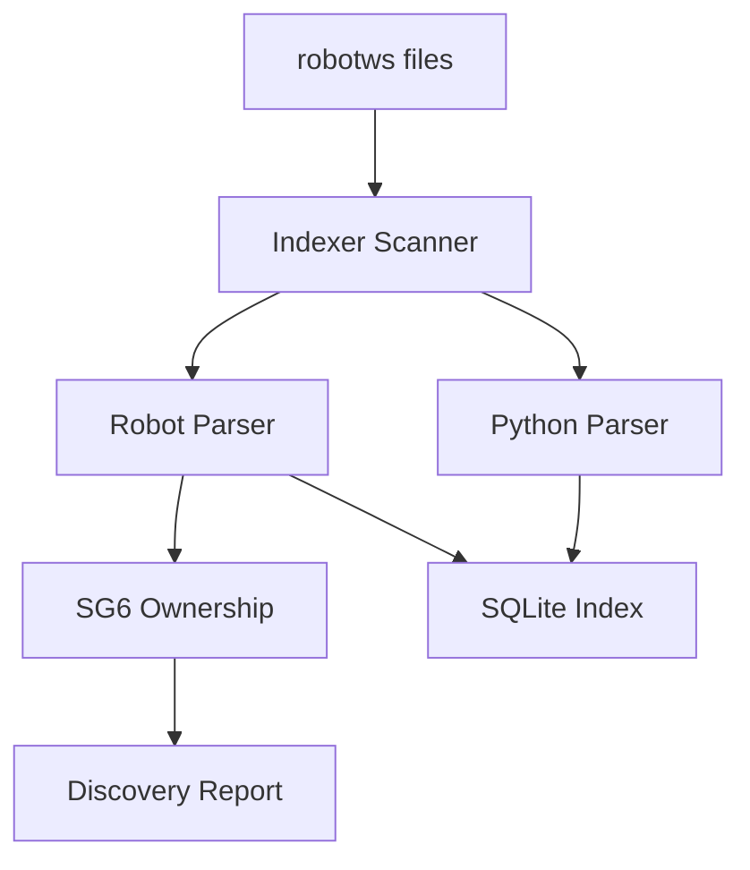
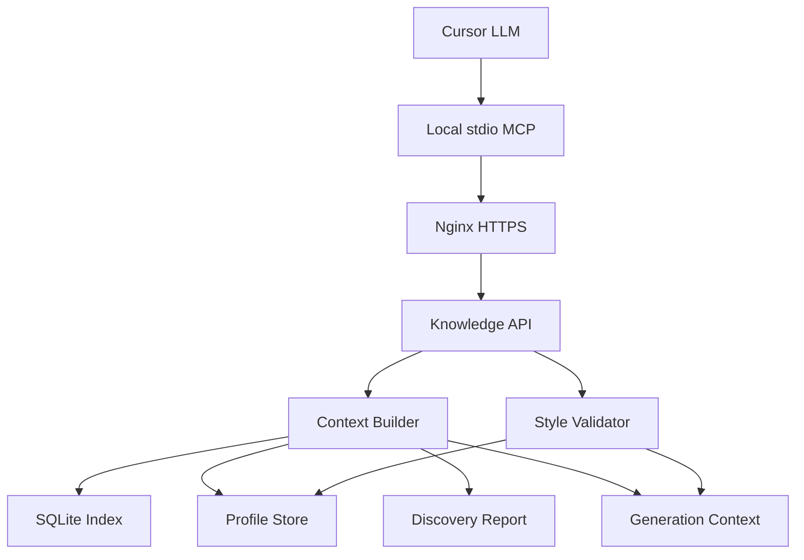
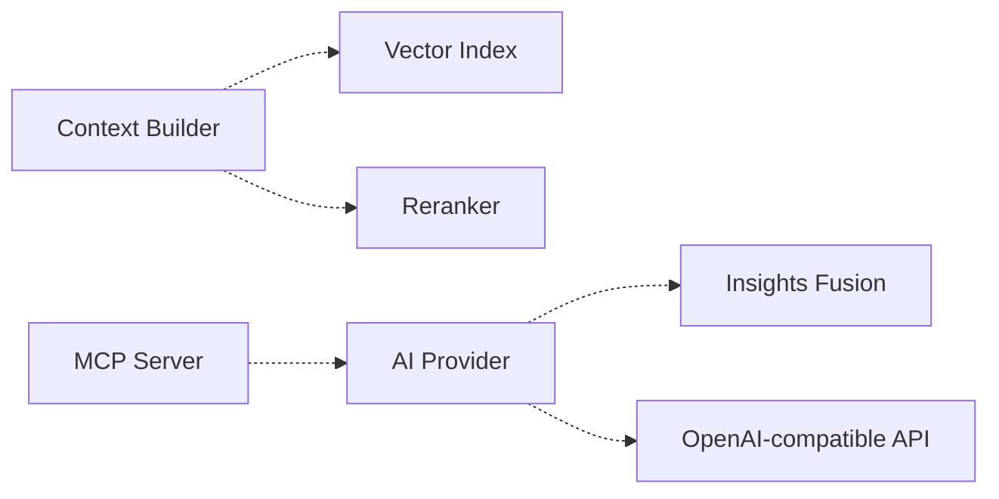
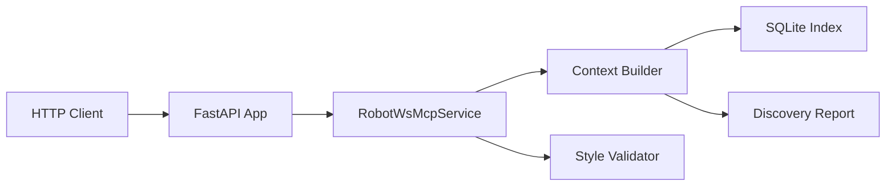
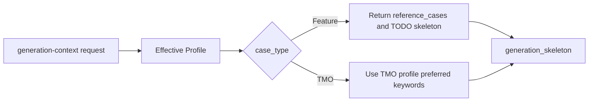

# RobotWS MCP Server Build Steps

本文档用于跟踪 `RobotWS MCP Server` 的实际构建步骤。

后续执行原则：

- 每次只实现一个 step。
- Cursor 负责编码和文档同步。
- 每个实现 step 必须同步补充 pytest 测试，不能把测试长期后置。
- 用户在本地或目标环境执行验证命令。
- 验收通过后，再进入下一个 step。
- 不把多个 step 混在一次实现里，避免验证边界不清楚。

每个实现 step 的交付内容必须包含：

- 功能代码。
- pytest 单元测试或集成测试。
- 文档/验收命令更新。
- 用户本地验证命令和期望结果。

## 当前状态总结

项目当前已经具备 MVP 基础能力：

- 能扫描外部 `robotws` 仓库。
- 能解析 Robot Framework `.robot` / `.resource` 文件。
- 能解析 Python symbol。
- 能写入 SQLite 结构化索引。
- 已建立 SG6 分层 profile 体系。
- 已实现 SG6 ownership discovery 的第一版。
- 已提供 MCP tools 和本地 query CLI。
- 已提供本地 RobotWS Knowledge API 最小版。
- 已预留未来 AI provider 接口，但默认不调用 LLM。

当前最明显的问题：

- 后续需要继续补充 allowlist 管理工具，避免长期手工维护 JSON。
- 需要增加单元测试，防止 allowlist-only 过滤逻辑回退。
- 需要增加 API client mode MCP，方便本地 Cursor 转发调用远端 Knowledge API。

## 总体代码骨架流程图

为避免一张大图过密，这里拆成 4 张小图：总览、离线索引、在线查询、未来扩展。

### 1. 总览流程



### 2. 离线索引流程



### 3. 在线查询流程



### 4. 未来扩展流程



流程说明：

- `Indexer Scanner` 负责离线扫描 `robotws`，调用 Robot/Python parser，并结合 profile 执行 SG6 ownership discovery。
- `SQLite Index` 保存结构化索引，`Discovery Report` 保存 SG6 feature 归属审计结果。
- 本地 `stdio MCP` 不直接生成 testcase，只把 Cursor tool request 转发到 Nginx 后面的 Knowledge API。
- `Knowledge API` 不实现远端 HTTP MCP transport，只提供普通 HTTPS REST API。
- `Context Builder` 负责组装 generation context，包括 profile、similar cases、recommended keywords、ownership summary、style rules。
- `Style Validator` 负责检查 Cursor 生成的 Robot 文本是否符合 profile 规则。
- `AI Provider`、`Vector Index`、`Reranker` 属于未来扩展，当前默认不启用。

## 已完成 Steps

### Done 1: 独立项目骨架

已完成内容：

- 创建独立项目目录 `C:\TA\robotws_mcp_server`。
- 添加 Python package skeleton。
- 添加 `pyproject.toml`、`.gitignore`、`README.md`。
- 建立 `src/`、`config/`、`data/`、`docs/`、`tests/` 目录。

价值：

- 本项目和 `jenkins_robotframework` 解耦。
- 后续可以独立放到 GitHub 管理。

### Done 2: 基础文档

已完成内容：

- 添加 `docs/architecture.md`。
- 添加 `docs/implementation-plan.md`。
- 在 README 中说明项目边界、quick start、MCP tools、非目标。

价值：

- 明确第一版只做只读 MCP + context builder。
- 明确 MCP 不直接调用 LLM，Cursor LLM 负责生成和解释。

### Done 3: Robot / Python Parser

已完成内容：

- `RobotParser` 解析 settings、resources、libraries、variables、test cases、keywords、tags、setup、teardown、keyword calls。
- `RobotParser` 已解析 `Force Tags` / `Default Tags`，用于 SG6 ownership discovery。
- `PythonParser` 解析 Python module、class、function、method、signature、docstring、imports。

价值：

- 为 RobotWS 建立结构化索引。
- 支撑 testcase 检索、keyword 检索、调用链分析。

### Done 4: SQLite 结构化索引

已完成内容：

- 建立 `robot_files`、`robot_cases`、`robot_keywords`、`library_imports`、`resource_imports`、`call_edges`、`python_symbols` 表。
- 支持写入、清空、基础 search、case lookup、keyword trace、library usage query。

价值：

- 让 MCP 不直接全量扫描文件回答问题。
- 为后续 RAG / rerank / vector index 提供基础数据层。

### Done 5: SG6 Profile 分层

已完成内容：

- 新增 `Hangzhou_SG6_Common`。
- 新增 `Hangzhou_RRM_SG6_Feature`。
- 修正 `Hangzhou_RRM_SG6_TMO` 为 RRM `None_Feature_SG6` 子 profile。
- 新增 `Hangzhou_SISO_SG6_Feature`。
- 新增 `Hangzhou_SISO_SG6_TMO`。
- 子 profile 可继承 common profile 的推荐 keyword、negative patterns、required fields 和 resource boundary。

价值：

- 不再把 `Hangzhou_RRM_SG6_TMO` 当作全局 SG6 profile。
- 能分别表达 SG6 common boundary、RRM/SISO、Feature/TMO 的不同规则。

### Done 6: SG6 Ownership Discovery MVP

已完成内容：

- 支持 `None_Feature_SG6` 路径直接 confirmed。
- 支持 feature allowlist confirmed，allowlist 是唯一 SG6 testcase pool 来源。
- 支持 hard exclude 和 not-in-allowlist 排除。
- 支持 discovery report 输出到 JSON。

价值：

- 解决 RRM/SISO feature folder 不能只靠名字判断是否属于 SG6 的问题。
- 为 similar case pool 提供 ownership filter。

当前不足：

- allowlist 仍需要人工维护，后续可增加管理/检查工具。
- 需要更多单元测试覆盖 allowlist-only 过滤边界。

### Done 7: Context Builder / MCP Tools / Query CLI

已完成内容：

- `get_generation_context` 返回 profile、SG6 ownership summary、similar cases、recommended keywords、keyword examples、style rules、negative patterns、Robot skeleton。
- MCP tools 已包含 `discover_sg6_features`、`get_sg6_discovery_report`。
- query CLI 已包含 `discover-sg6-features`、`get-sg6-discovery-report`。

价值：

- Cursor 可以通过 MCP 获取结构化上下文。
- 本地也可以通过 query CLI 做 smoke test。

### Done 8: Style Validator 和 AI Provider 预留

已完成内容：

- `validate_generated_case_style` 检查 documentation、tags、setup、teardown、negative patterns、基础缩进。
- 预留 `AiProvider`、`EmbeddingProvider`、`RerankerProvider`、`WorkflowProvider`。
- 默认使用 `NoopAiProvider`，不调用外部 LLM。

价值：

- 第一版保持 `context_only`。
- 后续可以平滑接 Insights Fusion、OpenAI-compatible API 或内部 LLM。

### Done 9: 本地 RobotWS Knowledge API 最小版

已完成内容：

- 新增 `robotws_mcp.api`，提供普通 HTTP REST API，不实现远端 HTTP MCP transport。
- 新增 console script `robotws-knowledge-api`，也可通过 `python -m robotws_mcp.api` 启动。
- API 复用 `RobotWsMcpService`，与本地 MCP tools / query CLI 共用同一套 context builder、profile store 和 style validator。
- 新增 `tests/test_api.py`，使用临时 SQLite index 和 discovery report 覆盖 health、version、discovery、generation context、search、validate endpoints。

本 step 解决的问题：

- 为后续 Jenkins master + Docker Compose + Nginx HTTPS 的集中式 Knowledge API 部署提供本地可验证的最小服务。
- 保持本地 Cursor MCP client 转发模式：Cursor 仍连接本地 stdio MCP，远端只提供普通 HTTPS API。

核心调用流：



关键 endpoints：

- `GET /health`
- `GET /version`
- `GET /profiles`
- `GET /discovery/sg6`
- `POST /query/generation-context`
- `POST /query/search-cases`
- `POST /query/search-keywords`
- `POST /query/validate-style`

验收命令：

```powershell
cd C:\TA\robotws_mcp_server
C:\Users\stlin\Python313\python -m pip install -e ".[dev]"
C:\Users\stlin\Python313\python -m pytest tests\test_api.py
C:\Users\stlin\Python313\python -m robotws_mcp.indexer --robotws-root C:\TA\robotws --profile Hangzhou_SG6_Common --write-index
C:\Users\stlin\Python313\python -m robotws_mcp.api --db-path data\indexes\robotws.sqlite3 --host 127.0.0.1 --port 8051
```

另开一个 PowerShell 窗口验证：

```powershell
Invoke-WebRequest http://127.0.0.1:8051/health
Invoke-WebRequest http://127.0.0.1:8051/version
Invoke-RestMethod -Method Post http://127.0.0.1:8051/query/generation-context -ContentType "application/json" -Body '{"requirement":"RRM SG6 handover KPI testcase","profile":"Hangzhou_RRM_SG6_Feature","limit":3}'
```

期望结果：

- pytest 通过。
- `/health` 返回 `{"status":"ok"}`。
- `/version` 返回 API 名称、版本和当前 SQLite index 路径。
- `/query/generation-context` 返回 `context_only`、profile、similar cases、recommended keywords、style rules、SG6 ownership summary。

常见失败：

- `No module named fastapi` 或 `No module named httpx`: 需要执行 `python -m pip install -e ".[dev]"`。
- `/query/generation-context` 返回空 similar cases: 需要先执行 `--write-index`，并确认 `data\indexes\robotws.sqlite3` 是最新 index。
- 端口被占用: 换用 `--port 8052`，或停止已有 API 进程。

学习记录：

- 解决的问题：集中式部署需要一个普通 HTTPS API 作为远端 Knowledge API，本 step 先在本地提供最小 API 能力。
- 变更文件：`src/robotws_mcp/api.py` 新增 FastAPI app；`pyproject.toml` 新增 API 依赖和入口；`tests/test_api.py` 新增 API 测试；`README.md`、`docs/build_steps.md`、`docs/robotws-knowledge-api-deployment-spec.md` 同步验收命令。
- 核心调用流：HTTP request -> FastAPI endpoint -> `RobotWsMcpService` -> `ContextBuilder` / `StyleValidator` -> SQLite index / discovery report -> JSON response。
- 关键字段：`requirement`、`profile`、`path_hint`、`limit`、`db_path`、`summary`、`features`。
- 验证命令：先跑 `pytest tests\test_api.py`，再写真实 index，最后启动 API 并 curl/Invoke-WebRequest 验证。
- 期望结果：API 与本地 MCP/query CLI 返回同一类结构化上下文，后续可以直接被 local MCP client 转发使用。

### Done 10: Feature/TMO Setup Teardown 推荐逻辑修正

已完成内容：

- 修正 profile preferred keywords 继承逻辑：按 category 合并，而不是子 profile 为空时整包继承 common。
- 从 `Hangzhou_SG6_Common` 移除 TMO 专属 setup/teardown，避免污染 Feature profile。
- 为 `Hangzhou_SISO_SG6_TMO` 显式补充 TMO setup/teardown，与 RRM TMO profile 行为一致。
- `ContextBuilder` 生成 Feature skeleton 时使用 TODO 占位，不直接照抄任一 similar case 的 `[Setup]` / `[Teardown]`。
- `setup_teardown_pattern.reference_cases` 提供同一个 similar case 中成对的 feature-local setup/teardown，供 Cursor/LLM 参考组合。
- `ContextBuilder` 生成 TMO skeleton 时，继续使用 TMO profile 的 `SetUp.TMO Case Common SetUp` 和 `TMO_Common_Case_Teardown`。
- 更新 `tests/test_api.py`，覆盖 Feature 不再使用 TMO setup，以及 TMO 仍使用 TMO setup。

本 step 解决的问题：

- 用户在验证 API 时发现 `Hangzhou_RRM_SG6_Feature` 的 `generation_skeleton` 错用了 TMO setup/teardown。
- 根因是 common profile 中放了 TMO 默认 setup/teardown，Feature 子 profile 的空 `preferred_keywords` 会整包继承 common。

核心调用流：



验收命令：

```powershell
cd C:\TA\robotws_mcp_server
C:\Users\stlin\Python313\python -m pytest tests\test_api.py
Invoke-RestMethod -Method Post http://127.0.0.1:8051/query/generation-context -ContentType "application/json" -Body '{"requirement":"RRM SG6 handover KPI testcase","profile":"Hangzhou_RRM_SG6_Feature","limit":3}'
Invoke-RestMethod -Method Post http://127.0.0.1:8051/query/generation-context -ContentType "application/json" -Body '{"requirement":"RRM SG6 TMO KPI testcase","profile":"Hangzhou_RRM_SG6_TMO","limit":3}'
```

期望结果：

- Feature profile 的 `generation_skeleton` 不再出现 `SetUp.TMO Case Common SetUp` / `TMO_Common_Case_Teardown`。
- Feature profile 的 `generation_skeleton` 使用 `TODO_SELECT_FEATURE_LOCAL_SETUP` / `TODO_SELECT_FEATURE_LOCAL_TEARDOWN`。
- Feature profile 的 `setup_teardown_pattern.reference_cases` 显示同一个 similar case 中成对的 feature-local setup/teardown，例如 `10767_Case_SetUp`、`10767_Case_Teardown`。
- TMO profile 的 `generation_skeleton` 仍使用 TMO common setup/teardown。

学习记录：

- 解决的问题：Feature 和 TMO 的 setup/teardown 推荐策略混在一起，导致 Feature case skeleton 推荐了 TMO 专用 keyword。
- 变更文件：`src/robotws_mcp/profiles/store.py` 改为按 category 合并 preferred keywords；`src/robotws_mcp/retrieval/context_builder.py` 根据 `case_type` 选择 setup/teardown 来源；`config/profiles/Hangzhou_SG6_Common.json` 移除 TMO setup/teardown；`config/profiles/Hangzhou_SISO_SG6_TMO.json` 显式补充 TMO setup/teardown；`tests/test_api.py` 增加回归断言。
- 核心调用流：请求 profile -> effective profile 合并 common keywords -> Feature skeleton 保持 TODO 并把成对 setup/teardown 放进 reference cases，TMO 从 profile preferred keywords 获取 -> 生成 skeleton。
- 关键字段：`profile.case_type`、`preferred_keywords.setup`、`preferred_keywords.teardown`、`similar_cases[].setup`、`similar_cases[].teardown`、`setup_teardown_pattern.reference_cases`。
- 验证命令：先跑 `pytest tests\test_api.py`，再分别请求 Feature/TMO generation context 对比 skeleton。
- 期望结果：Feature/TMO setup/teardown 推荐互不污染。

## 后续优先级 Steps

### Step 1: 优化 Discovery 输出和 Hard Exclude 摘要

状态：

- 本 step 已进入实现阶段。
- CLI 已设计为默认 summary 输出，只有指定过滤条件或 detail 参数时才打印 feature 明细。

目标：

- 让 indexer 默认输出简短、可读、适合人工验收的 summary。
- 完整 JSON 不直接刷屏，改为保存到文件或通过 detail 参数查看。
- 泛化 hard exclude，自动排除明显属于其他 SG 的 feature。

需要实现：

- 新增简短 summary 输出，例如 scanned files、cases、confirmed、excluded、warnings。
- 默认使用 summary 模式。
- 新增 `--discovery-details` 查看完整明细。
- 新增 `--status confirmed|excluded` 过滤。
- 新增 `--area RRM|SISO` 过滤。
- 新增 `--case-type TMO|Feature` 过滤，其中 `TMO` 对应 `None_Feature_SG6`，`Feature` 对应普通 feature folder。
- 新增 `--top N` 限制输出数量。
- 新增 `--list-paths` 只输出匹配 feature 的目录 path，方便人工核对或重定向到文件。
- 保留 `--print-discovery` 作为兼容参数，但不再直接输出全量 JSON。
- 支持 `--discovery-report-path` 在 dry-run 时显式保存完整 JSON。
- hard exclude 支持识别 `lines/SG\d+`、`lines/MMW_SG\d+`，除 SG6 外直接排除。
- hard exclude 支持识别 path 中明显的 `None_Feature_SG4`、`SG8_*` 等非 SG6 目录。

验收命令：

```powershell
cd C:\TA\robotws_mcp_server
C:\Users\stlin\Python313\python -m robotws_mcp.indexer --robotws-root C:\TA\robotws --profile Hangzhou_SG6_Common --dry-run
```

期望结果：

- 不再刷屏输出完整 features JSON。
- 控制台先显示简短 summary。
- 能快速看出 confirmed、excluded 的数量。
- 如未指定 `--discovery-report-path`，dry-run 不保存完整 JSON。

进一步验收：

```powershell
C:\Users\stlin\Python313\python -m robotws_mcp.indexer --robotws-root C:\TA\robotws --profile Hangzhou_SG6_Common --dry-run --status excluded --area SISO --top 20
C:\Users\stlin\Python313\python -m robotws_mcp.indexer --robotws-root C:\TA\robotws --profile Hangzhou_SG6_Common --dry-run --status confirmed --area RRM --top 0 --list-paths
C:\Users\stlin\Python313\python -m robotws_mcp.indexer --robotws-root C:\TA\robotws --profile Hangzhou_SG6_Common --dry-run --status confirmed --area SISO --top 0 --list-paths
C:\Users\stlin\Python313\python -m robotws_mcp.indexer --robotws-root C:\TA\robotws --profile Hangzhou_SG6_Common --dry-run --case-type TMO --top 0 --list-paths
C:\Users\stlin\Python313\python -m robotws_mcp.indexer --robotws-root C:\TA\robotws --profile Hangzhou_SG6_Common --dry-run --case-type Feature --status confirmed --area RRM --top 0 --list-paths
C:\Users\stlin\Python313\python -m robotws_mcp.indexer --robotws-root C:\TA\robotws --profile Hangzhou_SG6_Common --dry-run --discovery-report-path data\indexes\sg6_discovery_report.json
```

期望结果：

- 只输出指定 status / area 的少量 detail。
- `--list-paths` 模式只输出目录 path，不输出 summary 和 warnings。
- `--case-type TMO` 只输出 `None_Feature_SG6` 路径；`--case-type Feature` 不包含 `None_Feature_SG6`。
- 明显引用 `lines/SG3`、`lines/SG8`、`lines/MMW_SG4` 的 feature 应进入 excluded。

常见失败：

- 仍然刷屏：summary/detail 分支没有区分好。
- excluded 过多：hard exclude pattern 过宽。
- excluded 明显异常：检查 allowlist 是否漏配或 hard exclude token 是否误判。

学习记录：

- 解决的问题：原 `--print-discovery` 会输出完整 JSON，结果刷屏且难以人工判断；同时 hard exclude 只覆盖少数 SG resource，导致明显引用 `SG3`、`SG8`、`MMW_SG4` 的 feature 不容易审计。
- 变更文件：`src/robotws_mcp/indexer/__main__.py` 增加 summary/detail/filter 输出；`src/robotws_mcp/profiles/ownership.py` 增加通用 SG token hard exclude；`README.md`、`docs/implementation-plan.md`、`docs/build_steps.md` 同步验收命令和说明。
- 核心调用流：用户运行 `python -m robotws_mcp.indexer` -> `RobotWsIndexer.build()` 扫描并生成 `IndexSummary` -> `FeatureOwnershipDiscoverer.discover()` 分类 feature -> CLI formatter 输出 summary 或过滤后的 detail。
- 关键字段：summary 使用 `robot_files`、`robot_cases`、`robot_keywords`、`python_files`、`python_symbols`、`warnings`；discovery detail 使用 `area`、`feature`、`status`、`source`、`case_count`、`exclude_reason`。
- 验证命令：先运行 dry-run summary，再用 `--status confirmed --top 0 --list-paths` 和 `--status excluded --area SISO --top 20` 查看过滤结果。
- 期望结果：默认输出不再刷屏；allowlist feature 进入 `confirmed`；allowlist 外 feature 进入 `excluded`。
- 复盘问题：如果 excluded 数量明显过多，检查 allowlist 是否漏配；如果 confirmed 出现 allowlist 外目录，检查 allowlist 判断逻辑。

### Step 2: 切换为完整 Feature Allowlist 白名单检索

状态：

- 本 step 已实现，等待用户执行 allowlist-only dry-run / write-index 验收。
- 本轮目标是确保 SG6 testcase 检索只发生在人工确认的 RRM/SISO feature 目录和两个 TMO 目录内。

目标：

- 使用完整 `feature_allowlist` 作为 SG6 testcase pool 的唯一入口。
- 不再使用 tag/resource/author/keyword overlap 自动匹配决定 testcase 是否属于 SG6。
- 不在 allowlist 中的 feature 默认不属于 SG6 testcase。

需要实现：

- 将 RRM allowlist 设置为：
  - `CB007949`
  - `CB008015`
  - `CB008247`
  - `CB008360`
  - `CB009198`
  - `CB009235`
  - `CB009363`
  - `CB010767`
  - `CB010774`
  - `CB010887`
  - `CB010889`
  - `CB012544`
  - `None_Feature_SG6`
- 将 SISO allowlist 设置为：
  - `5GC002510`
  - `CB009008`
  - `CB009275_AEHC`
  - `CB009464`
  - `CB009843_SG6`
  - `CB010889`
  - `CB012195`
  - `CB012591`
  - `FGCR_3610`
  - `None_Feature_SG6`
- indexer 写入 SQLite 时只写入 allowlist paths 下的 testcase/resource/keyword。
- `get_generation_context` 和 `search_robot_cases` 只从 allowlist case pool 检索。
- 保留 discovery report 作为审计输出，但只展示 confirmed/excluded 结果和排除原因。
- 删除 SG6 auto-discovery scoring 配置和代码。
- `--list-paths --case-type TMO` 输出两个 `None_Feature_SG6` root；TMO root 下的子目录递归纳入。

验收命令：

```powershell
cd C:\TA\robotws_mcp_server
C:\Users\stlin\Python313\python -m robotws_mcp.indexer --robotws-root C:\TA\robotws --profile Hangzhou_SG6_Common --dry-run --status confirmed --top 0 --list-paths
C:\Users\stlin\Python313\python -m robotws_mcp.indexer --robotws-root C:\TA\robotws --profile Hangzhou_SG6_Common --dry-run --case-type TMO --top 0 --list-paths
C:\Users\stlin\Python313\python -m robotws_mcp.indexer --robotws-root C:\TA\robotws --profile Hangzhou_SG6_Common --write-index
```

期望结果：

- confirmed path 列表只包含完整 allowlist 中的 RRM/SISO feature paths 和两个 `None_Feature_SG6` TMO paths。
- `--case-type TMO --list-paths` 只输出：
  - `testsuite/Hangzhou/RRM/RAN_PZ_HAZ_34/None_Feature_SG6`
  - `testsuite/Hangzhou/SISO/RAN_PZ_HAZ_34/None_Feature_SG6`
- 写入索引后，SG6 similar testcase 检索不会返回 allowlist 外的 feature testcase。

常见失败：

- allowlist 外 feature 出现在 search result：说明 index/write 或 query filter 没有限制到 allowlist paths。
- TMO 子目录没有被索引：说明 path prefix 判断只匹配 root，未递归包含 root 下子路径。
- AIC 或其他 area case 出现在 SG6 pool：说明 allowlist scope 过滤不完整。

学习记录：

- 解决的问题：自动纳入会把“可能 SG6”的 feature 自动加入 testcase pool，但用户希望 testcase 检索只基于人工确认清单，降低误纳入风险。
- 变更文件：`config/profiles/Hangzhou_SG6_Common.json` 写入完整 allowlist；`src/robotws_mcp/profiles/ownership.py` 改为 allowlist-only 分类；`src/robotws_mcp/retrieval/context_builder.py` 增加 allowlist path 检索过滤。
- 变更方向：完整 `feature_allowlist` 成为唯一 SG6 testcase pool；score、tag、resource、author、keyword overlap 已删除，不再参与审计或纳入。
- 核心调用流：读取 `feature_allowlist` -> 展开 RRM/SISO feature paths 和两个 TMO root paths -> indexer/search/context 只处理这些 paths 下的 testcase/resource/keyword -> allowlist 外 feature 默认不属于 SG6 testcase。
- 关键字段：`feature_allowlist.RRM`、`feature_allowlist.SISO`、`case_type=TMO|Feature`、`path`。
- 验证命令：用 `--list-paths` 检查 allowlist paths，用 `--case-type TMO` 检查两个 TMO root，用 query 验证 allowlist 外 feature 不返回。
- 期望结果：SG6 case pool 可人工解释、可审计、可复现；后续新增 SG6 feature 必须先加入 allowlist。

### Step 3: 增加 Cursor MCP 配置示例

目标：

- 让用户知道如何把 `RobotWS MCP Server` 接入 Cursor。
- 明确本地启动命令、Python 路径、index 路径、常见配置位置。

需要实现：

- 新增 `docs/cursor-mcp-setup.md`。
- 在 `README.md` 增加配置入口链接。
- 给出 Windows PowerShell 下的 MCP 配置示例。

验收命令：

```powershell
cd C:\TA\robotws_mcp_server
C:\Users\stlin\Python313\python -c "import robotws_mcp; print(robotws_mcp.__file__)"
```

期望结果：

- 能输出 `C:\TA\robotws_mcp_server\src\robotws_mcp\__init__.py`。
- Cursor MCP tools 中可以看到 RobotWS MCP tools。

常见失败：

- `No module named robotws_mcp`: 需要先执行 `C:\Users\stlin\Python313\python -m pip install -e .` 或设置 `PYTHONPATH`。
- Cursor 看不到 MCP tools: MCP 配置路径或 Python 路径错误。

### Step 4: 增加单元测试和 Fixtures

目标：

- 固化 parser、profile loading、SG6 ownership discovery、context builder 的当前行为。
- 防止后续修改 scoring、profile、parser 时引入回归。

需要实现：

- 新增 `tests/fixtures/robotws_sample/`。
- 覆盖 confirmed allowlist、TMO root、not_in_allowlist、hard_exclude 几类 feature。
- 覆盖 profile inheritance 和 generation context 中的 ownership 输出。

验收命令：

```powershell
cd C:\TA\robotws_mcp_server
C:\Users\stlin\Python313\python -m pytest
```

期望结果：

- 所有单元测试通过。
- 测试报告能体现 SG6 discovery 的关键分类路径。

常见失败：

- `No module named pytest`: 需要安装 dev 依赖。
- discovery 分类结果不符合预期: fixture 或 scoring 规则需要调整。

### Step 5: 增加 Profile 自动识别评分可解释输出

目标：

- 当 MCP 根据 path 和 requirement 自动选择 profile 时，返回评分明细。
- 帮助用户理解为什么选中某个 profile。

需要实现：

- `identify_robotws_profile` 返回 `profile` 和 `score_breakdown`。
- `get_generation_context` 中包含 profile selection explanation。

验收命令：

```powershell
cd C:\TA\robotws_mcp_server
C:\Users\stlin\Python313\python -m robotws_mcp.query get-generation-context --requirement "create RRM SG6 TMO KPI testcase"
```

期望结果：

- 不传 `--profile` 时，也能看到自动识别 profile 的评分原因。

常见失败：

- 选中 profile 不符合预期: 需要调整 profile tokens、path scopes 或 scoring 权重。

### Step 6: 增加 Keyword Policy 独立配置文件

目标：

- 把 keyword 使用策略从 style profile 中拆出来。
- 明确某类业务应该优先使用哪些 keyword，哪些底层 API 不建议直接调用。

需要实现：

- 新增 `config/policies/sg6_keyword_policy.json`。
- 定义 PA、KPI、UE、COAM、evidence 等分类的 recommended / avoid / fallback。
- `get_generation_context` 返回 policy-based recommended keywords。

验收命令：

```powershell
cd C:\TA\robotws_mcp_server
C:\Users\stlin\Python313\python -m robotws_mcp.query get-generation-context --requirement "create SG6 PA handover with wireshark testcase" --profile Hangzhou_RRM_SG6_TMO
```

期望结果：

- recommended keywords 中优先出现 SG6 PA 和 evidence 相关 common keywords。
- negative patterns 能提醒不要优先直接调用底层 TAF PA API。

常见失败：

- 推荐 keyword 为空: policy 分类和 requirement token 没匹配。
- 推荐了其他小组 keyword: allowed resource boundary 过滤不足。

### Step 7: 增加 Allowlist / Ownership Registry 管理工具

目标：

- 提供 CLI 管理 SG6 feature allowlist。
- 避免长期手工编辑 JSON 导致格式错误或遗漏审计记录。

需要实现：

- 新增 ownership registry CLI。
- 支持 list、add、remove、explain。
- 每次变更保留可读审计输出。

验收命令：

```powershell
cd C:\TA\robotws_mcp_server
C:\Users\stlin\Python313\python -m robotws_mcp.query discover-sg6-features --area RRM
```

期望结果：

- 能查看 RRM area 的 confirmed / excluded feature。
- allowlist 中的 feature 能稳定显示为 confirmed。

常见失败：

- allowlist 修改后没有生效: profile store 缓存或 JSON 路径错误。

### Step 8: 增加 GitHub Actions 或本地 CI

目标：

- 自动运行测试、import check、JSON profile 校验和基础 CLI smoke test。
- 为后续独立 GitHub 管理做准备。

需要实现：

- 新增本地 CI 脚本或 GitHub Actions workflow。
- 覆盖 `pytest`、JSON 格式校验、核心 CLI import check。

验收命令：

```powershell
cd C:\TA\robotws_mcp_server
C:\Users\stlin\Python313\python -m pytest
```

期望结果：

- 本地 CI 或 GitHub Actions 中同样通过。

常见失败：

- CI 找不到包: editable install 或 `PYTHONPATH` 配置缺失。
- Windows/Linux 路径差异导致测试失败: 需要统一 path normalization。

### Step 9: 增强 Robot Parser 复杂语义建模

目标：

- 更准确理解复杂 Robot testcase 的真实调用链。
- 支持更可靠的 keyword trace、similar case retrieval 和底层 TAF usage 分析。

需要实现：

- 增强 continuation 行合并。
- 增强 FOR / IF / TRY block 建模。
- 增强 wrapper keyword 的 nested keyword 提取。

验收命令：

```powershell
cd C:\TA\robotws_mcp_server
C:\Users\stlin\Python313\python -m pytest
```

期望结果：

- 新增复杂 Robot fixture 的调用链测试通过。
- `trace_keyword_usage` 对复杂 case 的结果更完整。

常见失败：

- call edge 重复或漏掉: block 解析和 continuation 合并规则需要调整。

### Step 10: 增加 Vector Index

目标：

- 支持语义检索 testcase、keyword docs、README、resource 文档。
- 用户用自然语言描述需求时，也能找到词面不完全匹配但语义相近的 case。

需要实现：

- 先设计可选 vector index 接口。
- 保持 SQLite/text retrieval fallback。
- 不强制引入外部 LLM，embedding provider 仍可配置化。

验收命令：

```powershell
cd C:\TA\robotws_mcp_server
C:\Users\stlin\Python313\python -m robotws_mcp.query get-generation-context --requirement "handover by changing attenuation and collect pcap" --profile Hangzhou_RRM_SG6_TMO
```

期望结果：

- 能召回 PA handover、Wireshark、pcap 相关 case 或 keyword。

常见失败：

- 无法生成 embedding: embedding provider 或模型配置缺失。
- 召回无关内容: vector retrieval 缺少 SG6 ownership filter 或 rerank。

### Step 11: 增加 Reranker

目标：

- 对 text/vector 初筛结果进行二次排序。
- 优先保留同 area、同 case type、同 SG6 ownership、同 testline、同 keyword family 的结果。

需要实现：

- 增加 deterministic rerank 规则。
- 后续可预留 AI reranker provider。
- 确保 rerank 前后都保留 SG6 hard exclude。

验收命令：

```powershell
cd C:\TA\robotws_mcp_server
C:\Users\stlin\Python313\python -m robotws_mcp.query get-generation-context --requirement "RRM SG6 TMO DL SFTP KPI" --profile Hangzhou_RRM_SG6_TMO
```

期望结果：

- similar cases 排序中，RRM、TMO、SG6-owned、KPI/SFTP 相关 case 更靠前。

常见失败：

- 其他 area 或其他 SG case 排名前列: rerank 权重或 ownership filter 需要调整。

### Step 12: 增加 Insights Fusion Provider Stub

目标：

- 为未来从 `context_only` 演进到 `ai_assisted` 预留实际接入样板。
- 说明 Insights Fusion endpoint、鉴权、request/response adapter 应该放在哪里。

需要实现：

- 新增 `InsightsFusionProvider` 空实现或样板实现。
- 增加配置结构示例。
- 默认保持 disabled。

验收命令：

```powershell
cd C:\TA\robotws_mcp_server
C:\Users\stlin\Python313\python -c "from robotws_mcp.providers import NoopAiProvider; print(NoopAiProvider)"
```

期望结果：

- 默认仍使用 `NoopAiProvider`。
- 不配置 Insights Fusion 时不会发起外部请求。

常见失败：

- provider stub 默认发起网络请求: 违反 MVP 的 `context_only` 默认原则。
