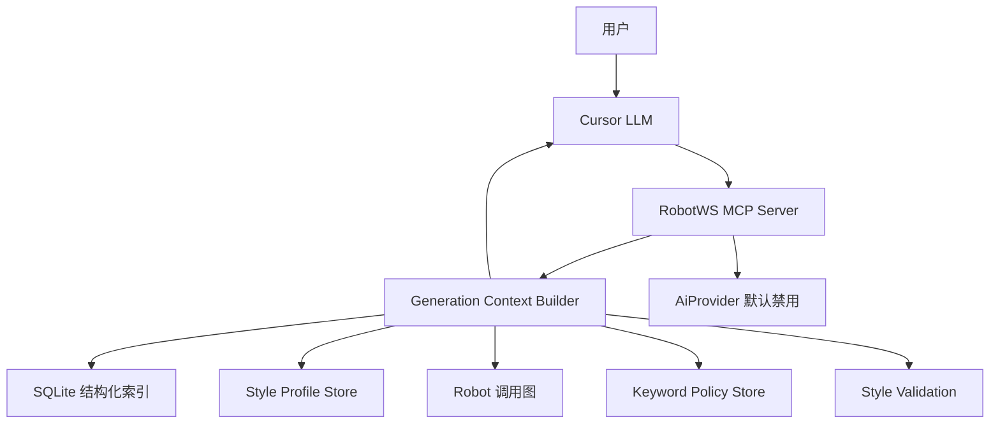

# RobotWS MCP Server 实现计划

## 1. 项目边界

`RobotWS MCP Server` 是一个独立项目，不放在 `C:\TA\jenkins_robotframework` 里维护。

推荐项目目录：

- `C:\TA\robotws_mcp_server`

后续可以独立发布到 GitHub，例如仓库名：

- `robotws-mcp-server`

边界原则：

- `robotws` 作为外部被索引源码，不复制进本项目。
- 本项目只读扫描 `robotws`，不修改 `robotws`。
- `jenkins_robotframework` 后续可以引用本项目文档，但不承载本项目代码。
- MVP 不直接连接测试线、不运行 testcase、不调用 LLM。

## 2. 核心目标

构建一个只读 MCP Server，帮助 Cursor 理解 `robotws`，并让 Cursor LLM 在生成 Robot Framework testcase 时符合不同部门/小组的调用规则和代码风格。

它需要回答的问题包括：

- 当前需求属于哪个部门/小组/profile？
- 哪些已有 testcase 最相似？
- 应该优先使用哪些组内 common keyword？
- 哪些底层 TAF API 不应该直接在 testcase 里调用？
- 该组 testcase 的 setup、teardown、tags、注释、KPI report 写法是什么？
- Cursor 生成 Robot testcase 前应该拿到哪些结构化上下文？

## 3. 架构选择

第一版采用：

- MCP 内部做轻量 RAG 编排。
- MCP 不直接调用 LLM。
- Cursor LLM 负责自然语言理解、解释、总结和 testcase 生成。
- MCP 负责索引、检索、profile 识别、调用链追踪、上下文组装和风格校验。
- 预留 `AiProvider` 接口，后续可接 Insights Fusion、OpenAI-compatible API 或内部 LLM。



## 4. 目录结构

初始项目结构：

- `README.md`
- `pyproject.toml`
- `.gitignore`
- `src/robotws_mcp/server.py`
- `src/robotws_mcp/indexer/`
- `src/robotws_mcp/parser/`
- `src/robotws_mcp/storage/`
- `src/robotws_mcp/profiles/`
- `src/robotws_mcp/retrieval/`
- `src/robotws_mcp/validation/`
- `src/robotws_mcp/providers/`
- `config/profiles/`
- `data/indexes/`
- `tests/`
- `docs/`

说明：

- `data/indexes/` 用于生成索引文件，默认不提交到 Git。
- `config/profiles/` 存放组内风格 profile。
- `providers/` 只预留 AI/Workflow 接口，MVP 默认不启用。

## 5. MVP 范围

第一版只做只读能力：

- 扫描指定 `robotws` 路径。
- 解析 `.robot` 文件中的 settings、resource imports、library imports、variables、test cases、keywords、tags、setup、teardown、keyword calls。
- 基础解析本地 Python 文件中的 module、class、function、docstring、imports。
- 建立 SQLite 结构化索引。
- 建立 Robot testcase 到 keyword 的调用图。
- 生成 profile-aware 的 testcase generation context。
- 对生成的 Robot 文本做组内风格校验。

第一版聚焦 SG6 profile 体系：

- `Hangzhou_SG6_Common`
- `Hangzhou_RRM_SG6_Feature`
- `Hangzhou_RRM_SG6_TMO`
- `Hangzhou_SISO_SG6_Feature`
- `Hangzhou_SISO_SG6_TMO`

`Hangzhou_SG6_Common` 定义 SG6 小组共同的 common resource 边界；RRM/SISO 和 Feature/TMO profile 在此基础上定义 testcase 归属和相似 case 检索策略。

实现上，子 profile 会继承 `Hangzhou_SG6_Common` 的 recommended keywords、negative patterns、required fields 和 allowed resource boundary；子 profile 只覆盖 area、case type、candidate scope、confirmed scope、feature allowlist 等差异点。

### 5.1 SG6 testcase 候选扫描范围

RRM area 的 feature testcase 候选目录：

- `C:\TA\robotws\testsuite\Hangzhou\RRM\RAN_PZ_HAZ_34`

RRM area 的 TMO / None Feature testcase 明确目录：

- `C:\TA\robotws\testsuite\Hangzhou\RRM\RAN_PZ_HAZ_34\None_Feature_SG6`

SISO area 的 feature testcase 候选目录：

- `C:\TA\robotws\testsuite\Hangzhou\SISO\RAN_PZ_HAZ_34`

SISO area 的 TMO / None Feature testcase 明确目录：

- `C:\TA\robotws\testsuite\Hangzhou\SISO\RAN_PZ_HAZ_34\None_Feature_SG6`

注意：

- RRM/SISO 的 feature 目录通常以 feature 名命名，例如 `CB009363`、`CB009275_AEHC`。
- 仅从 feature folder 名字无法判断是否属于 SG6。
- 因此不能把整个 `RRM\RAN_PZ_HAZ_34` 或 `SISO\RAN_PZ_HAZ_34` 都当作 SG6 case pool。

### 5.2 SG6 common keyword 允许边界

生成 SG6 风格 testcase 时，优先且默认只允许使用以下 SG6 common resource / helper 范围内的 keyword：

- `C:\TA\robotws\testsuite\Hangzhou\resources\RAN_PZ_HAZ_34\lines\SG6`
- `C:\TA\robotws\testsuite\Hangzhou\resources\RAN_PZ_HAZ_34\python`
- `C:\TA\robotws\testsuite\Hangzhou\resources\RAN_PZ_HAZ_34\robot`

禁止作为推荐 keyword 来源：

- 其他 site 的 resource keyword。
- 其他小组目录下的 resource keyword，例如 `lines\SG1`、`lines\SG11` 等。
- 其他小组专用 wrapper keyword。

允许直接调用底层 TAF library，但生成组内风格 Robot testcase 时应优先使用 SG6 common keyword。只有 SG6 common keyword 覆盖不了时，才提示可以考虑直接调用底层 TAF library。

### 5.3 SG6 feature 归属策略

SG6 feature ownership 改为完整 allowlist 白名单模式。

MVP 后续实现时不再使用阈值、score、tag/resource/author 自动匹配来决定 testcase 是否属于 SG6。SG6 testcase pool 只来自人工确认的完整 `feature_allowlist`：

- RRM feature allowlist。
- SISO feature allowlist。
- RRM TMO 目录：`testsuite/Hangzhou/RRM/RAN_PZ_HAZ_34/None_Feature_SG6`。
- SISO TMO 目录：`testsuite/Hangzhou/SISO/RAN_PZ_HAZ_34/None_Feature_SG6`。

不在完整 allowlist 中的 feature folder，默认不属于 SG6 testcase pool，不参与 SG6 similar testcase 检索。

SG6 allowlist 的含义：

- 由 SG6 小组维护的人工确认 feature registry。
- allowlist 是 testcase 检索的唯一入口。
- 不在 allowlist 中的 feature 不再通过自动发现信号进入 confirmed pool。
- 自动发现信号后续只作为审计参考，不作为纳入 SG6 testcase pool 的依据。

示例：

```yaml
sg6_feature_allowlist:
  rrm:
    - CB007949
    - CB008015
    - CB008247
    - CB008360
    - CB009198
    - CB009235
    - CB009363
    - CB010767
    - CB010774
    - CB010887
    - CB010889
    - CB012544
    - None_Feature_SG6
  siso:
    - 5GC002510
    - CB009008
    - CB009275_AEHC
    - CB009464
    - CB009843_SG6
    - CB010889
    - CB012195
    - CB012591
    - FGCR_3610
    - None_Feature_SG6
```

完整 allowlist 对应的路径：

```text
testsuite/Hangzhou/RRM/RAN_PZ_HAZ_34/CB007949
testsuite/Hangzhou/RRM/RAN_PZ_HAZ_34/CB008015
testsuite/Hangzhou/RRM/RAN_PZ_HAZ_34/CB008247
testsuite/Hangzhou/RRM/RAN_PZ_HAZ_34/CB008360
testsuite/Hangzhou/RRM/RAN_PZ_HAZ_34/CB009198
testsuite/Hangzhou/RRM/RAN_PZ_HAZ_34/CB009235
testsuite/Hangzhou/RRM/RAN_PZ_HAZ_34/CB009363
testsuite/Hangzhou/RRM/RAN_PZ_HAZ_34/CB010767
testsuite/Hangzhou/RRM/RAN_PZ_HAZ_34/CB010774
testsuite/Hangzhou/RRM/RAN_PZ_HAZ_34/CB010887
testsuite/Hangzhou/RRM/RAN_PZ_HAZ_34/CB010889
testsuite/Hangzhou/RRM/RAN_PZ_HAZ_34/CB012544
testsuite/Hangzhou/RRM/RAN_PZ_HAZ_34/None_Feature_SG6
testsuite/Hangzhou/SISO/RAN_PZ_HAZ_34/5GC002510
testsuite/Hangzhou/SISO/RAN_PZ_HAZ_34/CB009008
testsuite/Hangzhou/SISO/RAN_PZ_HAZ_34/CB009275_AEHC
testsuite/Hangzhou/SISO/RAN_PZ_HAZ_34/CB009464
testsuite/Hangzhou/SISO/RAN_PZ_HAZ_34/CB009843_SG6
testsuite/Hangzhou/SISO/RAN_PZ_HAZ_34/CB010889
testsuite/Hangzhou/SISO/RAN_PZ_HAZ_34/CB012195
testsuite/Hangzhou/SISO/RAN_PZ_HAZ_34/CB012591
testsuite/Hangzhou/SISO/RAN_PZ_HAZ_34/FGCR_3610
testsuite/Hangzhou/SISO/RAN_PZ_HAZ_34/None_Feature_SG6
```

纳入规则：

- feature path 在完整 allowlist 中：纳入 SG6 testcase pool。
- feature path 不在完整 allowlist 中：默认不属于 SG6 testcase pool。
- TMO 目录下的子目录、case 文件、resource 文件都随 `None_Feature_SG6` root 一起纳入。
- AIC 或其他非 RRM/SISO area 不进入当前 SG6 testcase pool。

直接排除：

- tag 明确指向其他 SG，例如 `SG_01`、`SG_11`。
- resource import 明确引用其他 SG 专用目录，例如 `lines/SG1`、`lines/SG11`。
- path 明确属于其他 site/group。
- feature 主要依赖其他小组专用 wrapper keyword。

### 5.4 SG6 相似 case 检索原则

相似 case 检索必须先做 SG6 ownership filter，再排序。

流程：

```text
读取完整 feature_allowlist
  -> 展开 RRM/SISO feature paths 和两个 None_Feature_SG6 TMO paths
  -> 仅在 allowlist paths 内读取 testcase/resource/keyword
  -> 得到 SG6-owned case pool
  -> 在 SG6-owned case pool 内做相似度排序
```

排序因素：

- 同 area 优先：RRM 需求优先 RRM，SISO 需求优先 SISO。
- 同类型优先：feature 需求优先 feature，TMO/None Feature 需求优先 TMO。
- 同 feature 优先：如果用户指定 `CB009363`，优先该 feature 下的 case。
- 同 testline tag 优先，例如 `T073`、`T080`、`T813`。
- 同业务关键词优先，例如 handover、PA、SFTP、KPI、scell、BWP、Wireshark。
- 同 common keyword 使用优先。
- 同底层 TAF library usage 可作为辅助排序信号。

## 6. 数据模型

核心实体：

- `RobotFile`: 文件路径、settings、resources、libraries、variables。
- `RobotCase`: testcase 名称、路径、tags、documentation、setup、teardown、called keywords。
- `RobotKeyword`: keyword 名称、路径、arguments、documentation、called keywords。
- `PythonSymbol`: Python module/function/class/method、signature、docstring、imports。
- `LibraryImport`: Robot library import、alias、所在文件。
- `ResourceImport`: Robot resource import、所在文件。
- `CallEdge`: caller、callee、文件、行号、原始调用行。
- `StyleProfile`: 小组路径范围、推荐 keyword、negative patterns、style rules。
- `KeywordPolicy`: keyword 推荐使用场景、避免场景、封装的底层 API。
- `FeatureOwnership`: feature 目录、area、status、source、case_count、resource_imports、exclude_reason。
- `DiscoveryReport`: SG6 confirmed / excluded feature 目录审计结果。

## 7. MCP 工具设计

初始 MCP tools：

- `identify_robotws_profile(path_hint, requirement)`
- `discover_sg6_features(area, print_detail)`
- `get_sg6_discovery_report()`
- `search_robot_cases(query, profile, tags, limit)`
- `search_robot_keywords(query, profile, limit)`
- `get_case_pattern(case_name_or_path)`
- `trace_keyword_usage(keyword_name, profile, depth)`
- `find_taf_library_usage(library_name, profile)`
- `get_style_profile(profile)`
- `get_generation_context(requirement, path_hint, profile_hint)`
- `validate_generated_case_style(robot_text, profile)`

其中最重要的是：

- `get_generation_context`

它应该返回：

- 识别出的 profile。
- confirmed SG6 features。
- excluded features 及排除原因。
- 相似 testcase。
- 推荐 setup / teardown。
- 推荐 common keywords。
- keyword 使用示例。
- negative patterns。
- required user inputs。
- 建议 Robot skeleton。
- unresolved assumptions。

## 8. RAG 策略

MVP：

- 使用 SQLite 结构化索引。
- 使用确定性文本检索。
- 先进行 SG6 ownership filter，再做相似度排序。
- SG6 ownership filter 只使用 complete feature allowlist 和 TMO root paths。
- 根据 area、feature/TMO 类型、testline tag、业务关键词、keyword overlap、profile match、case documentation 做简单 scoring。
- MCP 负责把检索结果组装成结构化上下文交给 Cursor。

Phase 2：

- 增加 vector index。
- 对 testcase docs、keyword docs、README、profile 说明做 embedding。
- 增加 rerank，优先选择同 profile、同 testline、同功能、同 resource family 的结果。

Phase 3：

- 增加可选 `AiProvider`。
- 默认仍保持 `context_only`。
- 需要时可接 Insights Fusion、OpenAI-compatible API 或内部 LLM workflow。

## 9. AI Provider 预留设计

从一开始预留接口：

- `AiProvider`
- `EmbeddingProvider`
- `RerankerProvider`
- `WorkflowProvider`

默认实现：

- `NoopAiProvider`

未来实现：

- `InsightsFusionProvider`
- `OpenAiCompatibleProvider`
- `InternalLlmProvider`

工具模式：

- `context_only`: MCP 不调用 LLM，只返回上下文给 Cursor。
- `ai_assisted`: MCP 调用配置的 AI provider。
- `hybrid`: provider 生成草稿，Cursor 再 review 或二次编辑。

## 10. 第一版 Style Profile

Profile:

- `Hangzhou_SG6_Common`
- `Hangzhou_RRM_SG6_Feature`
- `Hangzhou_RRM_SG6_TMO`
- `Hangzhou_SISO_SG6_Feature`
- `Hangzhou_SISO_SG6_TMO`

推荐规则：

- SG6 common keyword 只从 `lines\SG6`、`python`、`robot` 三个允许范围中推荐。
- Feature 类 case 必须先通过 SG6 ownership filter。
- `None_Feature_SG6` 下的 TMO case 可直接视为 confirmed SG6 case。
- 不在 allowlist 的 feature 不纳入 SG6 testcase pool。
- 明确命中其他 SG tag/resource/path 的 feature 直接 hard exclude。
- TMO case setup 优先使用 `SetUp.TMO Case Common SetUp`。
- TMO case teardown 优先使用 `TMO_Common_Case_Teardown`。
- Feature case skeleton 使用 `TODO_SELECT_FEATURE_LOCAL_SETUP` / `TODO_SELECT_FEATURE_LOCAL_TEARDOWN` 占位，不直接照抄某个 similar case。
- Feature case 的 `setup_teardown_pattern.reference_cases` 提供同一个已选 similar case 中成对的 setup/teardown 参考，不继承 TMO common setup/teardown，也不混搭不同 case 的 setup 和 teardown。
- COAM 优先使用 `Connect to gnb coam via ssl`。
- 修改 `cellBarred` 优先使用 `Change status for parameter cellBarred on GNB`。
- PA 操作优先使用 `Modify PA Value Setting For Required RU` 或 `Set Maritix PA Port`。
- KPI report 优先使用 `Compass.KPI Generate And Upload To Remote Server`。
- UE 操作优先使用组内已有 `power_ue.*`、`Perform Mutli-UE *`、`Procedures.*`。
- 避免在 testcase body 里直接调用底层 `taf.hw.rf_attenuator`。
- 避免在 testcase body 里写裸 SSH 命令，除非没有 common keyword 覆盖。
- 避免硬编码 UE index，优先使用组内 mapping variable。

## 11. Style Validation

`validate_generated_case_style` 应检查：

- 是否包含 `[Documentation]`。
- 是否包含 `[Tags]`。
- 是否包含 `[Setup]`。
- 是否包含 `[Teardown]`。
- setup 是否符合 profile。
- teardown 是否符合 profile。
- 是否使用了推荐 common keyword。
- 是否出现 negative patterns。
- 是否发明不存在的 resource/library。
- UE index、PCell、testline、report comments 等变量是否被静默猜测。
- Robot 缩进和基本语法是否符合约定。

## 12. 实施阶段

### Phase 0: 独立项目骨架

- 创建 `C:\TA\robotws_mcp_server`。
- 添加 Python package skeleton。
- 添加外部 `robotws` root 配置。
- 添加 README 和架构文档。

### Phase 1: Indexer 和 Parser

- 解析 Robot 文件为结构化数据。
- 解析 resources、libraries、cases、keywords、setup、teardown、tags、documentation。
- 建立第一版调用图。

### Phase 2: Profile 和 Policy 层

- 添加 `Hangzhou_SG6_Common`、`Hangzhou_RRM_SG6_Feature`、`Hangzhou_RRM_SG6_TMO`、`Hangzhou_SISO_SG6_Feature`、`Hangzhou_SISO_SG6_TMO` profiles。
- 添加 preferred keywords。
- 添加 negative patterns。
- 添加 SG6 feature allowlist / ownership registry。
- 添加 allowlist-only ownership 和 hard exclude 审计规则。
- 添加 keyword policy store。

### Phase 3: MCP Server Tools

- 实现只读 MCP tools。
- 优先实现：
  - `discover_sg6_features`
  - `search_robot_cases`
  - `search_robot_keywords`
  - `get_case_pattern`
  - `trace_keyword_usage`
  - `get_generation_context`

### Phase 4: Style Validation

- 实现 `validate_generated_case_style`。
- 只校验生成文本，不写入 `robotws`。

### Phase 5: Semantic Retrieval

- 增加可选 embedding/vector index。
- 增加 rerank。
- 保留 SQLite/text retrieval fallback。

### Phase 6: 可选 AI 集成

- 添加 provider 具体实现。
- 默认保持 `ai.enabled=false`。
- 当 Insights Fusion endpoint 和鉴权方式确认后，再接入 workflow。

## 13. 验证方式

本项目遵循小步验证。

### Dry-run 索引验证

```powershell
cd C:\TA\robotws_mcp_server
python -m robotws_mcp.indexer --robotws-root C:\TA\robotws --profile Hangzhou_SG6_Common --dry-run
```

期望结果：

- 扫描目标 profile 范围内的文件。
- 输出简短 summary，包括 Robot files、cases、keywords、Python symbols、warnings。
- 输出 SG6 discovery summary，包括 confirmed、excluded 数量。
- 默认不打印完整 features JSON，避免刷屏。
- 不写入索引文件。

如需查看少量明细：

```powershell
python -m robotws_mcp.indexer --robotws-root C:\TA\robotws --profile Hangzhou_SG6_Common --dry-run --status confirmed --top 0 --list-paths
python -m robotws_mcp.indexer --robotws-root C:\TA\robotws --profile Hangzhou_SG6_Common --dry-run --status excluded --area SISO --top 20
python -m robotws_mcp.indexer --robotws-root C:\TA\robotws --profile Hangzhou_SG6_Common --dry-run --case-type TMO --top 0 --list-paths
```

常见失败：

- `robotws root not found`: `robotws` 路径错误。
- `encoding error`: 某些历史文件编码特殊，需要 fallback encoding。
- `parse warning`: parser 不支持某些 Robot 语法，应记录 warning 而不是崩溃。
- `confirmed path missing`: allowlist 未包含预期 feature，需要补充 feature registry。
- `unexpected confirmed feature`: allowlist 配置或 path 判断错误。

### SG6 Discovery Report 验证

索引器应支持导出 SG6 ownership discovery audit report：

```powershell
python -m robotws_mcp.indexer --robotws-root C:\TA\robotws --profile Hangzhou_SG6_Common --write-index --discovery-report-path data\indexes\sg6_discovery_report.json
```

控制台应输出简短 summary；完整 JSON 报告保存到 `data\indexes\sg6_discovery_report.json`。报告应包含 summary：

```text
confirmed_by_allowlist
confirmed_by_none_feature_path
excluded_by_hard_exclude
excluded_by_not_in_allowlist
```

报告 detail 示例：

```json
{
  "area": "RRM",
  "feature": "CB009363",
  "path": "testsuite/Hangzhou/RRM/RAN_PZ_HAZ_34/CB009363",
  "status": "confirmed",
  "source": "allowlist",
  "case_count": 8,
  "resource_imports": [
    "testsuite/Hangzhou/resources/RAN_PZ_HAZ_34/lines/SG6/Resources.robot"
  ],
  "exclude_reason": ""
}
```

该报告用于人工审计 allowlist 纳入范围和非 allowlist 排除情况。

### 写入索引并查询

```powershell
python -m robotws_mcp.indexer --robotws-root C:\TA\robotws --profile Hangzhou_SG6_Common --write-index
python -m robotws_mcp.query get-generation-context --requirement "create SG6 TMO DL SFTP KPI testcase" --profile Hangzhou_RRM_SG6_TMO
```

期望结果：

- SQLite index 创建在 `data\indexes\`。
- 查询返回 confirmed SG6 allowlist features、excluded audit features、similar cases、recommended keywords、style rules、negative patterns、required user inputs。

## 14. 当前实现状态

当前已完成 MVP 基础实现，并已按最新 SG6 ownership 讨论从旧的单一 profile 改为分层 profile 体系：

- 独立项目目录已创建。
- Python package skeleton 已创建。
- Robot parser 已实现，并解析 `Force Tags` / `Default Tags` 用于 ownership discovery。
- Robot parser 已解析 settings documentation 和 continuation，用于后续 author signal。
- Python symbol parser 已实现。
- SQLite store 已实现。
- indexer CLI 已实现，默认入口为 `Hangzhou_SG6_Common`。
- profile 配置已拆分为 `Hangzhou_SG6_Common`、`Hangzhou_RRM_SG6_Feature`、`Hangzhou_RRM_SG6_TMO`、`Hangzhou_SISO_SG6_Feature`、`Hangzhou_SISO_SG6_TMO`。
- `Hangzhou_RRM_SG6_TMO` 只表示 RRM `None_Feature_SG6` 子 profile，不再代表整个 SG6 pool。
- SG6 feature ownership discovery 已切换为 complete allowlist-only 模式，只有 allowlist/TMO root paths 进入 SG6 testcase pool。
- SG6 auto-discovery scoring 已删除。
- discovery audit report 已实现，默认输出到 SQLite index 同目录的 `sg6_discovery_report.json`，也可用 `--discovery-report-path` 指定。
- context builder 已实现，并对 case search/generation context 增加 allowlist path 过滤。
- style validator 已实现。
- MCP server tools 已实现，包含 `discover_sg6_features` 和 `get_sg6_discovery_report`。
- query CLI 已实现，包含 `discover-sg6-features` 和 `get-sg6-discovery-report`。
- `NoopAiProvider` 和未来 provider interfaces 已预留。
- `docs/architecture.md` 已添加。

后续仍需要增强但不阻塞 MVP 的事项：

- 单元测试和 fixtures。
- 更细粒度的 keyword policy store。
- allowlist / ownership registry 管理工具。

## 15. 后续待增强

后续按优先级分 step 实现。原则是每次只完成一个 step，由 Cursor 编码实现，用户在本地或目标环境验收；验收通过后再进入下一个 step。

实际执行顺序以 `docs/build_steps.md` 为准。当前优先级已经调整为先落地完整 feature allowlist 白名单检索；Cursor MCP 配置示例和单元测试顺延。

### Step 1: 增加 Cursor MCP 配置示例

作用：

- 让用户知道如何把 `RobotWS MCP Server` 接入 Cursor。
- 明确本地启动命令、Python 路径、index 路径、常见配置位置。

必要性：

- 这是让项目真正可用的入口。
- 如果没有配置示例，后续即使 indexer 和 query CLI 能跑，Cursor 也无法稳定调用 MCP tools。

建议交付：

- 新增 `docs/cursor-mcp-setup.md`。
- 在 `README.md` 增加配置入口链接。
- 给出 Windows PowerShell 下的 MCP 配置示例。

验收命令：

```powershell
cd C:\TA\robotws_mcp_server
C:\Users\stlin\Python313\python -c "import robotws_mcp; print(robotws_mcp.__file__)"
```

期望结果：

- 能输出 `C:\TA\robotws_mcp_server\src\robotws_mcp\__init__.py`。
- Cursor MCP tools 中可以看到 RobotWS MCP tools。

常见失败：

- `No module named robotws_mcp`: 需要先执行 `C:\Users\stlin\Python313\python -m pip install -e .` 或设置 `PYTHONPATH`。
- Cursor 看不到 MCP tools: MCP 配置路径或 Python 路径错误。

### Step 2: 增加单元测试和 fixtures

作用：

- 固化 parser、profile loading、SG6 ownership discovery、context builder 的当前行为。
- 防止后续修改 scoring、profile、parser 时引入回归。

必要性：

- SG6 ownership 规则是本项目的核心风险点。
- 没有测试时，后续很容易误把其他小组 feature 纳入 SG6 pool，或把真正 SG6 feature 排除。

建议交付：

- 新增 `tests/fixtures/robotws_sample/`，构造小型 RobotWS 样例。
- 覆盖 confirmed allowlist、TMO root、not_in_allowlist、hard_exclude 几类 feature。
- 覆盖 profile inheritance 和 generation context 中的 ownership 输出。

验收命令：

```powershell
cd C:\TA\robotws_mcp_server
C:\Users\stlin\Python313\python -m pytest
```

期望结果：

- 所有单元测试通过。
- 测试报告能体现 SG6 discovery 的关键分类路径。

常见失败：

- `No module named pytest`: 需要安装 dev 依赖。
- discovery 分类结果不符合预期: fixture 或 scoring 规则需要调整。

### Step 3: 清理 auto-discovery scoring

作用：

- 删除自动发现评分、作者匹配、keyword overlap 等逻辑。
- 保持 SG6 testcase pool 只由 complete `feature_allowlist` 决定。

必要性：

- 自动发现逻辑会增加维护成本，也容易让“可能属于 SG6”的 feature 被误纳入 testcase pool。
- 当前项目目标已经调整为 allowlist-only 检索，因此 scoring 不再需要保留。

建议交付：

- 删除 profile 中的自动发现配置。
- 删除 ownership 中的 scoring 代码。
- CLI 只保留 confirmed / excluded 状态过滤。

验收命令：

```powershell
cd C:\TA\robotws_mcp_server
C:\Users\stlin\Python313\python -m robotws_mcp.indexer --robotws-root C:\TA\robotws --profile Hangzhou_SG6_Common --dry-run
```

期望结果：

- summary 中只有 confirmed / excluded ownership 结果。
- `--status confirmed --top 0 --list-paths` 只输出 allowlist paths。
- 旧的自动确认状态参数不再是合法参数。

常见失败：

- report 中仍出现自动发现评分字段：说明 scoring 逻辑未完全删除。

### Step 4: 增加 profile 自动识别评分可解释输出

作用：

- 当 MCP 根据 path 和 requirement 自动选择 profile 时，返回评分明细。
- 帮助用户理解为什么选中 `Hangzhou_RRM_SG6_TMO`、`Hangzhou_RRM_SG6_Feature` 或其他 profile。

必要性：

- profile 选错会直接影响 similar cases、recommended keywords 和 style validation。
- 可解释输出能帮助快速定位是 path hint、requirement wording 还是 profile 配置导致误判。

建议交付：

- `identify_robotws_profile` 返回 `profile` 和 `score_breakdown`。
- `get_generation_context` 中包含 profile selection explanation。

验收命令：

```powershell
cd C:\TA\robotws_mcp_server
C:\Users\stlin\Python313\python -m robotws_mcp.query get-generation-context --requirement "create RRM SG6 TMO KPI testcase" --profile Hangzhou_RRM_SG6_TMO
```

期望结果：

- 输出中能看到选中 profile。
- 如果不传 `--profile`，也能看到自动识别 profile 的评分原因。

常见失败：

- 选中 profile 不符合预期: 需要调整 profile tokens、path scopes 或 scoring 权重。

### Step 5: 增加 keyword policy 独立配置文件

作用：

- 把 keyword 使用策略从 style profile 中拆出来。
- 明确某类业务应该优先使用哪些 keyword，哪些底层 API 不建议直接调用。

必要性：

- 随着 SG6 keyword 增多，继续把所有规则塞进 profile JSON 会难以维护。
- keyword policy 独立后，可以更清楚地区分“profile 归属规则”和“keyword 使用规则”。

建议交付：

- 新增 `config/policies/sg6_keyword_policy.json`。
- 定义 PA、KPI、UE、COAM、evidence 等分类的 recommended / avoid / fallback。
- `get_generation_context` 返回 policy-based recommended keywords。

验收命令：

```powershell
cd C:\TA\robotws_mcp_server
C:\Users\stlin\Python313\python -m robotws_mcp.query get-generation-context --requirement "create SG6 PA handover with wireshark testcase" --profile Hangzhou_RRM_SG6_TMO
```

期望结果：

- recommended keywords 中优先出现 SG6 PA 和 evidence 相关 common keywords。
- negative patterns 能提醒不要优先直接调用底层 TAF PA API。

常见失败：

- 推荐 keyword 为空: policy 分类和 requirement token 没匹配。
- 推荐了其他小组 keyword: allowed resource boundary 过滤不足。

### Step 6: 增加 allowlist / ownership registry 管理工具

作用：

- 提供 CLI 管理 SG6 feature allowlist。
- 避免长期手工编辑 JSON 导致格式错误或遗漏审计记录。

必要性：

- 当 SG6 feature 越来越多时，人工维护 allowlist 会变得频繁。
- 管理工具可以统一新增、删除、查看、导出 registry。

建议交付：

- 新增 ownership registry CLI。
- 支持 list、add、remove、explain。
- 每次变更保留可读审计输出。

验收命令：

```powershell
cd C:\TA\robotws_mcp_server
C:\Users\stlin\Python313\python -m robotws_mcp.query discover-sg6-features --area RRM
```

期望结果：

- 能查看 RRM area 的 confirmed / excluded feature。
- allowlist 中的 feature 能稳定显示为 confirmed。

常见失败：

- allowlist 修改后没有生效: profile store 缓存或 JSON 路径错误。

### Step 7: 增加 GitHub Actions 或本地 CI

作用：

- 自动运行测试、import check、JSON profile 校验和基础 CLI smoke test。
- 为后续独立 GitHub 管理做准备。

必要性：

- 项目开始多人维护后，需要自动发现破坏性修改。
- CI 可以保证 parser/profile/discovery 的基础行为持续可用。

建议交付：

- 新增本地 CI 脚本或 GitHub Actions workflow。
- 覆盖 `pytest`、JSON 格式校验、核心 CLI import check。

验收命令：

```powershell
cd C:\TA\robotws_mcp_server
C:\Users\stlin\Python313\python -m pytest
```

期望结果：

- 本地 CI 或 GitHub Actions 中同样通过。

常见失败：

- CI 找不到包: editable install 或 `PYTHONPATH` 配置缺失。
- Windows/Linux 路径差异导致测试失败: 需要统一 path normalization。

### Step 8: 增加 Robot parser 对复杂 continuation / FOR / IF / TRY 语义的更细粒度建模

作用：

- 更准确理解复杂 Robot testcase 的真实调用链。
- 支持更可靠的 keyword trace、similar case retrieval 和底层 TAF usage 分析。

必要性：

- RobotWS 中大量 testcase 会使用 continuation、wrapper keyword、FOR、IF、TRY。
- 轻量 parser 可以支撑 MVP，但对复杂 case 的调用链会有遗漏。

建议交付：

- 增强 continuation 行合并。
- 增强 FOR / IF / TRY block 建模。
- 增强 wrapper keyword 的 nested keyword 提取。

验收命令：

```powershell
cd C:\TA\robotws_mcp_server
C:\Users\stlin\Python313\python -m pytest
```

期望结果：

- 新增复杂 Robot fixture 的调用链测试通过。
- `trace_keyword_usage` 对复杂 case 的结果更完整。

常见失败：

- call edge 重复或漏掉: block 解析和 continuation 合并规则需要调整。

### Step 9: 增加 vector index

作用：

- 支持语义检索 testcase、keyword docs、README、resource 文档。
- 用户用自然语言描述需求时，也能找到词面不完全匹配但语义相近的 case。

必要性：

- SQLite/text search 对关键词敏感，适合 MVP。
- 当需求描述和 Robot case 用词差异较大时，vector index 可以提升召回率。

建议交付：

- 先设计可选 vector index 接口。
- 保持 SQLite/text retrieval fallback。
- 不强制引入外部 LLM，embedding provider 仍可配置化。

验收命令：

```powershell
cd C:\TA\robotws_mcp_server
C:\Users\stlin\Python313\python -m robotws_mcp.query get-generation-context --requirement "handover by changing attenuation and collect pcap" --profile Hangzhou_RRM_SG6_TMO
```

期望结果：

- 能召回 PA handover、Wireshark、pcap 相关 case 或 keyword。

常见失败：

- 无法生成 embedding: embedding provider 或模型配置缺失。
- 召回无关内容: vector retrieval 缺少 SG6 ownership filter 或 rerank。

### Step 10: 增加 reranker

作用：

- 对 text/vector 初筛结果进行二次排序。
- 优先保留同 area、同 case type、同 SG6 ownership、同 testline、同 keyword family 的结果。

必要性：

- vector search 负责召回，reranker 负责排序。
- 没有 reranker 时，召回结果可能多但不够贴合当前 SG6 需求。

建议交付：

- 增加 deterministic rerank 规则。
- 后续可预留 AI reranker provider。
- 确保 rerank 前后都保留 SG6 hard exclude。

验收命令：

```powershell
cd C:\TA\robotws_mcp_server
C:\Users\stlin\Python313\python -m robotws_mcp.query get-generation-context --requirement "RRM SG6 TMO DL SFTP KPI" --profile Hangzhou_RRM_SG6_TMO
```

期望结果：

- similar cases 排序中，RRM、TMO、SG6-owned、KPI/SFTP 相关 case 更靠前。

常见失败：

- 其他 area 或其他 SG case 排名前列: rerank 权重或 ownership filter 需要调整。

### Step 11: 增加 Insights Fusion provider stub

作用：

- 为未来从 `context_only` 演进到 `ai_assisted` 预留实际接入样板。
- 说明 Insights Fusion endpoint、鉴权、request/response adapter 应该放在哪里。

必要性：

- 当前 MVP 不调用 LLM，但项目长期目标包含接入公司内部 AI 平台。
- provider stub 可以降低未来接入成本，同时不影响当前只读 MCP 模式。

建议交付：

- 新增 `InsightsFusionProvider` 空实现或样板实现。
- 增加配置结构示例。
- 默认保持 disabled。

验收命令：

```powershell
cd C:\TA\robotws_mcp_server
C:\Users\stlin\Python313\python -c "from robotws_mcp.providers import NoopAiProvider; print(NoopAiProvider)"
```

期望结果：

- 默认仍使用 `NoopAiProvider`。
- 不配置 Insights Fusion 时不会发起外部请求。

常见失败：

- provider stub 默认发起网络请求: 违反 MVP 的 `context_only` 默认原则。
