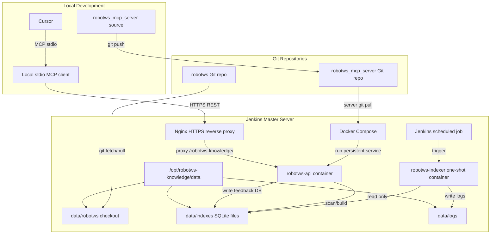
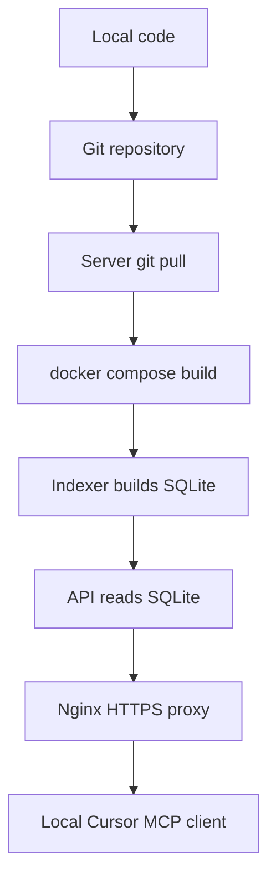

# Server Build Steps: RobotWS Knowledge API

本文档用于指导在 Jenkins master Debian 13 服务器上部署集中式 `RobotWS Knowledge API`。

推荐部署方式：

- Docker Compose 运行常驻 API service。
- Jenkins scheduled job 定时触发 indexer container。
- Nginx 复用现有 HTTPS 入口，对外暴露 `/robotws-knowledge/`。
- `robotws` 源码、SQLite index、日志都放在 `/opt/robotws-knowledge/data`。
- 本地 Cursor 使用 stdio MCP client；该 client 通过 HTTPS 调用 Nginx 后面的 RobotWS Knowledge API。

本方案明确采用：

```text
Cursor
  -> local RobotWS MCP client
  -> Nginx HTTPS
  -> RobotWS Knowledge API
```

不采用：

```text
Cursor
  -> remote HTTP MCP server
```

## 部署原理总览

本部署方案把 **知识构建** 和 **知识查询** 分开：

- **知识构建链路**：Jenkins 定时触发一次性 `robotws-indexer` container，更新 `robotws` 源码并重建 SQLite index。
- **知识查询链路**：常驻 `robotws-api` container 只读取 SQLite，不主动 git pull、不主动重建 index。
- **对外访问链路**：Nginx 提供 HTTPS `/robotws-knowledge/`，反向代理到本机 `127.0.0.1:8051`。
- **Cursor 接入链路**：用户本地 Cursor 连接本地 stdio MCP client；本地 MCP client 再通过 HTTPS 调用服务器 API。服务器不直接暴露 remote HTTP MCP。

整体关系：



服务器上的 `data/indexes` 里会有：

```text
robotws.sqlite3                  legacy search/context index
robotws_layer1_v2.sqlite3         Layer 1 structured facts
robotws_layer2_graph.sqlite3      Layer 2 keyword graph
robotws_feedback.sqlite3          Layer 7 execution feedback cache
sg6_discovery_report.json         SG6 ownership discovery report
```

### Cursor 到服务器的协议分层

这里的 MCP 是 **Model Context Protocol**，用于 Cursor/LLM 和本地 tool 进程之间通信；它不是浏览器访问的普通 HTTP API。

本方案中实际有两段协议：

```text
Cursor
  -- MCP over stdio -->
local RobotWS MCP client
  -- HTTPS REST -->
Nginx
  -- HTTP reverse proxy -->
RobotWS Knowledge API
```

第一段：Cursor 到本地 MCP client。

- Cursor 本地启动一个 stdio MCP 进程。
- Cursor 通过该进程的 `stdin` / `stdout` 发送和接收 MCP JSON-RPC 消息。
- Cursor 会向本地 MCP client 查询 tool 列表、tool 参数 schema，并发起 tool call。
- 这一段使用 MCP 协议，transport 是 stdio。

第二段：本地 MCP client 到服务器 API。

- 本地 MCP client 收到 Cursor 的 tool call 后，把它转换为普通 HTTPS REST 请求。
- 例如 Cursor 调用 `search_evidence(query="MTK L3 call")`，本地 MCP client 会请求：

```http
POST https://<jenkins-master-host>/robotws-knowledge/query/layer4/search-evidence
Content-Type: application/json

{
  "query": "MTK L3 call",
  "profile": "Hangzhou_RRM_SG6_Feature",
  "limit": 5
}
```

- Nginx 接收 HTTPS 请求后，转发到服务器本机 `http://127.0.0.1:8051/query/layer4/search-evidence`。
- `robotws-api` container 读取 SQLite index / graph / feedback DB，并返回 JSON。

返回方向：

```text
RobotWS Knowledge API
  -> JSON response
Nginx
  -> HTTPS response
local RobotWS MCP client
  -> MCP JSON-RPC tool result over stdout
Cursor
```

因此核心区别是：

```text
MCP 是 Cursor 和本地 tool 进程之间的协议。
HTTPS REST 是本地 tool 进程和远端 RobotWS Knowledge API 之间的协议。
```

部署和更新流：



注意：

- 本文档描述当前推荐部署步骤：服务器只部署普通 HTTPS `RobotWS Knowledge API`，Cursor 仍通过本地 stdio MCP client 转发访问。
- 当前仓库已完成并本地验证 Layer 1-7 MVP、HTTP API 和 MCP service 创建。
- 服务器部署需要生成三类核心 index：legacy `robotws.sqlite3`、Layer 1 `robotws_layer1_v2.sqlite3`、Layer 2 `robotws_layer2_graph.sqlite3`；Layer 7 feedback DB 可由 API 首次启动自动创建。
- API client mode MCP 仍是本地 Cursor 接入阶段的独立代码项；服务器侧先部署 HTTPS Knowledge API。

## Step 0: 本地 API 最小版完成与验证记录

本 step 是服务器部署前的本地前置验收。目标是先证明 API 代码本身可运行、可读取本地 SQLite index、可返回 Cursor/LLM 需要的 generation context，然后再进入 Docker 和服务器部署。

已完成代码能力：

- `src/robotws_mcp/api.py` 提供普通 HTTP REST API。
- `pyproject.toml` 提供 `robotws-knowledge-api` console script，也支持 `python -m robotws_mcp.api`。
- API 复用 `RobotWsMcpService`，并统一接入 Layer 1-7 的 query/service 能力。
- `tests/test_api.py` 覆盖基础 API、Layer 2/3 endpoints，以及 Layer 4-7 endpoints。
- Feature profile 的 skeleton 使用 `TODO_SELECT_FEATURE_LOCAL_SETUP` / `TODO_SELECT_FEATURE_LOCAL_TEARDOWN`，不固定照抄某个 case。
- Feature profile 的 `setup_teardown_pattern.reference_cases` 返回成对 setup/teardown 候选，供 Cursor/LLM 根据 RAG 上下文选择或组合。
- TMO profile 仍使用 TMO common setup/teardown。
- Layer 4 当前运行在 `vector_status=disabled:no_embedding_provider` 模式，这是预期状态。
- Layer 7 feedback cache 使用 `robotws_feedback.sqlite3`，支持 manual feedback、Robot `output.xml` 和 Jenkins JSON 导入。

本地验证命令：

```powershell
cd C:\TA\robotws_mcp_server
C:\Users\stlin\Python313\python -m pytest
C:\Users\stlin\Python313\python -m robotws_mcp.api `
  --db-path data\indexes\robotws.sqlite3 `
  --layer2-db-path data\indexes\robotws_layer2_graph.sqlite3 `
  --layer7-db-path data\indexes\robotws_feedback.sqlite3 `
  --host 127.0.0.1 `
  --port 8051
```

另开一个 PowerShell：

```powershell
Invoke-WebRequest http://127.0.0.1:8051/health
Invoke-WebRequest http://127.0.0.1:8051/version
$r = Invoke-RestMethod -Method Post http://127.0.0.1:8051/query/generation-context `
  -ContentType "application/json" `
  -Body '{"requirement":"RRM SG6 handover KPI testcase","profile":"Hangzhou_RRM_SG6_Feature","limit":3}'
$r.setup_teardown_pattern.reference_cases | ConvertTo-Json -Depth 10
$l4 = Invoke-RestMethod -Method Post http://127.0.0.1:8051/query/layer4/search-evidence `
  -ContentType "application/json" `
  -Body '{"query":"RRM MTK basic L3 call attach DL UL traffic check tput detach","profile":"Hangzhou_RRM_SG6_Feature","limit":5}'
$l5 = Invoke-RestMethod -Method Post http://127.0.0.1:8051/query/layer5/extract-template `
  -ContentType "application/json" `
  -Body '{"requirement":"RRM MTK basic L3 call attach DL UL traffic check tput detach","profile":"Hangzhou_RRM_SG6_Feature","domain":"RRM","limit":3}'
$l4.vector_status
$l5.operation
```

已验证结果：

- `/health` 返回 `{"status":"ok"}`。
- `/version` 返回 `{"name":"robotws-knowledge-api","version":"0.1.0","db_path":"data\\indexes\\robotws.sqlite3"}`。
- `/query/generation-context` 返回 `context_only`、profile、SG6 ownership、similar cases、recommended keywords、keyword examples、style rules、required user inputs 和 generation skeleton。
- `/query/layer4/search-evidence` 返回 `vector_status=disabled:no_embedding_provider` 和 explainable evidence。
- `/query/layer5/extract-template` 对 L3 call 返回 `operation=l3_call`。
- `/query/layer6/validate-generated-robot` 可对 MTK L3 call 草稿返回 `decision=allow`。
- `/query/layer7/record-execution-feedback` 和 `/query/layer7/feedback-hints` 可写入并查询 feedback。
- Feature skeleton 返回 TODO setup/teardown，占位符为 `TODO_SELECT_FEATURE_LOCAL_SETUP` 和 `TODO_SELECT_FEATURE_LOCAL_TEARDOWN`。
- `setup_teardown_pattern.reference_cases` 返回同一个 similar case 中成对的 setup/teardown，例如 `10767_Case_SetUp` / `10767_Case_Teardown`。
- 本地 focused smoke 结果：Layer 4-7 + API endpoints 可返回预期结果。
- 本地 pytest 曾验证通过：`34 passed`。

常见失败：

- `No module named fastapi`: 需要先执行 `C:\Users\stlin\Python313\python -m pip install -e ".[dev]"`。
- API 修改后验证结果未变化：需要停止旧的 `uvicorn` 进程并重启 API。
- `similar_cases` 为空：需要先执行 legacy indexer `--write-index`，确认 `data\indexes\robotws.sqlite3` 存在且是最新。
- Layer 4/5 返回空：检查 `robotws_layer2_graph.sqlite3` 是否存在并由最新 Layer 1 DB 构建。
- Layer 7 feedback 报路径错误：检查 `--layer7-db-path` 所在目录是否可写。
- PowerShell 显示 `System.Object[]`: 使用 `ConvertTo-Json -Depth 10` 查看嵌套对象。

学习记录：

- 解决的问题：服务器部署前先完成本地 API 验证，避免把代码问题和 Docker/Nginx/服务器权限问题混在一起排查。
- 变更文件：`src/robotws_mcp/api.py`、`src/robotws_mcp/server.py`、`src/robotws_mcp/layer4/`、`src/robotws_mcp/layer5/`、`src/robotws_mcp/layer6/`、`src/robotws_mcp/layer7/`、`pyproject.toml`、`tests/test_api.py`。
- 核心调用流：HTTP request -> FastAPI endpoint -> `RobotWsMcpService` -> Layer 4/5/6/7 service -> SQLite index / graph / feedback DB -> JSON response。
- 关键字段：`requirement`、`profile`、`limit`、`setup_teardown_pattern.reference_cases`、`generation_skeleton`、`vector_status`、`operation`、`decision`、`feedback_hints`。
- 验证命令：先跑 `pytest`，再启动 API，最后用 `Invoke-WebRequest` / `Invoke-RestMethod` 验证 Layer 1-7 endpoints。
- 期望结果：本地 API 通过后，再进入 Dockerfile + Docker Compose 最小版。

## Step 0.5: 服务器环境检查

登录 Jenkins master Debian 13 后，先确认 OS、架构、网络和已有服务状态。

检查 OS 和架构：

```bash
cat /etc/os-release
dpkg --print-architecture
uname -a
```

期望结果：

- `VERSION_CODENAME` 是 Debian 13 对应 codename，例如 `trixie`。
- 架构通常是 `amd64`。

检查网络和 DNS：

```bash
curl -I https://download.docker.com
curl -I https://wrgitlab.ext.net.nokia.com
curl -I https://github.com
```

期望结果：

- 能解析域名。
- `download.docker.com` 可访问，用于安装 Docker。
- GitLab 地址可访问，用于后续 clone/pull `robotws`。
- GitHub 地址可访问，用于后续 HTTPS clone/pull `robotws_mcp_server`。

检查已有 Jenkins/Nginx：

```bash
systemctl status jenkins --no-pager
systemctl status nginx --no-pager
```

期望结果：

- Jenkins service 存在并运行。
- Nginx service 存在并运行。

常见失败：

- `curl: Could not resolve host`: DNS 或代理配置问题。
- `Connection timed out`: 服务器到外网或内网 GitLab 的网络策略不通。
- `Unit nginx.service could not be found`: 当前服务器可能用其他方式托管 HTTPS，需要先确认已有 portal/Jenkins 入口的反向代理服务。

## Step 0.6: 安装 Docker Engine 和 Compose Plugin

如果服务器尚未安装 Docker，按 Docker 官方 Debian APT repository 方式安装。

安装依赖和 Docker APT repository：

```bash
sudo apt update
sudo apt install -y ca-certificates curl
sudo install -m 0755 -d /etc/apt/keyrings
sudo curl -fsSL https://download.docker.com/linux/debian/gpg -o /etc/apt/keyrings/docker.asc
sudo chmod a+r /etc/apt/keyrings/docker.asc
sudo tee /etc/apt/sources.list.d/docker.sources > /dev/null <<EOF
Types: deb
URIs: https://download.docker.com/linux/debian
Suites: $(. /etc/os-release && echo "$VERSION_CODENAME")
Components: stable
Architectures: $(dpkg --print-architecture)
Signed-By: /etc/apt/keyrings/docker.asc
EOF
sudo apt update
```

安装 Docker Engine、Buildx 和 Compose v2 plugin：

```bash
sudo apt install -y docker-ce docker-ce-cli containerd.io docker-buildx-plugin docker-compose-plugin
sudo systemctl enable --now docker
```

验证 Docker：

```bash
docker --version
docker compose version
sudo docker run --rm hello-world
```

期望结果：

- `docker --version` 输出 Docker Engine 版本。
- `docker compose version` 输出 Compose v2 plugin 版本。
- `hello-world` 容器能成功运行并退出。

常见失败：

- `Unable to locate package docker-ce`: Docker APT repository 未正确添加，检查 `/etc/apt/sources.list.d/docker.sources`。
- `The repository ... does not have a Release file`: `VERSION_CODENAME` 不正确或当前 Debian 版本未被 Docker repo 支持。
- `permission denied while trying to connect to the Docker daemon socket`: 当前用户不在 `docker` group，可先用 `sudo docker ...` 验证。
- 公司网络需要代理：需要先配置 apt、Docker daemon 或系统代理，不能把代理账号密码提交到 repo。

## Step 0.7: Docker 权限和 Jenkins 权限验证

Jenkins job 后续需要运行 `docker compose run --rm robotws-indexer`，因此 Jenkins 用户必须能访问 Docker daemon。

确认 Jenkins 用户存在：

```bash
id jenkins
```

把 Jenkins 加入 docker group：

```bash
sudo usermod -aG docker jenkins
```

如果后续使用 `robotws-knowledge` 用户手动维护服务，也可以加入 docker group：

```bash
sudo usermod -aG docker robotws-knowledge || true
```

让 group membership 生效：

```bash
sudo systemctl restart jenkins
```

验证 Jenkins 用户 Docker 权限：

```bash
sudo -u jenkins docker ps
sudo -u jenkins docker compose version
```

期望结果：

- `sudo -u jenkins docker ps` 不报 permission denied。
- `sudo -u jenkins docker compose version` 能输出 Compose v2 版本。

常见失败：

- 加组后仍然 permission denied：Jenkins service 还没有重启，或 Jenkins 是容器化/自定义用户运行。
- `docker compose` 不存在：安装的是旧 `docker-compose` 二进制，不是 Compose v2 plugin；建议使用 `docker compose`。
- 不允许 Jenkins 直接进 docker group：可改用受控 sudo policy，但需要在 Jenkins job shell 中显式使用 `sudo docker ...`。

## Step 1: 准备服务器目录

登录 Jenkins master Debian 13。

建议使用独立目录：

```bash
sudo mkdir -p /opt/robotws-knowledge/data/robotws
sudo mkdir -p /opt/robotws-knowledge/data/indexes
sudo mkdir -p /opt/robotws-knowledge/data/logs
```

建议建立独立 Linux 用户。重复执行时先检查用户是否存在：

```bash
id robotws-knowledge || sudo useradd --system --create-home --home-dir /opt/robotws-knowledge robotws-knowledge
sudo chown -R robotws-knowledge:robotws-knowledge /opt/robotws-knowledge
```

如果使用 Jenkins job 触发 indexer，需要让 Jenkins 能访问该目录。可选方案：

```bash
sudo usermod -aG robotws-knowledge jenkins
sudo chmod -R 775 /opt/robotws-knowledge
```

验证目录权限：

```bash
namei -l /opt/robotws-knowledge/data/indexes
sudo -u jenkins test -w /opt/robotws-knowledge/data/indexes
echo $?
```

期望结果：

- `/opt/robotws-knowledge` 存在。
- Jenkins job 可以进入该目录。
- `sudo -u jenkins test -w ...` 返回 `0`。

常见失败：

- `Permission denied`: 检查目录 owner/group。
- Jenkins 不能写 `data/indexes`: 检查 group 权限或改用 Jenkins workspace 挂载。
- `useradd: home directory already exists`: 目录已创建不是问题，确认 owner/group 后继续。

## Step 2: 准备 Git 只读凭据

最终方案：

```text
robotws:
  source: GitLab
  auth: Jenkins master / robotws-knowledge 专用 read-only SSH key 或 Deploy Key
  checkout: /opt/robotws-knowledge/data/robotws

robotws_mcp_server:
  source: GitHub public repository
  auth: HTTPS clone，不需要 SSH key/token
  checkout: /opt/robotws-knowledge/robotws_mcp_server
```

RobotWS GitLab SSH 地址：

```text
git@wrgitlab.ext.net.nokia.com:RAN/robotws.git
```

在 Jenkins master 上为 `robotws-knowledge` 用户生成独立只读 key：

```bash
sudo -u robotws-knowledge mkdir -p /opt/robotws-knowledge/.ssh
sudo chmod 700 /opt/robotws-knowledge/.ssh

sudo -u robotws-knowledge ssh-keygen -t ed25519 \
  -C "robotws-knowledge-gitlab-readonly" \
  -f /opt/robotws-knowledge/.ssh/robotws_gitlab_readonly \
  -N ""

sudo chmod 600 /opt/robotws-knowledge/.ssh/robotws_gitlab_readonly
sudo chmod 644 /opt/robotws-knowledge/.ssh/robotws_gitlab_readonly.pub
```

查看公钥：

```bash
sudo cat /opt/robotws-knowledge/.ssh/robotws_gitlab_readonly.pub
```

把公钥添加到 GitLab `RAN/robotws` 项目的 Deploy Key，权限只给 read，不要给 write access。

验证 GitLab 访问：

```bash
sudo -u robotws-knowledge \
  GIT_SSH_COMMAND='ssh -i /opt/robotws-knowledge/.ssh/robotws_gitlab_readonly -o IdentitiesOnly=yes' \
  git ls-remote git@wrgitlab.ext.net.nokia.com:RAN/robotws.git HEAD
```

首次连接时如果提示确认 host fingerprint，确认域名是 `wrgitlab.ext.net.nokia.com` 后输入 `yes`，SSH 会把 host key 写入 `known_hosts`。

预期输出类似：

```text
0f45a3ca4d2941c435cb95566518b356daaed9cc        HEAD
```

首次 clone `robotws` 到固定路径：

```bash
cd /opt/robotws-knowledge/data
sudo -u robotws-knowledge \
  GIT_SSH_COMMAND='ssh -i /opt/robotws-knowledge/.ssh/robotws_gitlab_readonly -o IdentitiesOnly=yes' \
  git clone git@wrgitlab.ext.net.nokia.com:RAN/robotws.git robotws
```

如果 `/opt/robotws-knowledge/data/robotws` 已经存在，更新方式为：

```bash
cd /opt/robotws-knowledge/data/robotws
sudo -u robotws-knowledge \
  GIT_SSH_COMMAND='ssh -i /opt/robotws-knowledge/.ssh/robotws_gitlab_readonly -o IdentitiesOnly=yes' \
  git fetch --all --prune
sudo -u robotws-knowledge git checkout master
sudo -u robotws-knowledge \
  GIT_SSH_COMMAND='ssh -i /opt/robotws-knowledge/.ssh/robotws_gitlab_readonly -o IdentitiesOnly=yes' \
  git pull --ff-only
```

不要复用 TL-813 Jenkins agent 的 SSH key，也不要依赖 TL-813 agent workspace。server indexer 只读取 `/opt/robotws-knowledge/data/robotws`。

期望结果：

- `git ls-remote ... HEAD` 返回 commit hash。
- `/opt/robotws-knowledge/data/robotws` 是有效 `robotws` checkout。
- `robotws-knowledge` 用户可以独立 clone/pull，不依赖 TL-813 agent。

常见失败：

- `Permission denied (publickey)`: Deploy Key 没有加到 GitLab 项目，或 `GIT_SSH_COMMAND` 指向了错误私钥。
- `Repository not found`: Deploy Key 没有 `RAN/robotws` read 权限，或 Git URL 写错。
- `Host key verification failed`: 先用同一用户完成首次 SSH 连接并写入 `known_hosts`。
- `Permission denied` 写目录：检查 `/opt/robotws-knowledge/data` owner/group。

## Step 2.5: 同步 robotws_mcp_server 源码到服务器

`robotws_mcp_server` 当前使用 GitHub public repository，服务器用 HTTPS clone，不需要配置公钥或 token。

GitHub 地址：

```text
https://github.com/stella555359/robotws_mcp_server.git
```

同步方式：

```text
Windows local code
  -> git commit / push
  -> Jenkins master git pull
  -> docker build
  -> docker compose up
```

服务器部署目录建议：

```text
/opt/robotws-knowledge/robotws_mcp_server
```

首次 clone `robotws_mcp_server` 项目：

```bash
cd /opt/robotws-knowledge
sudo -u robotws-knowledge git clone \
  https://github.com/stella555359/robotws_mcp_server.git \
  robotws_mcp_server
```

如果服务器访问 GitHub 必须走公司代理，`sudo -u robotws-knowledge` 默认不会继承当前 shell 的 proxy 环境变量，需要显式传入：

```bash
cd /opt/robotws-knowledge
sudo -u robotws-knowledge env \
  http_proxy=http://10.144.1.10:8080 \
  https_proxy=http://10.144.1.10:8080 \
  HTTP_PROXY=http://10.144.1.10:8080 \
  HTTPS_PROXY=http://10.144.1.10:8080 \
  git ls-remote https://github.com/stella555359/robotws_mcp_server.git HEAD

sudo -u robotws-knowledge env \
  http_proxy=http://10.144.1.10:8080 \
  https_proxy=http://10.144.1.10:8080 \
  HTTP_PROXY=http://10.144.1.10:8080 \
  HTTPS_PROXY=http://10.144.1.10:8080 \
  git clone https://github.com/stella555359/robotws_mcp_server.git robotws_mcp_server
```

后续更新源码：

```bash
cd /opt/robotws-knowledge/robotws_mcp_server
sudo -u robotws-knowledge git fetch --all --prune
sudo -u robotws-knowledge git status
sudo -u robotws-knowledge git pull --ff-only
```

如果 GitHub 仍需代理，更新源码时也要显式传入 proxy：

```bash
cd /opt/robotws-knowledge/robotws_mcp_server
sudo -u robotws-knowledge env \
  http_proxy=http://10.144.1.10:8080 \
  https_proxy=http://10.144.1.10:8080 \
  HTTP_PROXY=http://10.144.1.10:8080 \
  HTTPS_PROXY=http://10.144.1.10:8080 \
  git fetch --all --prune
sudo -u robotws-knowledge git status
sudo -u robotws-knowledge env \
  http_proxy=http://10.144.1.10:8080 \
  https_proxy=http://10.144.1.10:8080 \
  HTTP_PROXY=http://10.144.1.10:8080 \
  HTTPS_PROXY=http://10.144.1.10:8080 \
  git pull --ff-only
```

验证源码：

```bash
cd /opt/robotws-knowledge/robotws_mcp_server
test -f pyproject.toml
test -f src/robotws_mcp/api.py
git log -1 --oneline
```

期望结果：

- `/opt/robotws-knowledge/robotws_mcp_server` 存在。
- 能看到最新 commit。
- `pyproject.toml` 和 `src/robotws_mcp/api.py` 存在。

常见失败：

- `Permission denied`: 检查 `/opt/robotws-knowledge` owner/group。
- `fatal: not a git repository`: 当前目录不是源码目录。
- `git pull --ff-only` 失败：服务器上有本地修改，先确认是否误改，不要直接 `reset --hard`。
- GitHub HTTPS clone 超时：如果当前用户设置了 proxy，但命令使用 `sudo -u robotws-knowledge`，需要用 `env` 显式传入 `http_proxy` / `https_proxy`。
- GitHub HTTPS clone 失败：检查服务器能否访问 `github.com`，proxy 是否可用，以及仓库 URL 是否正确。

## Step 3: 准备 Docker Compose 工作目录

本步骤在 `/opt/robotws-knowledge` 下创建 Docker Compose 工作目录配置。

```bash
cd /opt/robotws-knowledge

sudo -u robotws-knowledge mkdir -p data/robotws data/indexes data/logs
```

创建 `.env`。`ROBOTWS_PUBLIC_BASE_URL` 先按当前 Jenkins master hostname 写，后续接入正式域名时再替换：

```bash
cd /opt/robotws-knowledge

sudo -u robotws-knowledge tee .env > /dev/null <<'EOF'
ROBOTWS_GIT_URL=git@wrgitlab.ext.net.nokia.com:RAN/robotws.git
ROBOTWS_BRANCH=master
ROBOTWS_ROOT=/data/robotws
ROBOTWS_DB_PATH=/data/indexes/robotws.sqlite3
ROBOTWS_TMP_DB_PATH=/data/indexes/robotws.tmp.sqlite3
ROBOTWS_LAYER1_DB_PATH=/data/indexes/robotws_layer1_v2.sqlite3
ROBOTWS_LAYER1_TMP_DB_PATH=/data/indexes/robotws_layer1_v2.tmp.sqlite3
ROBOTWS_LAYER2_DB_PATH=/data/indexes/robotws_layer2_graph.sqlite3
ROBOTWS_LAYER2_TMP_DB_PATH=/data/indexes/robotws_layer2_graph.tmp.sqlite3
ROBOTWS_LAYER7_DB_PATH=/data/indexes/robotws_feedback.sqlite3
ROBOTWS_DISCOVERY_REPORT=/data/indexes/sg6_discovery_report.json
ROBOTWS_PROFILE=Hangzhou_SG6_Common
ROBOTWS_API_HOST=0.0.0.0
ROBOTWS_API_PORT=8051
ROBOTWS_PUBLIC_BASE_URL=https://CZ23420CKK/robotws-knowledge
EOF
```

创建 `docker-compose.yml`：

```bash
cd /opt/robotws-knowledge

sudo -u robotws-knowledge tee docker-compose.yml > /dev/null <<'EOF'
services:
  robotws-api:
    image: robotws-knowledge-api:latest
    container_name: robotws-knowledge-api
    restart: unless-stopped
    env_file:
      - .env
    ports:
      - "127.0.0.1:8051:8051"
    volumes:
      - ./data:/data
    command:
      - robotws-knowledge-api
      - --db-path
      - /data/indexes/robotws.sqlite3
      - --layer2-db-path
      - /data/indexes/robotws_layer2_graph.sqlite3
      - --layer7-db-path
      - /data/indexes/robotws_feedback.sqlite3
      - --host
      - 0.0.0.0
      - --port
      - "8051"

  robotws-indexer:
    image: robotws-knowledge-api:latest
    env_file:
      - .env
    volumes:
      - ./data:/data
    command:
      - /bin/sh
      - -lc
      - |
        set -eu
        python -m robotws_mcp.indexer \
          --robotws-root /data/robotws \
          --profile "${ROBOTWS_PROFILE}" \
          --db-path "${ROBOTWS_TMP_DB_PATH}" \
          --discovery-report-path "${ROBOTWS_DISCOVERY_REPORT}" \
          --write-index
        python -m robotws_mcp.layer1.scanner \
          --robotws-root /data/robotws \
          --profile "${ROBOTWS_PROFILE}" \
          --db-path "${ROBOTWS_LAYER1_TMP_DB_PATH}" \
          --write-index \
          --export-json
        python -m robotws_mcp.layer2.build_graph \
          --layer1-db "${ROBOTWS_LAYER1_TMP_DB_PATH}" \
          --db-path "${ROBOTWS_LAYER2_TMP_DB_PATH}" \
          --profile "${ROBOTWS_PROFILE}"
        mv -f "${ROBOTWS_TMP_DB_PATH}" "${ROBOTWS_DB_PATH}"
        mv -f "${ROBOTWS_LAYER1_TMP_DB_PATH}" "${ROBOTWS_LAYER1_DB_PATH}"
        mv -f "${ROBOTWS_LAYER2_TMP_DB_PATH}" "${ROBOTWS_LAYER2_DB_PATH}"
EOF
```

说明：

- `robotws-api` 是常驻服务。
- `robotws-indexer` 是 Jenkins job 触发的一次性任务，当前一次运行会依次构建 legacy index、Layer 1 v2 index 和 Layer 2 graph index。
- `./data` 是持久化目录。
- API 端口只绑定宿主机 `127.0.0.1`，Windows/Cursor 不直接访问 `8051`。
- API command 必须显式传入 `/data/indexes/robotws.sqlite3`、`/data/indexes/robotws_layer2_graph.sqlite3` 和 `/data/indexes/robotws_feedback.sqlite3`，否则 container 可能读取包内默认相对路径。
- 当前 indexer command 不负责 git clone/pull `robotws`，首次运行前需要确保 `/opt/robotws-knowledge/data/robotws` 已经是有效 robotws checkout；后续可由 Jenkins shell 在运行 indexer 前执行 git sync。
- Layer 7 feedback DB 不由 indexer 构建，API 启动时会自动初始化 `robotws_feedback.sqlite3`。

期望结果：

- Docker Compose 文件和 `.env` 放在 `/opt/robotws-knowledge`。
- `docker compose config` 能正常展开配置。

验证：

```bash
cd /opt/robotws-knowledge
docker compose config
```

期望输出包含：

```text
robotws-api
robotws-indexer
/data/indexes/robotws.sqlite3
/data/indexes/robotws_layer1_v2.sqlite3
/data/indexes/robotws_layer2_graph.sqlite3
/data/indexes/robotws_feedback.sqlite3
```

常见失败：

- Docker 未安装：需要先安装 Docker Engine / Compose plugin。
- 端口占用：修改 `ROBOTWS_API_PORT`、compose ports 和 Nginx upstream。
- `services.robotws-api.command contains an invalid type`: YAML 缩进或引号错误。

## Step 4: 构建或拉取 Docker Image

目标 image：

```text
robotws-knowledge-api:latest
```

仓库已提供 `Dockerfile` 和 `.dockerignore`，服务器拉到最新源码后直接 build 即可。

Dockerfile 采用 editable install，并把 `config/` 目录复制进镜像，保证容器内 `ProfileStore` 可以读取 `config/profiles`。

先确认服务器源码目录包含 Docker packaging 文件：

```bash
cd /opt/robotws-knowledge/robotws_mcp_server
test -f Dockerfile
test -f .dockerignore
```

如果在服务器本地 build：

```bash
cd /opt/robotws-knowledge/robotws_mcp_server
docker build -t robotws-knowledge-api:latest .
```

如果后续将 `docker-compose.yml` 放在 `/opt/robotws-knowledge` 并配置 `build: ./robotws_mcp_server`，也可以使用：

```bash
cd /opt/robotws-knowledge
docker compose build robotws-api
```

如果从 registry 拉取：

```bash
docker pull <registry>/robotws-knowledge-api:latest
docker tag <registry>/robotws-knowledge-api:latest robotws-knowledge-api:latest
```

期望结果：

```bash
docker images | grep robotws-knowledge-api
```

镜像 smoke test：

```bash
docker run --rm robotws-knowledge-api:latest python -c "import robotws_mcp; print(robotws_mcp.__version__)"
docker run --rm robotws-knowledge-api:latest python -c "from robotws_mcp.profiles.store import ProfileStore; print([p.name for p in ProfileStore().all()])"
docker run --rm robotws-knowledge-api:latest robotws-knowledge-api --help
docker run --rm robotws-knowledge-api:latest robotws-layer1-scan --help
docker run --rm robotws-knowledge-api:latest robotws-layer2-build --help
docker run --rm robotws-knowledge-api:latest robotws-layer7-import --help
```

期望结果：

- 第一条输出 `0.1.0` 或当前版本。
- profile 检查输出包含 `Hangzhou_SG6_Common`。
- API help 输出 `--db-path`、`--host`、`--port` 等参数说明。
- Layer 1/2/7 CLI 能显示 help。

常见失败：

- Dockerfile 不存在：需要先完成 Docker packaging step。
- pip install 失败：检查内部 PyPI/Artifactory 配置。
- `robotws-knowledge-api: executable file not found`: package entrypoint 没有安装进 image，检查 `pip install .` 或 `pip install -e .`。
- 镜像 build 很慢：确认 `.dockerignore` 排除了 `data/`、`.git/`、cache 和本地 index。

## Step 5: 手动运行 Indexer

首次部署时先手动跑 indexer。

当前临时前提：

- `/opt/robotws-knowledge/data/robotws` 已经是有效的 `robotws` checkout。
- 后续 `robotws-knowledge-indexer` entrypoint 完成后，可以把 git clone/pull 和 tmp index atomic replace 封装进 container command。

如果 `data/robotws` 还不存在，先手动 clone：

```bash
cd /opt/robotws-knowledge/data
sudo -u robotws-knowledge \
  GIT_SSH_COMMAND='ssh -i /opt/robotws-knowledge/.ssh/robotws_gitlab_readonly -o IdentitiesOnly=yes' \
  git clone git@wrgitlab.ext.net.nokia.com:RAN/robotws.git robotws
```

如果已经存在，先手动更新：

```bash
cd /opt/robotws-knowledge/data/robotws
sudo -u robotws-knowledge \
  GIT_SSH_COMMAND='ssh -i /opt/robotws-knowledge/.ssh/robotws_gitlab_readonly -o IdentitiesOnly=yes' \
  git fetch --all --prune
sudo -u robotws-knowledge git checkout master
sudo -u robotws-knowledge \
  GIT_SSH_COMMAND='ssh -i /opt/robotws-knowledge/.ssh/robotws_gitlab_readonly -o IdentitiesOnly=yes' \
  git pull --ff-only
```

```bash
cd /opt/robotws-knowledge
docker compose run --rm robotws-indexer
```

期望结果：

```text
data/robotws/                         exists
data/indexes/robotws.sqlite3          exists
data/indexes/robotws_layer1_v2.sqlite3 exists
data/indexes/robotws_layer2_graph.sqlite3 exists
data/indexes/sg6_discovery_report.json exists
```

验证：

```bash
ls -lh data/indexes/
sqlite3 data/indexes/robotws.sqlite3 ".tables"
sqlite3 data/indexes/robotws_layer1_v2.sqlite3 ".tables"
sqlite3 data/indexes/robotws_layer2_graph.sqlite3 ".tables"
python3 -m json.tool data/indexes/sg6_discovery_report.json > /dev/null
python3 -m json.tool data/indexes/layer1_v2_scan_summary.json > /dev/null
```

期望输出包含：

```text
robotws.sqlite3
robotws_layer1_v2.sqlite3
robotws_layer2_graph.sqlite3
sg6_discovery_report.json
```

常见失败：

- `git clone` 失败：检查 GitLab Deploy Key 是否加入 `RAN/robotws`，以及 `GIT_SSH_COMMAND` 是否指向正确私钥。
- `robotws root not found`: 检查 container 内路径 `/data/robotws`。
- `SQLite database is locked`: 检查是否已有 indexer 正在运行。
- `sqlite3: command not found`: 可先安装 `sudo apt install -y sqlite3`，或跳过 `.tables` 检查。
- `json.tool` 失败：discovery report 不是有效 JSON，检查 indexer 输出。
- Layer 2 build 失败：先检查 Layer 1 DB 是否生成成功，并查看 `data/indexes/layer1_v2_parse_issues.json`。

## Step 6: 启动 API Service

启动：

```bash
cd /opt/robotws-knowledge
docker compose up -d robotws-api
```

查看日志：

```bash
docker compose logs -f robotws-api
```

健康检查：

```bash
curl http://127.0.0.1:8051/health
curl http://127.0.0.1:8051/version
```

查询 smoke test：

```bash
curl --fail -X POST http://127.0.0.1:8051/query/generation-context \
  -H "Content-Type: application/json" \
  -d '{"requirement":"RRM SG6 handover KPI testcase","profile":"Hangzhou_RRM_SG6_Feature","limit":3}'

curl --fail -X POST http://127.0.0.1:8051/query/layer4/search-evidence \
  -H "Content-Type: application/json" \
  -d '{"query":"RRM MTK basic L3 call attach DL UL traffic check tput detach","profile":"Hangzhou_RRM_SG6_Feature","limit":5}'

curl --fail -X POST http://127.0.0.1:8051/query/layer5/extract-template \
  -H "Content-Type: application/json" \
  -d '{"requirement":"RRM MTK basic L3 call attach DL UL traffic check tput detach","profile":"Hangzhou_RRM_SG6_Feature","domain":"RRM","limit":3}'

curl --fail -X POST http://127.0.0.1:8051/query/layer6/validate-generated-robot \
  -H "Content-Type: application/json" \
  -d '{"robot_text":"BASIC_L3_Call\n    [Documentation]    smoke\n    [Tags]    T813\n    [Setup]    9198_Case_Setup\n    [Teardown]    Detach Ue    ue_alias=UE_1\n    Attach Ue    ue_alias=UE_1\n    Start Data Transfer    DL_TRAFFIC    UE_1    DL    throughput=1800Mbits/sec\n    Stop Data Transfer    DL_TRAFFIC\n    Detach Ue    ue_alias=UE_1\n","profile":"Hangzhou_RRM_SG6_Feature","requirement":"RRM MTK L3 traffic detach"}'

curl --fail -X POST http://127.0.0.1:8051/query/layer7/record-execution-feedback \
  -H "Content-Type: application/json" \
  -d '{"feedback":{"source_type":"server_smoke","test_name":"BASIC_L3_Call","keyword_name":"Make_L3_Call_With_MTK_UE","status":"FAIL","message":"timeout sample","profile":"Hangzhou_RRM_SG6_Feature","testline":"T813"}}'

curl --fail -X POST http://127.0.0.1:8051/query/layer7/feedback-hints \
  -H "Content-Type: application/json" \
  -d '{"record_id_or_name":"Make_L3_Call_With_MTK_UE","profile":"Hangzhou_RRM_SG6_Feature"}'
```

期望结果：

- `/health` 返回 `ok`。
- 当前 `/version` 返回 API 名称、版本和 `db_path`。
- robotws commit、index build time、profile 属于后续 index metadata step。
- 查询 smoke test 返回 `mode=context_only`，并包含 `similar_cases`、`recommended_keywords`、`generation_skeleton`。
- Layer 4 返回 `vector_status=disabled:no_embedding_provider` 和 evidence 列表。
- Layer 5 返回 `operation=l3_call`，并包含 `setup -> attach -> start_dl_traffic -> start_ul_traffic -> check_tput -> stop_traffic -> detach -> teardown`。
- Layer 6 返回 `decision=allow` 或没有 blocking errors。
- Layer 7 feedback hints 返回 `has_failures=true`。

常见失败：

- `connection refused`: container 未启动或端口映射错误。
- `index not found`: 先执行 Step 5 build index。
- API 读取旧 index：检查 volume 是否挂载到同一个 `./data`。
- 查询返回空 `similar_cases`: 检查 Step 5 index 是否成功、allowlist 是否包含目标 feature、API 是否读取 `/data/indexes/robotws.sqlite3`。
- Layer 4/5 endpoint 返回空或 500：检查 API 是否传入 `--layer2-db-path /data/indexes/robotws_layer2_graph.sqlite3`。
- Layer 7 endpoint 写入失败：检查 `/data/indexes` 是否可写，或 `robotws_feedback.sqlite3` 是否被错误权限创建。
- `curl: (22) The requested URL returned error: 500`: 查看 `docker compose logs --tail=200 robotws-api`。

## Step 7: 配置 Nginx HTTPS 反向代理

Windows/Cursor 不直接访问 `8051`，统一走已有 Nginx HTTPS 入口。

目标外部 URL：

```text
https://<jenkins-master-host>/robotws-knowledge/
```

在现有 Nginx HTTPS server block 中增加：

先定位现有 HTTPS server block：

```bash
sudo nginx -T | grep -n "server_name\|listen 443\|ssl_certificate"
ls -l /etc/nginx/sites-enabled/
ls -l /etc/nginx/conf.d/
```

编辑前备份配置：

```bash
sudo cp -a /etc/nginx /etc/nginx.backup.$(date +%Y%m%d-%H%M%S)
```

确认 API upstream 本机可访问：

```bash
curl --fail http://127.0.0.1:8051/health
curl --fail http://127.0.0.1:8051/version
```

然后在正确的 HTTPS server block 中增加：

```nginx
location /robotws-knowledge/ {
    proxy_pass http://127.0.0.1:8051/;

    proxy_set_header Host $host;
    proxy_set_header X-Real-IP $remote_addr;
    proxy_set_header X-Forwarded-For $proxy_add_x_forwarded_for;
    proxy_set_header X-Forwarded-Proto https;

    proxy_connect_timeout 30s;
    proxy_send_timeout 300s;
    proxy_read_timeout 300s;
}
```

检查 Nginx 配置：

```bash
sudo nginx -t
sudo systemctl reload nginx
sudo systemctl status nginx --no-pager
```

服务器本机验证：

```bash
curl -k https://localhost/robotws-knowledge/health
curl -k https://localhost/robotws-knowledge/version
curl -k -X POST https://localhost/robotws-knowledge/query/generation-context \
  -H "Content-Type: application/json" \
  -d '{"requirement":"RRM SG6 handover KPI testcase","profile":"Hangzhou_RRM_SG6_Feature","limit":3}'

curl -k -X POST https://localhost/robotws-knowledge/query/layer5/extract-template \
  -H "Content-Type: application/json" \
  -d '{"requirement":"RRM MTK basic L3 call attach traffic tput detach","profile":"Hangzhou_RRM_SG6_Feature","domain":"RRM","limit":3}'
```

Windows 验证：

```powershell
curl.exe -k https://<jenkins-master-host>/robotws-knowledge/health
curl.exe -k https://<jenkins-master-host>/robotws-knowledge/version
curl.exe -k -X POST https://<jenkins-master-host>/robotws-knowledge/query/layer4/search-evidence -H "Content-Type: application/json" -d "{\"query\":\"RRM MTK basic L3 call\",\"profile\":\"Hangzhou_RRM_SG6_Feature\",\"limit\":3}"
```

期望结果：

- HTTPS 路径可以访问。
- Layer 4/5 这类 `/query/layer*/...` endpoint 可以经 Nginx 访问。
- 不需要 `Test-NetConnection <server> -Port 8051` 成功。

常见失败：

- `404`: 检查 `location /robotws-knowledge/` 是否在正确的 HTTPS server block 内。
- `502 Bad Gateway`: 检查 `robotws-api` 是否启动，宿主机是否能访问 `127.0.0.1:8051`。
- 路径转发错误：确认 `location` 和 `proxy_pass` 末尾都带 `/`。
- 证书错误：pilot 阶段用 `curl -k`；长期应修复证书信任链。
- `nginx -t` 失败：使用备份恢复，或先注释新增 location 再 reload。
- Windows 能访问 `/health` 但 query 失败：检查 Nginx `proxy_read_timeout`、请求 body 转发和 API logs。

## Step 8: Jenkins Job 定时刷新 Index

建议 Jenkins job 名称：

```text
robotws-knowledge-index-refresh
```

推荐 trigger：

```text
H 2 * * *
```

Jenkins job 配置建议：

- 勾选 `Do not allow concurrent builds`，避免多个 indexer 同时写 SQLite。
- `robotws` clone/update 使用 Jenkins master 本地 `/opt/robotws-knowledge/.ssh/robotws_gitlab_readonly` 只读 key。
- 不要把 Git token 写入 repository；当前方案不需要 Jenkins Credentials 注入 GitLab token。
- Job workspace 不应保存长期数据，长期数据只放 `/opt/robotws-knowledge/data`。

Jenkins shell 示例：

```bash
set -euo pipefail

cd /opt/robotws-knowledge

# Optional temporary source sync before dedicated indexer entrypoint is implemented.
cd /opt/robotws-knowledge/data/robotws
sudo -u robotws-knowledge \
  GIT_SSH_COMMAND='ssh -i /opt/robotws-knowledge/.ssh/robotws_gitlab_readonly -o IdentitiesOnly=yes' \
  git fetch --all --prune
sudo -u robotws-knowledge git checkout master
sudo -u robotws-knowledge \
  GIT_SSH_COMMAND='ssh -i /opt/robotws-knowledge/.ssh/robotws_gitlab_readonly -o IdentitiesOnly=yes' \
  git pull --ff-only
cd /opt/robotws-knowledge

docker compose run --rm robotws-indexer

curl --fail http://127.0.0.1:8051/health
curl --fail --insecure https://<jenkins-master-host>/robotws-knowledge/health
curl --fail --insecure -X POST https://<jenkins-master-host>/robotws-knowledge/query/generation-context \
  -H "Content-Type: application/json" \
  -d '{"requirement":"RRM SG6 handover KPI testcase","profile":"Hangzhou_RRM_SG6_Feature","limit":3}'
curl --fail --insecure -X POST https://<jenkins-master-host>/robotws-knowledge/query/layer4/search-evidence \
  -H "Content-Type: application/json" \
  -d '{"query":"RRM MTK basic L3 call","profile":"Hangzhou_RRM_SG6_Feature","limit":3}'
```

期望结果：

- Job 成功。
- legacy / Layer 1 / Layer 2 index 文件更新时间变化。
- API 仍能正常查询。
- Jenkins console log 中能看到 legacy indexer summary、Layer 1 scan summary、Layer 2 build summary 和 `/health` 验证成功。

常见失败：

- Jenkins 无 Docker 权限：将 Jenkins 加入 docker group，或使用 sudo policy。
- 同时触发多个 indexer：Jenkins job 需要禁止并发构建。
- 更新失败后覆盖旧 index：compose 中 indexer 使用 tmp index 成功后 `mv` 替换；如果中途失败，active DB 不应被替换。
- `git pull --ff-only` 失败：robotws checkout 有本地修改或分支不一致，需要人工检查。
- Jenkins job 中 `docker compose` 找不到：Jenkins service 的 PATH 与交互 shell 不同，可使用 `/usr/bin/docker compose ...`。

## Step 9: 本地 Cursor MCP 改为 API Client 模式

每个用户本地不再 clone `robotws`。

本地 MCP 配置目标：

```json
{
  "robotwsKnowledgeApi": "https://<jenkins-master-host>/robotws-knowledge"
}
```

注意：

- API client mode MCP 是本地 Cursor 接入阶段的代码项，不影响服务器 API 部署。
- 在它完成前，可以先用 `curl.exe` / `Invoke-RestMethod` 验证 Windows 到 Nginx HTTPS 的连通性。
- 完成后，本地 Cursor 仍连接本地 stdio MCP，本地 MCP 再转发到 `robotwsKnowledgeApi`。
- 不要把 Cursor 配成直接连接 remote HTTP MCP server；服务器只提供普通 HTTPS REST API。

本地 MCP tool 调用流：

```text
Cursor
  -> local RobotWS MCP client
  -> Nginx HTTPS
  -> RobotWS Knowledge API
  -> SQLite index on server
```

验收：

```powershell
curl.exe -k https://<jenkins-master-host>/robotws-knowledge/health
curl.exe -k https://<jenkins-master-host>/robotws-knowledge/version
curl.exe -k -X POST https://<jenkins-master-host>/robotws-knowledge/query/generation-context -H "Content-Type: application/json" -d "{\"requirement\":\"RRM SG6 handover KPI testcase\",\"profile\":\"Hangzhou_RRM_SG6_Feature\",\"limit\":3}"
curl.exe -k -X POST https://<jenkins-master-host>/robotws-knowledge/query/layer5/extract-template -H "Content-Type: application/json" -d "{\"requirement\":\"RRM MTK basic L3 call attach traffic tput detach\",\"profile\":\"Hangzhou_RRM_SG6_Feature\",\"domain\":\"RRM\",\"limit\":3}"
```

期望：

- 本地电脑能访问 API。
- 本地 API smoke 能返回 generation context 和 Layer 5 template。
- API client mode MCP 完成后，Cursor MCP 能返回同样的 generation context/template/validation/feedback。

常见失败：

- HTTPS 证书不被 Windows 信任：pilot 用 `-k` 验证，长期导入公司 CA 或使用可信证书。
- Nginx path 配置错误：检查 `/robotws-knowledge/` location。
- Windows PowerShell quoting 导致 JSON 失败：先用 `Invoke-RestMethod` 或把 JSON 放入变量再发送。
- Cursor MCP 看不到新 tools：检查本地 MCP 配置路径、Python 环境和 API base URL。

## Step 10: 运维检查

查看 API：

```bash
docker compose ps
docker compose logs --tail=100 robotws-api
```

查看 indexer 最近一次日志：

```bash
docker compose logs --tail=200 robotws-indexer
```

查看 index 文件：

```bash
ls -lh /opt/robotws-knowledge/data/indexes
sqlite3 /opt/robotws-knowledge/data/indexes/robotws_layer1_v2.sqlite3 "SELECT record_type, COUNT(*) FROM layer1_records GROUP BY record_type;"
sqlite3 /opt/robotws-knowledge/data/indexes/robotws_layer2_graph.sqlite3 "SELECT key, value FROM layer2_build_info;"
```

查看 robotws commit：

```bash
cd /opt/robotws-knowledge/data/robotws
git rev-parse HEAD
git log -1 --oneline
```

检查 API query：

```bash
curl --fail -X POST http://127.0.0.1:8051/query/search-cases \
  -H "Content-Type: application/json" \
  -d '{"query":"handover KPI","profile":"Hangzhou_RRM_SG6_Feature","limit":3}'
curl --fail -X POST http://127.0.0.1:8051/query/layer6/validate-generated-robot \
  -H "Content-Type: application/json" \
  -d '{"robot_text":"Smoke\n    [Documentation]    demo\n    [Tags]    T813\n    [Setup]    9198_Case_Setup\n    [Teardown]    Detach Ue    ue_alias=UE_1\n    Attach Ue    ue_alias=UE_1\n    Stop Data Transfer    DL_TRAFFIC\n    Detach Ue    ue_alias=UE_1\n","profile":"Hangzhou_RRM_SG6_Feature","requirement":"L3 traffic"}'
```

检查磁盘空间：

```bash
df -h /opt/robotws-knowledge
du -sh /opt/robotws-knowledge/data/*
```

常见风险：

- index 长期不更新：检查 Jenkins job 最近成功时间和 `data/indexes/robotws.sqlite3` mtime。
- API 正常但 query 空：检查 index 是否为空、allowlist 是否正确、API 是否读到同一个 mounted DB。
- Layer 4/5/6 查询异常：优先检查 `robotws_layer2_graph.sqlite3` 是否存在、是否由最新 Layer 1 DB 构建。
- Layer 7 feedback DB 过大：后续可按时间归档 `robotws_feedback.sqlite3` 或导出旧 feedback。
- 磁盘增长：定期清理旧 logs、旧 tmp index、Docker build cache。

## Step 11: 回滚策略

如果新 index 有问题：

- 保留上一版 index backup。
- API 可切回上一版 SQLite。
- Jenkins job 不应删除旧 index。

建议 index 文件命名：

```text
robotws.sqlite3
robotws.previous.sqlite3
robotws.tmp.sqlite3
robotws_layer1_v2.sqlite3
robotws_layer1_v2.previous.sqlite3
robotws_layer1_v2.tmp.sqlite3
robotws_layer2_graph.sqlite3
robotws_layer2_graph.previous.sqlite3
robotws_layer2_graph.tmp.sqlite3
```

替换策略：

```text
robotws.sqlite3 -> robotws.previous.sqlite3
robotws.tmp.sqlite3 -> robotws.sqlite3
robotws_layer1_v2.sqlite3 -> robotws_layer1_v2.previous.sqlite3
robotws_layer1_v2.tmp.sqlite3 -> robotws_layer1_v2.sqlite3
robotws_layer2_graph.sqlite3 -> robotws_layer2_graph.previous.sqlite3
robotws_layer2_graph.tmp.sqlite3 -> robotws_layer2_graph.sqlite3
```

手动备份当前 index：

```bash
cd /opt/robotws-knowledge/data/indexes
cp -a robotws.sqlite3 robotws.previous.sqlite3
cp -a robotws_layer1_v2.sqlite3 robotws_layer1_v2.previous.sqlite3
cp -a robotws_layer2_graph.sqlite3 robotws_layer2_graph.previous.sqlite3
cp -a sg6_discovery_report.json sg6_discovery_report.previous.json
```

如果新 index 有问题，恢复上一版：

```bash
cd /opt/robotws-knowledge/data/indexes
cp -a robotws.sqlite3 robotws.failed.$(date +%Y%m%d-%H%M%S).sqlite3
cp -a robotws_layer1_v2.sqlite3 robotws_layer1_v2.failed.$(date +%Y%m%d-%H%M%S).sqlite3
cp -a robotws_layer2_graph.sqlite3 robotws_layer2_graph.failed.$(date +%Y%m%d-%H%M%S).sqlite3
cp -a sg6_discovery_report.json sg6_discovery_report.failed.$(date +%Y%m%d-%H%M%S).json
cp -a robotws.previous.sqlite3 robotws.sqlite3
cp -a robotws_layer1_v2.previous.sqlite3 robotws_layer1_v2.sqlite3
cp -a robotws_layer2_graph.previous.sqlite3 robotws_layer2_graph.sqlite3
cp -a sg6_discovery_report.previous.json sg6_discovery_report.json
```

恢复后验证：

```bash
curl --fail http://127.0.0.1:8051/health
curl --fail -X POST http://127.0.0.1:8051/query/generation-context \
  -H "Content-Type: application/json" \
  -d '{"requirement":"RRM SG6 handover KPI testcase","profile":"Hangzhou_RRM_SG6_Feature","limit":3}'
curl --fail -X POST http://127.0.0.1:8051/query/layer4/search-evidence \
  -H "Content-Type: application/json" \
  -d '{"query":"RRM MTK basic L3 call","profile":"Hangzhou_RRM_SG6_Feature","limit":3}'
curl --fail --insecure https://<jenkins-master-host>/robotws-knowledge/health
```

注意：

- SQLite 文件替换应尽量用完整文件替换，不要编辑正在使用的 DB。
- API 当前按请求打开 SQLite 连接，恢复文件后通常不需要重启 API；如果结果仍异常，可以重启 `robotws-api`。
- Jenkins index refresh job 在问题定位前应暂停，避免再次覆盖恢复后的 index。

## 当前待实现代码项

为了让本文档完全可执行，后续代码需要补齐：

- API client mode MCP。
- 正式 Dockerfile 提交到仓库。
- 正式 Docker Compose template 提交到仓库。
- Git clone/update source sync 封装进 Jenkins job 或独立 entrypoint。

已完成：

- Layer 1-7 MVP。
- `robotws-knowledge-api` HTTP server。
- server/API 对 Layer 4-7 的 endpoint 接入。
- 本地 API endpoint 和真实 HTTP server smoke test。
- `tests/test_api.py` 和 layer-specific 回归测试。
- 当前文档已包含可在服务器本地临时创建 Dockerfile / Compose 的操作示例。

这些实现完成后，本文件即可作为服务器部署操作手册使用。
